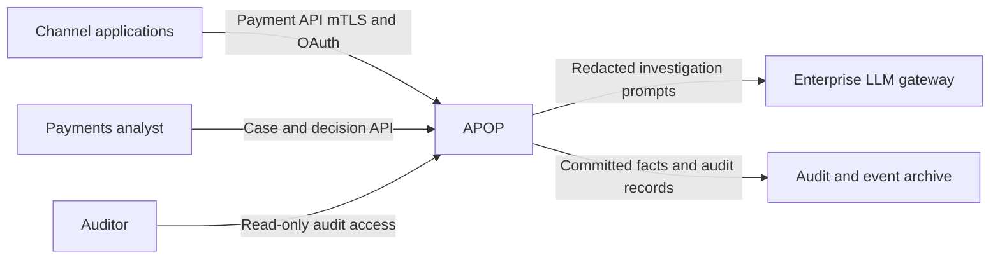
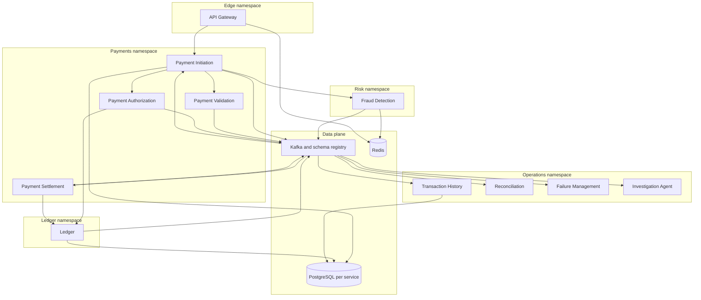
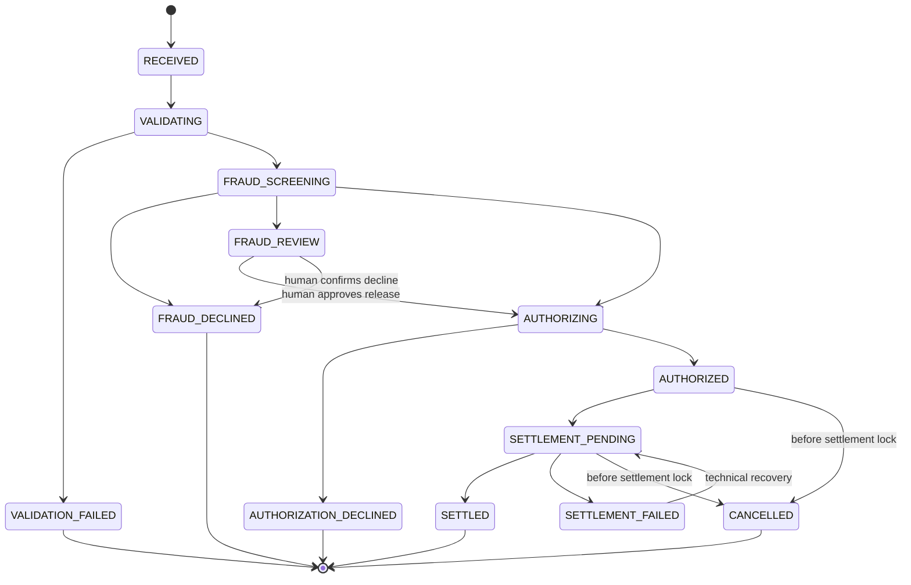
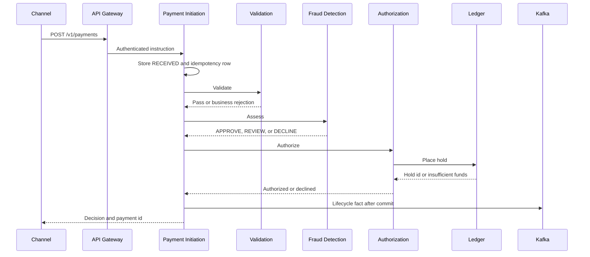

# 1. High-level architecture

| | |
| --- | --- |
| Status | Proposed |
| Audience | Architects, engineering leads, risk and operations reviewers |
| Related | [Service boundaries](02-service-boundaries.md), [Kafka](03-kafka-event-design.md), [Security](07-security-architecture.md) |

## Purpose

APOP accepts an outbound payment, decides whether it can be authorized, reserves funds, settles on a rail, and keeps an explainable history. When the straight-through path stops, failure management retries technical work and investigation agents prepare a case for a human.

The platform is built as a set of Java 21 Spring Boot services. Kafka is the integration log. PostgreSQL is the system of record for each service, and the Ledger database is the book of record for money. Redis holds short-lived counters and caches. Kubernetes runs the services. Prometheus, Grafana, and OpenTelemetry show whether the platform is meeting its service levels. Resilience4j bounds every synchronous dependency.

## System context

Channels are the only external writers of payment instructions. Analysts decide fraud reviews, reconciliation breaks, and escalated failures. The LLM gateway is a controlled dependency of the investigation path. The archive keeps events and audit records for the retention period after Kafka's hot retention expires.

Clearing houses, card networks, and core banking hosts of record sit outside this project. A rail simulator in the test and simulation namespace emits statement files so reconciliation has a counterparty. The simulator is not a system of record.

## Container view

Supporting platform components, specified in [Deployment](09-deployment-architecture.md), are the OpenTelemetry Collector, Prometheus, Grafana, the trace store, the log store, Vault, and the GitOps controller.

## Payment lifecycle

Payment Initiation owns the payment aggregate and is the single writer of its status.

`FAILED` is the technical stop from any in-progress status when no business decline was reached and recovery has not yet put the payment back on that step. Failure Management owns the retry. When the retry is accepted, Payment Initiation moves the payment back to the step that stopped. The diagram shows the business path; `FAILED` is that technical overlay, including hold expiry before settlement lock.

A settled payment stays `SETTLED`. A correction is a new linked payment with a reversing journal entry. Amounts on the original row are not edited.

### Synchronous path

The channel waits for one decision. The budget is 800 ms at p99.

Validation, fraud assessment, and authorization are internal synchronous calls protected by Resilience4j time limiters, bulkheads, and circuit breakers. Each callee commits its own decision and outbox row before returning. Initiation then commits the next payment status and its own outbox row. A crash between those commits is recovered by the idempotency key: the callee returns the original decision, and initiation advances the aggregate.

If the budget expires before a decision, the API returns `202` with status `RECEIVED` or the last committed status. The client polls `GET /v1/payments/{paymentId}`. Work already committed continues. Work not started is picked up by Failure Management from the durable step row.

### Asynchronous path

After `AUTHORIZED`, Initiation publishes a settlement command from the same database transaction that stores `SETTLEMENT_PENDING`. Settlement places the item in a window:

| Rail | Window |
| --- | --- |
| `BOOK` | Immediate. No cutoff wait. |
| `SIMULATED_WIRE` | Next same-day window. Missed cutoff rolls to the next business value date. |
| `SIMULATED_ACH` | Next business-day window. |

Settlement calls Ledger to post a balanced entry and release the hold, then publishes a settlement fact. Initiation consumes that fact and moves the payment to `SETTLED` or `SETTLEMENT_FAILED`.

Transaction History projects the lifecycle and the ledger and settlement facts into a query model. Reconciliation matches settlement items to statement lines from the rail simulator. Breaks and fraud reviews become investigation cases. Technical poison messages and dependency failures become failure cases.

## Money movement

Ledger is the only service that changes balances. Other services ask it to place a hold, release a hold, or post an entry.

| Stage | Ledger effect | Available balance | Ledger balance |
| --- | --- | --- | --- |
| Authorization | Open a hold for the debtor amount | Decreases | Unchanged |
| Settlement, book transfer | Debit debtor liability, credit creditor liability, release hold | Hold released; creditor ledger balance increases | Both customer accounts change |
| Settlement, external rail | Debit debtor liability, credit settlement clearing, release hold | Hold released | Debtor and clearing change |
| Decline or cancel before post | Release hold | Restored | Unchanged |
| Reversal after settlement | New balanced entry that undoes the original | Follows the new entry | Follows the new entry |

Customer deposit accounts are credit-normal liabilities. Internal accounts cover settlement clearing, suspense, the simulated nostro, and fee income. An authorization that would take available balance below zero is declined with `AUTH_INSUFFICIENT_FUNDS`. Overdraft is out of scope.

Holds expire. A scheduled sweep asks Ledger to release holds whose expiry has passed and whose payment is not settlement-locked. Initiation moves those payments to `FAILED` with a reason of hold expiry if settlement never started.

## Consistency model

| Concern | Consistency |
| --- | --- |
| Payment status | Strong inside Payment Initiation. Single writer. |
| Balances and postings | Strong inside one Ledger database transaction. |
| Idempotency | Strong. Unique key in PostgreSQL. Redis is a cache. |
| History, cases, and analytics | Eventual, with a consumer-lag objective of 2 seconds at p99 for the history projector. |
| Cross-service workflow | At-least-once delivery, idempotent consumers, transactional outbox. |

The outbox pattern is mandatory for every publisher. A service commits business rows and outbox rows in one local transaction. A relay publishes to Kafka and then marks the row published. Consumers store processed event ids and ignore duplicates.

Kafka transactions across the database and the broker are not required. The outbox is the source of the publish.

## Platform building blocks

| Building block | Role in the architecture |
| --- | --- |
| Java 21 and Spring Boot | Runtime for every domain service. Virtual threads for request handling. |
| Kafka | Lifecycle spine, domain facts, asynchronous commands, dead-letter queues. |
| PostgreSQL | One logical database per service. Ledger database is the book of record. |
| Redis | Gateway rate limits, fraud velocity windows, hot idempotency cache, reference-data cache. |
| Resilience4j | Time limiter, circuit breaker, bulkhead, and retry on synchronous clients. |
| OpenTelemetry | Traces, metrics, and logs correlated by `trace_id`. Context propagated on Kafka headers. |
| Prometheus and Grafana | Metrics store and operator dashboards. Alerts use SLO burn rates. |
| Docker and Kubernetes | Immutable images and the runtime topology in [Deployment](09-deployment-architecture.md). |

Retry is allowed for idempotent calls only. Ledger hold and post operations are idempotent by key, so a timed-out caller can retry safely. Resilience4j retries are short and local. Multi-minute backoff belongs to Failure Management, where the attempt is durable.

## Key decisions

| Id | Decision | Rationale |
| --- | --- | --- |
| AD-01 | Hybrid orchestration | The channel needs one authorization decision inside a latency budget. Settlement and investigation are asynchronous by nature. |
| AD-02 | Payment Initiation is the single status writer | One aggregate owner avoids two services racing to set `SETTLED` or `DECLINED`. |
| AD-03 | Database per service | Schema and retention can follow the owner. Ledger storage can be protected and scaled on its own. |
| AD-04 | Transactional outbox | A payment fact is published after the state it describes is durable. |
| AD-05 | Fail closed on risk-control outage | A payment is not authorized when fraud or sanctions screening cannot return a decision. |
| AD-06 | Agents are off the hot path | Investigation reads committed cases. It has no ledger-posting tool. |
| AD-07 | Integer minor units | Removes rounding error from balances, limits, and reconciliation. |
| AD-08 | Contract-first repository | OpenAPI, AsyncAPI, and Avro evolve under compatibility rules before service code. |
| AD-09 | Maven multi-module monorepo for the first delivery | One reviewable system while boundaries are still settling, with module fences that allow a later split. |
| AD-10 | Strimzi, CloudNativePG, and Helm plus Argo CD | The simulation is self-contained and uses the same operators a production rollout would. |

## Quality scenarios

| Id | Scenario | Architecture response |
| --- | --- | --- |
| Q1 | Duplicate `POST /v1/payments` with the same key and body during a timeout | PostgreSQL uniqueness returns the original payment. The channel receives the same body and status. |
| Q2 | Same key arrives with a different body | `409` conflict. No second payment is created. |
| Q3 | Fraud Detection is unavailable | Circuit opens. Initiation fails closed. No hold is placed. |
| Q4 | Ledger primary fails during a post | The post is atomic. On failover, the caller retries with the same ledger idempotency key and receives the committed entry or completes it once. |
| Q5 | A statement line disagrees with the internal item | Reconciliation opens a break. The agent drafts a recommendation. A human approves any adjustment. |
| Q6 | A poison lifecycle record cannot be projected | The consumer retries a bounded number of times, publishes to its dead-letter queue, and Failure Management opens a case. The partition remains available because the offset is committed only after the dead-letter write. |
| Q7 | Remittance text contains instructions aimed at the agent | Remittance is stored as data and wrapped as untrusted content. The tool gateway ignores instructions embedded in payment fields. |
| Q8 | An auditor reconstructs a settled payment six months later | Ledger rows, the initiation aggregate, the audit archive, and the event archive join on `payment_id` and `correlation_id`. |

## Capabilities to services

| Capability | Primary service |
| --- | --- |
| Payment initiation | Payment Initiation |
| Payment validation | Payment Validation |
| Fraud detection | Fraud Detection |
| Payment authorization | Payment Authorization with Ledger holds |
| Payment settlement | Payment Settlement with Ledger postings |
| Transaction history | Transaction History |
| Reconciliation | Reconciliation |
| Failure management | Failure Management |
| Event streaming | Kafka, outbox relays, and every publisher above |
| AI agent investigation | Investigation Agent |

The API gateway, rail simulator, and observability stack are platform capabilities rather than payment capabilities.

## Out of scope for version 1

Inbound payments, card acquiring and issuing, foreign-exchange conversion, interest, overdraft, fees as a billed product, multi-entity legal booking, and a customer-facing dispute portal. The data model leaves room for a reversal link and a `legal_entity_id` so those products can be added as new flows on the same ledger.

Sanctions and fraud are present as screening ports and decision services. Version 1 ships with a rules-and-velocity fraud engine and a screening adapter whose list source is a controlled reference file. Model scoring plugs in behind the fraud interface when a governed model exists.
