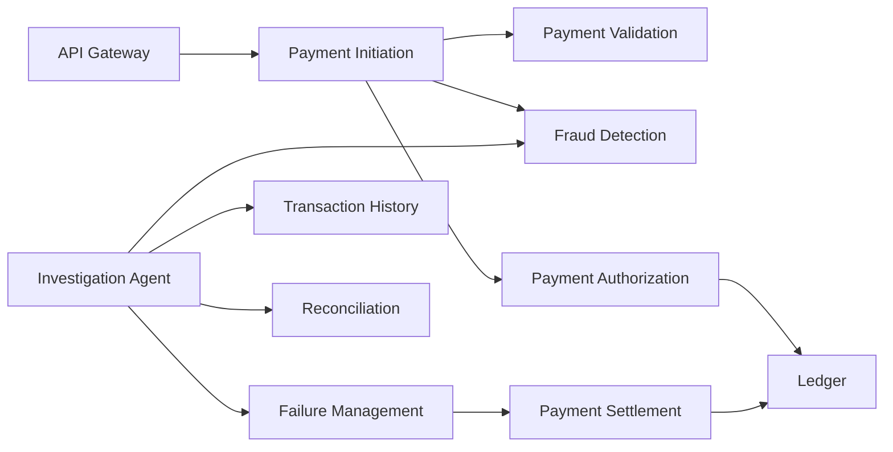

# 2. Service boundaries

| | |
| --- | --- |
| Status | Proposed |
| Audience | Service owners and API designers |
| Related | [High-level architecture](01-high-level-architecture.md), [Schema](04-postgresql-schema-design.md), [APIs](06-api-architecture.md) |

Each service has its own database, its own deployable, and a published contract. Cross-service reads go through an API or an event. Cross-service SQL is not part of the design.

## Ownership

| Capability | Accountable service | Data of record | Consulted |
| --- | --- | --- | --- |
| Channel authentication and rate limit | API Gateway | Redis counters | Identity provider |
| Payment aggregate and status | Payment Initiation | `payment` | Validation, Fraud, Authorization, Settlement |
| Structural and policy validation | Payment Validation | `validation_result` | Reference calendar and limits |
| Fraud decision | Fraud Detection | `fraud_assessment` | Initiation |
| Authorization decision | Payment Authorization | `authorization_decision` | Ledger |
| Balances, holds, journal | Ledger | `journal_entry`, `account` | Authorization, Settlement, Failure Management |
| Rail windows and settlement items | Payment Settlement | `settlement_item` | Ledger, Initiation |
| Customer and operator history | Transaction History | `payment_history` | Channels, agents |
| Statement match and breaks | Reconciliation | `recon_break` | Investigation Agent |
| Technical retry and compensation requests | Failure Management | `failure_case` | Owning service |
| Investigation narrative and recommendations | Investigation Agent | `investigation_case` | Analyst |

## API Gateway

**Mission.** Admit external traffic, verify identity, enforce rate limits, and route to Payment Initiation or to read APIs.

**Owns.** Route configuration, request size limits, and Redis rate-limit counters.

**Owned elsewhere.** Business rules, payment state, and token issuance. The identity provider issues tokens. Initiation interprets the payment.

**Scaling.** Stateless. Horizontal pod autoscaling on CPU and concurrent requests.

**Failure behavior.** If Redis is unavailable, the gateway fails closed on the write API and continues read traffic with a conservative local limit. This favors protecting the ledger over accepting an unbounded burst.

## Payment Initiation

**Mission.** Accept the instruction, own the status machine, call the synchronous decision services, and emit the lifecycle spine.

**Owns.** `payment`, parties, idempotency records, orchestration steps, payment links for reversals, and the initiation outbox.

**Owned elsewhere.** Whether the instruction is valid (Validation), the fraud decision (Fraud Detection), the hold (Ledger via Authorization), the journal (Ledger), and the batch (Settlement).

**External API.** `POST /v1/payments`, `GET /v1/payments/{paymentId}`, `POST /v1/payments/{paymentId}/cancellations`.

**Calls.** Validation, Fraud Detection, and Authorization over internal HTTP. Settlement through `payments.command.settlement.v1`.

**Consumes.** Settlement results and compensation outcomes, and applies them to the aggregate.

**Resilience4j.** A separate bulkhead and time limiter for validation, fraud, and authorization. Circuit breaker per client. Retry once only when the error is a definite transport failure and the downstream operation is idempotent. The end-to-end time limiter is 800 ms for the caller-visible attempt.

**Failure behavior.** Unknown downstream results are recorded on `orchestrator_step` as `UNCERTAIN`. The service does not invent a decline. Recovery re-calls with the same idempotency key.

**Scaling.** Stateless compute, stateful PostgreSQL. Partition work by payment id. Peak design point is 200 initiations per second.

## Payment Validation

**Mission.** Decide whether the instruction is structurally and commercially acceptable before any hold.

**Owns.** Validation results, limit policies, the business calendar, and currency reference data.

**Checks, in order.**

1. Required fields, currency exponent, and rail-specific creditor shape.
2. Debtor account is known to Ledger through a read API, is open, and is denominated in the payment currency.
3. Book payments credit an internal account. External rails carry an external creditor and a routing number.
4. Amount is within the product limit for that rail and account.
5. Requested value date is a business day and the cutoff for that rail is still open, or the value date is rolled forward and the rolled date is returned.
6. The screening port returns a clear result for debtor and creditor identities.

**Owned elsewhere.** Fraud behavior scoring, funds availability, and payment status. Validation returns a result. Initiation records the status transition.

**Failure behavior.** A screening-port outage fails the validation call with a technical error. Initiation fails closed and does not place a hold. A business rejection is terminal and is not retried.

**Scaling.** Read-heavy reference data cached in Redis with a short TTL. Limit checks remain authoritative in PostgreSQL.

## Fraud Detection

**Mission.** Score the payment and return `APPROVE`, `REVIEW`, or `DECLINE`.

**Owns.** Assessments, rule hits, list entries, and the feature snapshot used for the decision.

**Decision inputs.** Amount and rail, whether the creditor is new for this debtor, velocity of count and amount from Redis windows, and restricted list hits. A pluggable scorer interface allows a governed model to contribute a score later. Version 1 decides from rules and velocity.

**Policy.** Thresholds are configuration, owned by risk, deployed as versioned policy rows. The default posture is fail closed: if the assessment cannot be computed, the call errors and Initiation does not authorize.

`REVIEW` does not place a hold until an analyst releases the case. The agent may summarize the case. The agent cannot release it.

**Owned elsewhere.** Payment status, holds, and customer notification.

**Data minimization.** The assessment event published to Kafka contains the decision, the policy version, and rule identifiers. The feature snapshot stays in the fraud database under a restricted role.

**Scaling.** Stateless scoring with Redis for windows. Horizontal scale. A bulkhead isolates scoring from list administration.

## Payment Authorization

**Mission.** Turn an approved payment into a funds reservation, or decline it for insufficient funds.

**Owns.** The authorization decision row and the link to the ledger hold id.

**Calls.** Ledger `POST /internal/v1/holds` with the payment id and an idempotency key derived from the payment id.

**Owned elsewhere.** Balance math, account status, and the journal. Authorization does not compute available balance itself.

**Failure behavior.** Ledger technical failure is returned as uncertain. Authorization does not emit a local approval without a hold id. A business decline (`AUTH_INSUFFICIENT_FUNDS`, closed account) is terminal.

## Ledger

**Mission.** Keep accounts, available balance, holds, and the immutable journal.

**Owns.** The chart of accounts, customer and internal accounts, holds, journal entries, and journal lines. This database is the book of record.

**Operations.**

| Operation | Effect |
| --- | --- |
| Place hold | Insert hold, increase `held_minor`, leave `ledger_balance_minor` unchanged |
| Release hold | Mark hold released, decrease `held_minor` |
| Post | Insert a balanced entry, update ledger balances, release the related hold when the posting says so |
| Reverse | Post a new entry that swaps directions and links to the original entry |

Every operation takes an idempotency key. A replay returns the original hold or entry.

Concurrency uses a version column on the account row, updated in the same transaction as the hold or posting. Callers present the key, not a client-side balance.

**Invariants, enforced in the transaction.**

- Journal lines in one entry share one currency and their debit minor units equal their credit minor units.
- `held_minor` is never negative.
- A customer account's available balance is never negative.
- Posted lines are never updated or deleted.

**Owned elsewhere.** Whether a payment should exist, fraud policy, and settlement windows. Ledger will refuse a post that references an unknown hold or an expired hold.

**Scaling.** Writes are serialized per account, not globally. Read replicas serve history rebuilds and audit extracts. They do not serve the authorization balance check. The authorization check uses the primary.

## Payment Settlement

**Mission.** Group authorized payments into rail windows and post them.

**Owns.** Windows, batches, and settlement items.

**Consumes.** `payments.command.settlement.v1`.

**Calls.** Ledger postings. For `BOOK`, debtor liability to creditor liability. For external rails, debtor liability to settlement clearing. The posting and the hold release commit in one ledger transaction.

**Publishes.** Settlement item facts. Initiation is the service that turns those facts into `SETTLED`.

**Owned elsewhere.** Payment status, statement matching, and nostro real-world connectivity. The rail simulator consumes batch facts in non-production environments and writes statement files for Reconciliation.

**Failure behavior.** A ledger technical error leaves the item `POST_UNCERTAIN`. Failure Management asks Settlement to retry. Settlement calls the Ledger posting API with the same idempotency key. A locked batch is not rebuilt with different membership.

## Transaction History

**Mission.** Serve timeline and account-activity queries from a rebuildable projection.

**Owns.** `payment_history`, timeline rows, and account activity rows.

**Consumes.** Lifecycle, fraud summary, ledger movement, and settlement facts.

**Owned elsewhere.** Operational status used by the channel to learn the decision. `GET /v1/payments/{paymentId}` reads Payment Initiation. History serves search, timelines, and account activity, and it is what analysts and agents use for narrative context.

**Failure behavior.** The projector is idempotent. A destroyed history database is rebuilt from the event archive. It is not backed up as a financial record.

**Scaling.** Read replicas and monthly partitions. Consumer lag is an SLO.

## Reconciliation

**Mission.** Match each external settlement item to a statement line and open a break when the match fails.

**Owns.** Imported statement files, statement lines, match runs, and breaks.

**Match key.** End-to-end id, amount minor units, currency, value date, and debtor and creditor account fingerprints.

**Break classes.** Missing internal item, missing statement line, amount mismatch, value-date mismatch, duplicate statement line.

**Owned elsewhere.** Posting an adjustment. Reconciliation publishes a break. A human accepts a disposition. Failure Management or Settlement then sends a ledger command if the disposition requires one.

**Failure behavior.** An unreadable statement file becomes a failed run and a failure case. Previously matched items stay matched.

## Failure Management

**Mission.** Make technical failure durable, retry it with backoff, and request compensation when the business timer expires.

**Owns.** Failure cases, attempts, and compensation requests.

**Opens a case when.** A consumer dead-letters a record, an orchestrator step stays `UNCERTAIN` past its grace period, a settlement item remains `POST_UNCERTAIN`, or a hold is close to expiry with settlement not locked.

**Asks other services to act.** Settlement retries an uncertain post. A `RELEASE_HOLD` or `POST_REVERSAL` command is published for Ledger's in-process compensation consumer. Payment Initiation observes the resulting ledger movement and is the service that changes payment status.

**Compensation catalog.**

| Situation | Request |
| --- | --- |
| Decline or cancel after a hold and before a post | `RELEASE_HOLD` |
| Hold expired before settlement lock | `RELEASE_HOLD` and status `FAILED` |
| Settled payment approved for reversal | New reversal payment, then a reversing post |
| Duplicate projection or replay | No ledger action. Mark the case duplicate. |

**Owned elsewhere.** Business declines. Validation and fraud rejections are not retried here. Policy for whether a fraud review may proceed lives with the analyst decision, not with the retry engine.

**Retry policy.** Exponential backoff with jitter, capped attempts, and a recorded attempt row. The retried call always carries the original idempotency key.

## Investigation Agent

**Mission.** Prepare an evidence-backed recommendation for a human.

**Owns.** Investigation cases, agent sessions, tool-call audit, recommendations, and human decisions.

**Intake.** Fraud reviews, reconciliation breaks, and failure cases that an operator escalates.

**Owned elsewhere.** Every tool it calls. The agent service has no private copy of the ledger that it can edit. Tool behavior and prohibitions are specified in [Agentic AI architecture](05-agentic-ai-architecture.md).

**Failure behavior.** If the LLM gateway is unavailable, the case remains queued for the analyst with the evidence already attached by deterministic intake. Payments do not wait on the agent.

## Rail simulator

**Mission.** Give Reconciliation a counterparty in development, test, and simulation environments.

**Owns.** Generated statement files and an intentional mismatch rate that tests break handling.

**Owned elsewhere.** Production settlement. Production statement ingestion uses the same file contract against a bank-operated drop, which this project does not connect to.

The simulator runs in the `simulation` namespace and is not deployed to production.

## Redis keyspace

Redis is recoverable cache and counters. Losing it slows the platform and can fail-close the gateway write path. It does not lose money or payment state.

| Key pattern | Owner | TTL | Purpose |
| --- | --- | --- | --- |
| `idempo:{legalEntity}:{key}` | Payment Initiation | 24 hours | Hot copy of the idempotency pointer. PostgreSQL is authoritative. |
| `rl:{clientId}:{minute}` | API Gateway | 2 minutes | Write and read rate limits. |
| `vel:{debtorAccountId}:{window}` | Fraud Detection | Window length plus one hour | Count and amount velocity. |
| `ben:{debtorAccountId}:{creditorHash}` | Fraud Detection | 180 days | Creditor-seen marker for the new-beneficiary rule. |
| `ref:calendar:{date}` | Payment Validation | 1 hour | Business-day cache. |
| `acct-status:{accountId}` | Payment Validation | 30 seconds | Cached open/closed flag. Ledger remains authoritative on authorize. |

Velocity windows are rebuilt from recent fraud assessments if Redis is flushed. A flush fails closed until the warmup flag for that account is set, so a cold cache is not treated as zero velocity for an authorize decision.

## Synchronous dependency map

Failure Management does not call Ledger. It asks Settlement to retry a post, and it publishes compensation commands that Ledger applies. The agent calls read APIs only. On cancel, before a batch is locked, Payment Initiation calls Authorization, and Authorization calls Ledger to release the hold.

## What a service must not do

| Rule | Why it is a boundary |
| --- | --- |
| No shared tables | Ownership and retention stay enforceable. |
| No balance math outside Ledger | Available funds has one definition. |
| No second writer of payment status | The state machine stays explainable. |
| No agent call from the synchronous path | Authorization latency and risk controls stay deterministic. |
| No business retry inside a request thread | Long retries belong in Failure Management, where they are visible. |
