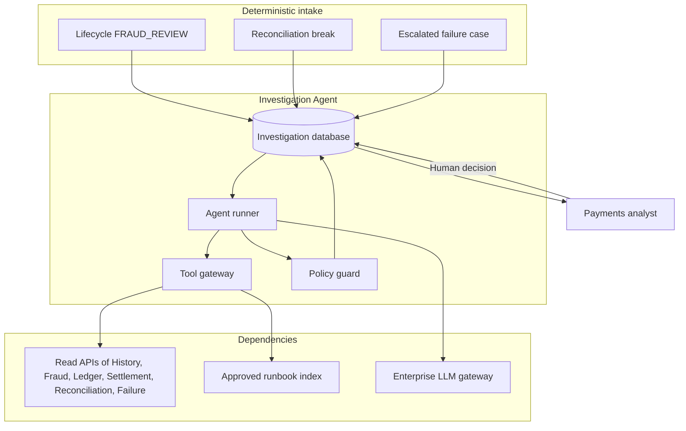

# 5. Agentic AI architecture

| | |
| --- | --- |
| Status | Proposed |
| Audience | Risk, operations, and the investigation service owner |
| Related | [Service boundaries](02-service-boundaries.md), [Security](07-security-architecture.md), [APIs](06-api-architecture.md) |

The agent layer investigates payments that have already stopped. It explains evidence and recommends a disposition. It sits off the synchronous authorization path. A human decision is required before a review is released, a reversal is posted, or a reconciliation break is adjusted.

If the agent or the LLM gateway is down, cases remain in the analyst queue. Payments that fraud has already approved continue to authorize. Payments in `FRAUD_REVIEW` wait for a human.

## Operating model

Intake is ordinary Kafka consumption. It creates an `investigation_case` and attaches source identifiers. It does not call a model. The runner starts when intake opens a case of severity that policy marks for assistance, or when an analyst requests assistance. High-severity breaks and fraud reviews qualify. Low-severity breaks wait for an analyst request so model usage stays intentional.

## Agents

One deployable, three roles inside the runner. A role is a system prompt, a tool subset, and an output schema. It is not a separate authority.

| Role | Used when | Tools | Output |
| --- | --- | --- | --- |
| Triage supervisor | Every assisted run | Case metadata only | Which specialist to run, or `ESCALATE` with no specialist |
| Fraud investigator | Source is `FRAUD_REVIEW` | Payment, timeline, fraud assessment, similar-payment summary | `CONFIRM_DECLINE`, `RELEASE_TO_AUTHORIZE`, or `ESCALATE` |
| Recon investigator | Source is `RECON_BREAK` | Settlement item, statement line, ledger movements, runbook | `RETRY_TECHNICAL`, `PROPOSE_REVERSAL`, `NO_ACTION`, or `ESCALATE` |
| Failure investigator | Source is `ESCALATED_FAILURE` | Failure attempts, payment timeline, runbook | `RETRY_TECHNICAL`, `NO_ACTION`, or `ESCALATE` |

The supervisor cannot call specialist tools and cannot write a money-movement disposition. Specialists cannot call each other. The runner executes one specialist per session. A second opinion is a new session requested by an analyst.

## Tool gateway

Tools are Spring-managed ports inside the investigation service. They call internal read APIs with the investigation service identity. The model never receives a network credential, a connection string, or a raw HTTP client.

| Tool | Effect | Bound |
| --- | --- | --- |
| `get_payment` | Read one payment and its parties, with account numbers masked to last four | Single `payment_id` on the case |
| `get_timeline` | Read history timeline | That payment only |
| `get_fraud_assessment` | Read decision, score, policy version, rule ids, and feature snapshot | That payment only, fraud-investigator role |
| `get_ledger_movements` | Read holds and postings for the payment | That payment only |
| `get_settlement_item` | Read the settlement item and batch status | That payment only |
| `get_break` | Read the break and the matched line identifiers | The case's break only |
| `get_failure_case` | Read attempts and last error code | The linked failure case |
| `summarize_similar` | Return counts of recent payments for the same debtor and creditor fingerprint, grouped by status | Maximum 30-day window, counts only, no other customers' remittance or names |
| `get_runbook` | Retrieve an approved procedure passage by id | The runbook index only |

Write tools available to the runner after the policy guard accepts the model output:

| Tool | Effect |
| --- | --- |
| `record_recommendation` | Insert `agent_recommendation` and move the case to `AWAITING_HUMAN` |
| `add_case_note` | Append an analyst-visible note on the session |

The gateway refuses any tool name outside this list. There is no SQL tool, no shell tool, no general HTTP tool, and no tool that places a hold, posts a journal, releases a hold, changes a limit, changes a fraud policy, or exports a customer population.

`get_payment` for a payment id other than the case's payment id returns a refusal. The refusal is a tool result the model can see, and an audit row.

## Control loop

A session has a hard budget: 8 model turns, 60 seconds, and a token ceiling configured per role. The runner stops on budget, on a schema-valid recommendation, or on a gateway refusal that repeats. The session status becomes `STOPPED` or `COMPLETED`. The case returns to `AWAITING_HUMAN` with whatever evidence was gathered. A stopped session is still useful to the analyst because tool calls are recorded.

Each turn:

1. The runner sends the system prompt, the case identifiers, and tool results so far to the LLM gateway.
2. The gateway returns a tool call or a final recommendation object.
3. Tool calls execute only through the gateway.
4. The final object is checked by the policy guard before it is stored.

The system prompt is configuration shipped with the service. Case data, remittance, and tool results are placed in a user-content channel labeled untrusted. Instructions that appear inside remittance or inside a counterparty name do not change the tool list, the system prompt, or the output schema.

## Policy guard

The guard is deterministic code. It runs after the model and before `record_recommendation`.

| Check | Refusal result |
| --- | --- |
| Output matches the role's JSON schema | Session `FAILED`, no recommendation |
| Disposition is one the role is allowed to emit | Session `FAILED` |
| Every id in `evidence_ids` was returned by a tool in this session | Session `FAILED` |
| `RELEASE_TO_AUTHORIZE` cites the fraud assessment id and the payment id | Session `FAILED` |
| `PROPOSE_REVERSAL` cites the journal entry id | Session `FAILED` |
| Narrative length is within 4,000 characters and contains no full account number pattern | Session `FAILED` |
| Confidence is between 0 and 1 | Session `FAILED` |

A refused recommendation is not shown as advice. The analyst sees that the session failed validation.

## Human decision

`POST /v1/cases/{caseId}/decisions` records `human_decision`. The subject must have the `payments.case.decide` role. The analyst may accept the recommendation or choose another disposition in the same catalog.

| Accepted disposition | Downstream effect |
| --- | --- |
| `CONFIRM_DECLINE` | Initiation moves `FRAUD_REVIEW` to `FRAUD_DECLINED`. No hold was placed. |
| `RELEASE_TO_AUTHORIZE` | Initiation resumes the saga at `AUTHORIZING`. |
| `RETRY_TECHNICAL` | Failure Management retries with the original idempotency key. |
| `PROPOSE_REVERSAL` | Failure Management opens a compensation that posts a reversal. The action still carries the human subject. |
| `NO_ACTION` | Case closes. Payment state unchanged. |
| `ESCALATE` | Case stays open and is assigned to a senior investigator queue. |

Two people are required for `PROPOSE_REVERSAL` when the amount is above the configured four-eyes threshold. The second approval is a second `human_decision` record on the same case, from a different subject. Below the threshold, one investigator with the reversal role is enough. The agent is never a second approver.

The investigation service does not call Ledger. It calls Payment Initiation or Failure Management with the human decision. Those services perform the status change or the compensation they already own.

## LLM gateway

The investigation service calls one internal endpoint. The gateway selects the deployed model route, applies organization retention rules, and redacts known secret patterns before the provider sees the prompt. Prompts and completions are retained for 30 days for incident review under the audit role, then deleted. They are not used to train a model.

Resilience4j on this client: a time limiter inside the session budget, a circuit breaker, and a bulkhead so investigation load cannot grow without bound. There is no automatic retry of a partially completed session. A new session is an explicit analyst action or a fresh intake policy decision.

Service configuration names the model route, for example `investigation-default`. The architecture does not bind the platform to a specific vendor model. Swapping the route is a configuration change reviewed like any other risk-control change.

## Data the model may see

| Data | Treatment |
| --- | --- |
| Payment status, rail, amount, currency, value date, reason code | Included |
| Account numbers | Last four only |
| Party name | Included for the case's own parties, marked untrusted |
| Remittance | Included, marked untrusted, length-capped |
| Feature snapshot | Fraud investigator role only |
| Similar activity | Aggregates only |
| Runbooks | Approved corpus only |

The model does not receive JWTs, database rows from other customers, Kafka offsets, or credentials.

## Runbook index

The index contains versioned operating procedures and product rules written by payments operations and approved by risk. It is rebuilt when a procedure is approved. Customer data never enters the index. Retrieval returns a passage id, and the recommendation's evidence list can cite that id. The analyst can open the same passage in the case UI.

## Evaluation

Before an agent-role prompt, tool, or policy-guard change is promoted, an offline evaluation runs against a golden set of cases. Each golden case has the permitted disposition family, the evidence ids that must be cited, and dispositions that are forbidden for that fixture. The set is stored as fixtures with synthetic parties.

The promotion gate is an agreement threshold on the golden set, zero policy-guard bypasses, and zero calls to a tool outside the case boundary. Evaluation uses the same tool gateway against stubs. It does not write to production databases and it does not call the production LLM route with production cases.

Production recommendations are sampled. Investigators' accept and override rates are metrics in [Monitoring](08-monitoring-architecture.md). A sharp drop in agreement opens an operations review. It does not automatically change payment policy.

## Observability

Every session is a trace. Child spans cover each model call and each tool call, using OpenTelemetry generative-AI semantic conventions where they apply: model route, token counts, and finish reason. Prompt and completion bodies are not span attributes. They stay in the restricted 30-day prompt store.

Metrics: sessions by status and role, tool refusal count, policy-guard failure count, recommendation disposition, human agreement, and latency. These are specified with the other platform metrics in the monitoring document.

## Kill switch

A configuration flag `investigation.agent.enabled` stops the runner from starting sessions. Intake still opens cases for analysts. In-flight sessions are cancelled at the next turn. The flag is a platform change with an audit event. Authorization, settlement, and ledger posting do not read this flag.

## Why this shape

The payment decision stays in deterministic services with versioned rules, unique keys, and a ledger transaction. The agent adds language and evidence assembly where those services have already produced a case. That split keeps the hot path testable without a model and keeps every money movement attributable to a service and, where the path is an exception, to a named human.
