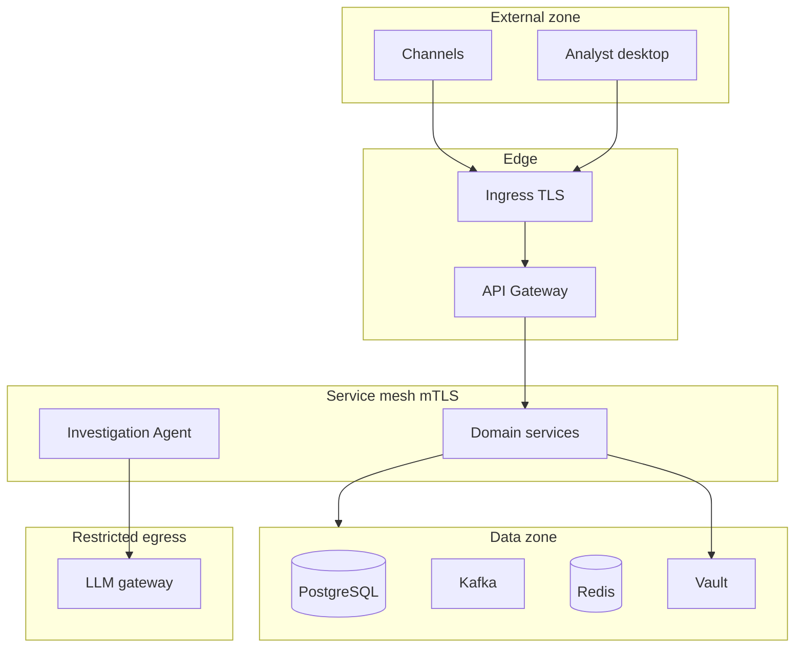

# 7. Security architecture

| | |
| --- | --- |
| Status | Proposed |
| Audience | Security architects, risk, and engineering leads |
| Related | [APIs](06-api-architecture.md), [Agentic AI](05-agentic-ai-architecture.md), [Deployment](09-deployment-architecture.md) |

APOP handles payment instructions, account identifiers, balances, and investigation narratives. The design reduces where confidential data lives, authenticates every caller, and leaves an audit trail that can reconstruct who changed a payment.

This is a simulated platform. The controls are the ones a production deployment of this design would require. Version 1 does not take card PANs and does not connect to real clearing.

## Trust boundaries

Egress from the mesh is denied by default. The investigation service may call the LLM gateway. Domain services may call Vault, PostgreSQL, Kafka, Redis, and each other as allowed by network policy. They may not call arbitrary internet endpoints.

## Data classification

| Class | Examples | Handling |
| --- | --- | --- |
| Restricted secrets | Tokens, database passwords, encryption keys, registry credentials | Vault only. Absent from Git, images, logs, traces, and Kafka. |
| Confidential | Account numbers, party names, remittance, feature snapshots, agent narratives, balances | Encrypted volumes. Field encryption where noted. Access by role. Masked in logs. |
| Internal | Payment status, reason codes, amounts on the event spine, operational metrics | Service credentials and mesh policy. |
| Public | This architecture pack and synthetic fixtures | May live in the repository. |

Account numbers and party names are confidential even though this build uses synthetic data, so the handling does not depend on a later data swap.

## Identity and authentication

| Caller | Mechanism |
| --- | --- |
| Channel application | OAuth 2.0 client credentials, private key JWT or mTLS-bound tokens, plus TLS at ingress |
| Analyst and auditor | OIDC authorization code with MFA at the identity provider. Access token lifetime 15 minutes. Refresh stays at the identity provider. |
| Service | Mesh mTLS certificate with the service name as the SPIFFE-style identity, and a short-lived service JWT for audience-specific calls |
| Agent runner | The investigation service identity. The model has no identity of its own. |
| Operator | Break-glass group, hardware-backed MFA, time-bounded, fully audited |

The identity provider is external to the domain services. Local environments run a development identity provider with the same claims. Production claims include `sub`, `legal_entity_id`, `roles`, and `account_scope`.

Token audiences are specific: `apop-external` at the gateway and `apop-internal` for service calls. A channel token presented directly to a pod is rejected because the internal listeners require the mesh identity plus an internal audience.

## Authorization

Role-based access is the baseline. Account scope is an additional check on payment and activity reads.

| Role | Can |
| --- | --- |
| `payments.write` | Create and cancel payments for accounts in scope |
| `payments.read` | Read payments, timelines, and activity for accounts in scope |
| `payments.recon.read` | Read breaks |
| `payments.case.read` | Read cases and request assistance |
| `payments.case.decide` | Record a human disposition except reversal above the four-eyes threshold |
| `payments.case.approve-reversal` | Provide the second approval on a large reversal |
| `payments.ops.read` | Read failure cases |
| `payments.audit.read` | Read the audit index and archived events |
| `payments.policy.admin` | Change limit, cutoff, and fraud policy through a reviewed deployment, not through a runtime write API in version 1 |
| `platform.admin` | Operate the cluster. No standing access to payment rows. |

Segregation of duties:

| Duty | Constraint |
| --- | --- |
| Create a payment and approve one's own fraud review | The decide role is separate from the channel write role. A subject with both still cannot decide a case on a payment they initiated. |
| Recommend and approve | The agent has no decide role. |
| First and second reversal approval | Two distinct user subjects. |
| Policy change and payment initiation | Policy changes ship as reviewed configuration. They are not an API the channel can call. |

The enforcement point for external roles is the API gateway plus a repeated check in the owning service. The gateway check is for early rejection. The service check is authoritative.

## Service-to-service policy

| Caller | Allowed callees |
| --- | --- |
| Gateway | Payment Initiation, Transaction History, Reconciliation, Investigation, Failure Management, audit query |
| Payment Initiation | Validation, Fraud, Authorization |
| Payment Authorization | Ledger holds and hold releases |
| Payment Settlement | Ledger postings |
| Failure Management | Settlement retry API. Compensation travels on `payments.command.compensation.v1`, which only Ledger consumes. |
| Investigation | Read APIs listed in the tool catalog, Initiation review-results, Failure Management retries |
| Ledger | PostgreSQL primary, Kafka, Vault |

Any other path is denied by network policy and by the callee's allow-list of caller identities.

## Data protection

| Layer | Control |
| --- | --- |
| In transit | TLS 1.2 or newer at ingress. mTLS inside the mesh. TLS to PostgreSQL, Kafka, and Redis. |
| At rest | Encrypted disks for PostgreSQL, Kafka, Redis persistence, and the archive. |
| Field encryption | External account numbers, routing numbers, party names, and remittance. Envelope encryption, key version on the row, keys in Vault, rotation by writing new versions and re-encrypting on a scheduled job. |
| Hashing | SHA-256 fingerprints for equality and reconciliation. The hash input includes a pepper from Vault. |
| Logs and traces | Structured logs. Account numbers masked to last four before the log call. Remittance excluded. Authorization headers excluded. Span attributes carry ids and status codes, not payloads. |
| Events | Spine and domain topics exclude remittance, names, and raw account numbers, as specified in the event design. |
| Backups | Ledger backups encrypted and access-controlled. Restore is an audited operator action. |
| Redis | AUTH and TLS. No confidential payloads in velocity keys. Values are counts, amounts, and ids. |

Key rotation does not rewrite history in place beyond the re-encryption job. Journal lines do not contain the encrypted party fields, so ledger retention and key rotation are independent.

## Payment-specific controls

| Control | Behavior |
| --- | --- |
| Idempotency | Stops duplicate financial effects from retries. |
| Fail closed | Fraud or screening outage prevents authorization. |
| Hold before external promise | A payment is not `AUTHORIZED` without a hold id. |
| Immutable journal | Corrections are reversals with a human on the reversal path. |
| Four-eyes | Large reversals need a second person. |
| List and policy changes | Versioned rows, not an unlogged edit. |
| Simulator isolation | The rail simulator cannot be scheduled in the production namespace. |

Sanctions screening is a port on Validation. A hit is a business decline. The list content is restricted data and is not copied into the payment row, the event, or the agent prompt. The agent sees the reason code, not the list entry.

## Audit

Every service writes an audit row in its own database and an `platform.audit.recorded.v1` event in the same transaction as the action.

| Audited action | Actor recorded |
| --- | --- |
| Payment created, cancelled, status changed | Channel subject and initiation service |
| Validation, fraud, and authorization decisions | Service identity and policy version |
| Hold, post, release, reverse | Service identity and, for reversal, the human approver |
| Case recommendation | Agent session id and model route |
| Human decision | User subject |
| Break opened and resolved | Reconciliation service and, when resolved by a person, the user |
| Policy activation | Deploy identity |
| Break-glass use | Operator subject |

Audit rows are insert-only. The archive sink keeps the event form for 7 years. Investigators query by `payment_id` through the audit read API. They do not receive database superuser access.

Clock source is the cluster NTP-synchronized time. Audit `occurred_at` is the database commit time.

## Agent and model security

| Threat | Control |
| --- | --- |
| Instructions hidden in remittance or a party name | Untrusted content channel. Tool list and system prompt are not taken from case data. |
| Model asks for another customer's payment | Tool gateway binds every read to the case's payment id. |
| Model attempts a ledger post | That tool does not exist. Egress and network policy block direct ledger access from anywhere except the allowed services. |
| Prompt or completion leaks into logs | Prompts stay in the restricted 30-day store. Traces carry token counts and route names. |
| Compromised model route | Kill switch stops new sessions. Hot path does not depend on the route. |
| Excessive tool use | Turn budget, time budget, and per-tool rate inside the session. |

Recommendation text is scanned for full account-number patterns before storage. A match fails the session.

## Application delivery controls

| Stage | Control |
| --- | --- |
| Source | Protected branches. Review required. Architecture and contract changes reviewed with the service change. |
| Build | Reproducible container build, non-root user, read-only root filesystem, dependency lockfile. |
| Scan | Image vulnerability scan and dependency policy gate before promotion. |
| Secrets | External secrets operator materializes Vault paths into Kubernetes secrets. Pods receive them as files. |
| Runtime | Restricted pod security, dropped capabilities, no privileged containers, resource limits. |
| Change of fraud or limit policy | Separate review label, recorded as an audit event at activation. |

## STRIDE summary

| Category | Primary exposure | Mitigation in this design |
| --- | --- | --- |
| Spoofing | Forged channel or service | mTLS, OAuth audience, caller allow-lists |
| Tampering | Altered payment or journal | Single writer, immutable journal, outbox in the same transaction, TLS |
| Repudiation | Denied approval or reversal | Audit actor, human decision row, archive retention |
| Information disclosure | Account numbers in logs or events | Field encryption, log masking, minimized event payloads, role grants |
| Denial of service | Traffic flood or slow consumers | Gateway rate limits, bulkheads, Kafka quotas, pod disruption budgets |
| Elevation | Agent or channel reaches the ledger | Tool allow-list, network policy, separate reversal role, four-eyes |

## Recovery of trust

A suspected credential leak rotates the Vault path and the mesh certificate, revokes tokens at the identity provider, and forces a new deploy so pods pick up new secrets. Ledger data is not wiped as part of credential rotation. An incident review uses the audit archive and traces, correlated by `correlation_id`.
