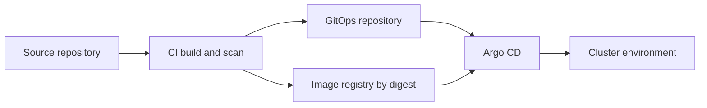

# 9. Deployment architecture

| | |
| --- | --- |
| Status | Proposed |
| Audience | Platform engineering and service owners |
| Related | [Monitoring](08-monitoring-architecture.md), [Security](07-security-architecture.md), [Repository structure](10-repository-structure.md) |

APOP runs on Kubernetes. Images are immutable. Configuration that changes behavior is versioned. The production-shaped topology fits a single cluster for this project, with node pools and namespaces separating edge, domain, data, and observability. A later split into multiple clusters can follow the same namespace and data-ownership lines.

## Environments

| Environment | Purpose | Data | Rail simulator |
| --- | --- | --- | --- |
| `dev` | Individual integration | Synthetic, disposable | Yes |
| `test` | Automated acceptance | Synthetic fixtures | Yes |
| `uat` | Operational rehearsal, including restore and failover | Synthetic, production-like volumes | Yes |
| `prod` | The controlled simulation treated as production for this project | Synthetic data under production controls | No |

Promotion is dev to test to uat to prod through the GitOps repository. Images are promoted by digest. Prod does not build.

## Namespaces

| Namespace | Contents |
| --- | --- |
| `edge` | Ingress gateway, API gateway |
| `payments` | Initiation, validation, authorization, settlement |
| `risk` | Fraud detection |
| `ledger` | Ledger service and its database primary |
| `operations` | History, reconciliation, failure management, investigation, audit query |
| `simulation` | Rail simulator. Absent in prod. |
| `data` | Kafka, schema registry, Redis, non-ledger PostgreSQL |
| `observability` | Collector, Prometheus, Grafana, Tempo, Loki |
| `security` | External secrets, policy bundles |

Network policy default is deny. Allowed paths are the ones in the [security architecture](07-security-architecture.md). The `simulation` namespace may subscribe to settlement batch facts. It may not call Ledger or Payment Initiation.

## Compute

| Pool | Workload | Starting size |
| --- | --- | --- |
| `general` | Domain services and gateway | 3 nodes, autoscaled |
| `data` | Kafka brokers and PostgreSQL | 3 nodes, dedicated |
| `observe` | Prometheus, Grafana, Tempo, Loki | 2 nodes |

Domain pods request CPU and memory and set limits. Java heaps are set below the memory limit so the node, not the JVM, is the last line of pressure. Services run as non-root with a read-only root filesystem, a writable empty dir for temp, and no privilege escalation.

Pod disruption budgets keep at least two gateway replicas and at least two replicas of Initiation, Authorization, and Ledger available during voluntary disruption. Kafka and PostgreSQL follow their operator disruption rules.

Horizontal pod autoscaling uses CPU for the gateway and consumer lag for projectors and settlement. The ledger service scales its read-only query replicas on CPU. The posting path stays on the primary, and primary write capacity is scaled vertically first.

## Images and runtime

| Choice | Value |
| --- | --- |
| Language runtime | Java 21 |
| Framework | Spring Boot 3.x on the current 3 release line when implementation starts |
| Base image | Eclipse Temurin 21 JRE, distroless or an equivalent minimal image |
| User | Numeric non-root uid |
| Probes | `/live` and `/ready` as specified in monitoring |
| Grace | `terminationGracePeriodSeconds` 45, longer than the lock timeout, with a preStop delay so endpoints drain first |
| Threads | Virtual threads for HTTP handlers. Consumer threads bounded by partition count. |

Resilience4j configuration ships in the service config map for timeouts and thresholds that operations may tune, within ranges validated at startup. Policy documents for fraud and limits ship as versioned data loaded into PostgreSQL by a migration, not as an unreviewed config edit.

## Data plane

### Kafka

Strimzi operates the cluster. Three brokers, replication factor 3, minimum in-sync replicas 2, TLS listeners, and SCRAM or mTLS client authentication. Topics and quotas are Kubernetes resources reviewed with the contract change. The schema registry runs beside the cluster with its own small database.

Client quotas cap produce and fetch rates per service account so a runaway projector cannot starve the lifecycle producers.

### PostgreSQL

CloudNativePG operates the clusters.

| Cluster | Databases | Topology |
| --- | --- | --- |
| `ledger-pg` | `ledger` | One primary and two synchronous replicas. Point-in-time recovery. Backup at least daily and WAL archived continuously. |
| `platform-pg` | initiation, validation, fraud, authorization, settlement, history, reconciliation, failure, investigation | One primary and one replica. The financial record is not this cluster. |

Services connect through the operator pooler in transaction mode. Prepared-statement use is configured to be safe with that pooler. Ledger authorization checks use a direct primary service, not a replica.

Restore of `ledger-pg` is rehearsed in `uat` on a schedule. A restore creates a new cluster and is cut over by GitOps. It is not a silent rewind of the live primary.

### Redis

One Redis deployment with TLS, authentication, and persistence for warm restarts. The design still treats Redis as recoverable cache. A total loss fails closed for gateway writes and for fraud decisions until velocity warmup completes, and it does not lose payments or balances.

### Object storage

The audit and event archive, database backups, and statement-file drop use an object store with versioning and retention locks on the audit prefix. Statement files are hashed and the hash is the `statement_file.file_hash` uniqueness key.

### Secrets

Vault holds database credentials, Redis credentials, field-encryption keys, the fingerprint pepper, and the LLM gateway credential. The External Secrets operator syncs the paths the pod is allowed to read. Pods mount secrets as files. Environment variables are reserved for non-secret configuration.

## Service deployment shape

Each domain service is a Deployment with at least two replicas in uat and prod, a Service, a PodMonitor, a NetworkPolicy, an ExternalSecret, and a service account. Consumers that must not overlap use a Kafka consumer group rather than a singleton pod, except where the settlement window locker uses a database lease so only one replica locks a given window.

| Service | Replicas, prod start | Scaling signal |
| --- | --- | --- |
| API Gateway | 3 | CPU and request rate |
| Payment Initiation | 3 | CPU and decision latency |
| Payment Validation | 2 | CPU |
| Fraud Detection | 3 | CPU and p99 assess latency |
| Payment Authorization | 2 | CPU |
| Ledger | 2 application replicas, 1 primary database | Write latency and connection count |
| Payment Settlement | 2 | Consumer lag and window duration |
| Transaction History | 2 | Consumer lag and read latency |
| Reconciliation | 2 | Run duration |
| Failure Management | 2 | Open case age |
| Investigation Agent | 2 | Queue age. Scaled for sessions, not for payments. |

Resource numbers are starting points for the design load of 50 sustained and 200 peak initiations per second. They are tuned from the dashboards after the first performance test, not fixed in advance beyond this shape.

## Delivery

CI builds the module that changed, runs unit and contract tests, scans dependencies and the image, and publishes the image by digest. It opens a GitOps change for the target environment. Argo CD syncs. Prod sync is manual approval. Dev sync is automatic.

Database migrations run as a job before the new pods become ready, backward compatible with the previous application version so a rollout can pause halfway. Expanding changes ship in one release. Contracting changes ship in a later release after the old code is gone.

## Configuration and flags

| Mechanism | Used for |
| --- | --- |
| Helm values per environment | Replica counts, resource sizes, topic retention overrides |
| Config maps | Timeouts inside an approved range, log level |
| PostgreSQL policy rows | Fraud policy, limits, cutoffs |
| Vault | Secrets and encryption keys |
| Feature flag `investigation.agent.enabled` | Agent kill switch, audited |

Fraud thresholds are not a Helm value that an individual can edit in a console without review. They are policy rows applied by a reviewed migration.

## Failure domains

| Failure | Platform behavior |
| --- | --- |
| One general node | Pods reschedule. Disruption budgets keep decision capacity. |
| One Kafka broker | Producers with `acks=all` continue on the remaining in-sync replicas. |
| Ledger primary loss | Operator failover promotes a synchronous replica. Callers retry with the same ledger idempotency key. |
| Platform PostgreSQL primary loss | Same pattern. Payment status catches up from the outbox and consumer offsets. |
| Zone loss, single-cluster design | This cluster is a single-region design. Backups and the archive allow a rebuild. A second region is a later decision and is not implied by the current topology. |
| LLM gateway loss | Agent sessions stop. Analysts use the case queue. Payments continue. |
| Fraud service loss | Circuit opens. New payments fail closed. Already authorized payments continue to settle. |

## Local developer topology

Developers run a reduced compose stack: one Kafka broker, one PostgreSQL with every database, one Redis, and the services they are changing. Contract and unit tests run without the stack. An acceptance profile starts the full local dependency set. The compose stack is a convenience and is not a second architecture. Names of topics and databases match this document.

The production-shaped path is always the cluster. Differences that hide defects, such as disabling mTLS or idempotency, are not part of the local profile. Secrets in local mode come from a developer Vault or a documented local secret file that is gitignored.

## Capacity sketch for the design load

At 200 initiations per second peak, with validation, fraud, and authorization in series inside 800 ms, each of those services needs headroom for about 200 concurrent in-flight calls if every call used the full budget. In practice the budget is the tail, not the mean. The starting point is 50 in-flight bulkhead slots per dependency from each Initiation replica, three replicas, which covers a slow dependency without unbounded queuing. When the bulkhead is saturated, Initiation returns `202` or `503` according to whether the payment row was already stored, and the metric `resilience4j.bulkhead.available` alerts before the availability burn.

Ledger write capacity is the scarce resource. Peak authorized payments produce one hold transaction and, shortly after, one posting transaction. At 200 per second that is 400 ledger write transactions per second plus reads for account status. The synchronous replica pair and the monthly journal partitioning exist for that load. A performance test in `uat` is the gate that confirms the sketch before prod promotion.

## What is intentionally not in the cluster

Card network adapters, a production core-banking host, a customer identity store beyond the identity provider integration, and a second-region active cluster. The archive and backup locations are outside the node pools so a cluster rebuild has a source to restore from.
