# 11. Payment domain guide

| | |
| --- | --- |
| Status | Proposed |
| Audience | Software engineers who are new to banking |
| Related | [High-level architecture](01-high-level-architecture.md), [Service boundaries](02-service-boundaries.md), [Kafka event design](03-kafka-event-design.md) |

This guide explains how money moves through the Agentic Payment Operations Platform (APOP). The formal service, table, and topic designs live in the earlier documents. This one teaches the vocabulary and the sequences those designs assume.

APOP is a simulation of outbound payments. The mechanics below are the ones the platform implements, plus a short explanation of card chargebacks so the word means something when you meet it. Version 1 does not send or receive card payments.

## The ten-minute version

Maya, a customer of the bank, pays Northwind Supplies **$1,250.00** for an invoice.

1. Her channel submits a payment instruction.
2. The platform checks the shape of the request, the accounts, the limits, and fraud.
3. It **authorizes** the payment by placing a **hold** on Maya's account. Her spendable money drops by $1,250. The official balance has not moved yet.
4. Later it **settles** the payment by writing a permanent **journal entry**. The hold disappears and the official balances change.
5. For a payment that leaves the bank, **reconciliation** checks that the other side's statement agrees with our journal.
6. If the payment must be undone after settlement, the platform posts a **reversal**: a new journal entry. It does not edit the old one.

Everything else in this guide is that story, with the names banks use and the failure cases you will code for.

## Terms

Read this table once. Later sections use the words on the left.

| Term | Plain meaning |
| --- | --- |
| Payment | One instruction and everything that happens to it. Identified by `payment_id`. |
| Channel | The application that submits the payment: a mobile app, a corporate portal, a batch file. |
| Debtor | The party paying. Maya. |
| Creditor | The party being paid. Northwind. |
| Account | A record of money the bank owes a customer, or an internal bucket the bank uses to balance its own books. |
| Rail | The track the payment travels on. `BOOK` stays inside the bank. `SIMULATED_ACH` is a next-business-day batch. `SIMULATED_WIRE` is a same-day window. |
| Instruction | The request itself: who pays, who receives, how much, which rail, and the client's own reference. |
| End-to-end id | The client's reference (`endToEndId`), unique for that debtor. Maximum 35 characters, matching the length used by ISO 20022 payment messages. |
| Idempotency key | A client-chosen key that means "this attempt is the same payment." Retries reuse it. |
| Minor units | Money as an integer. $1,250.00 in US dollars is `125000` because the dollar has two decimal places. The platform never stores money as a floating-point number. |
| Currency | An ISO 4217 code such as `USD`. Amount and currency always travel together. |
| Value date | The business date the money is considered moved. It can differ from the wall-clock time of the API call. |
| Cutoff | The last moment a payment can still make a given rail window. After cutoff, the value date rolls to the next business day. |
| Business day | A day the bank and the rail are open. Weekends and holidays in the bank calendar are not business days. The default timezone is `America/New_York`. Stored timestamps are UTC. |
| Authorization | The decision that this payment may proceed, paired with a hold on the debtor's funds. |
| Hold | A reservation. It reduces **available balance** and leaves **ledger balance** unchanged. |
| Available balance | What the customer can still spend: ledger balance minus open holds. Only the Ledger service calculates it. |
| Ledger balance | The official balance after permanent postings. Customer statements eventually reflect this. |
| Settlement | The step that makes the payment permanent on the books and, for external rails, aligns it with a clearing window. |
| Posting | One immutable journal entry that changes ledger balances. |
| Journal entry | The header of a posting. It balances: debits equal credits. |
| Journal line | One leg of an entry: an account, a direction (`DEBIT` or `CREDIT`), and a positive amount. |
| Debit and credit | Directions on a journal line. On a customer deposit account, a debit decreases the balance and a credit increases it. Section 5 shows why. |
| Clearing | The exchange of payment information between banks, and the internal account (`GL-CLEARING`) we credit when money is leaving for another bank. |
| Nostro | Our account at another bank. The simulation keeps one internal account, `GL-NOSTRO-SIM`, for that idea. |
| Suspense | A parking account (`GL-SUSPENSE`) for money whose owner is not yet known. |
| Reconciliation | Comparing our settlement records with the rail's statement. |
| Break | A mismatch found by reconciliation. |
| Reversal | A new posting that undoes an earlier posting. The original entry stays in the journal. |
| Chargeback | A card-network dispute that pulls a settled card payment back. Not a version 1 APOP flow. Section 7 explains it. |
| Book of record | The Ledger database. If a balance question matters, this database is the answer. |
| Lifecycle spine | The Kafka topic `payments.payment.lifecycle.v1`, an ordered log of status changes for each payment. |
| Outbox | A database table written in the same transaction as the business change. A relay publishes those rows to Kafka after the commit. |
| Fail closed | When a risk check cannot run, the payment stops. The platform does not authorize it. |

ISO 20022 is the message standard many real payment systems use for fields such as debtor, creditor, amount, and end-to-end id. APOP borrows that vocabulary. It does not claim to be a certified ISO 20022 gateway.

## A payment you can hold in your head

| Field | Value |
| --- | --- |
| Purpose | Maya pays Northwind invoice 4401 |
| Amount | $1,250.00, stored as `125000` with currency `USD` |
| Debtor | Maya, internal account, ledger balance $2,000.00 (`200000`) |
| Creditor, book example | Northwind's account at this bank, ledger balance $500.00 (`50000`) |
| Creditor, external example | Northwind's account at another bank, routing number `021000021` |
| End-to-end id | `E2E-20261002-0001` |
| Idempotency key | `maya-invoice-4401` |

Two rails show up throughout:

| Rail | What Maya experiences | When the journal updates |
| --- | --- | --- |
| `BOOK` | Northwind banks here too. The credit appears after a short async hop, targeted within 2 seconds at p99. | Debit Maya, credit Northwind, release the hold. |
| `SIMULATED_ACH` | Northwind banks elsewhere. The money is promised now and posted on the next business-day window. | Debit Maya, credit clearing, release the hold. Northwind's own bank is outside our ledger. |

## 1. Payment lifecycle

A payment is a state machine. **Payment Initiation** is the only service allowed to change that state. Other services do their work and report results. Initiation records the next status. One writer keeps two services from marking the same payment both settled and cancelled.

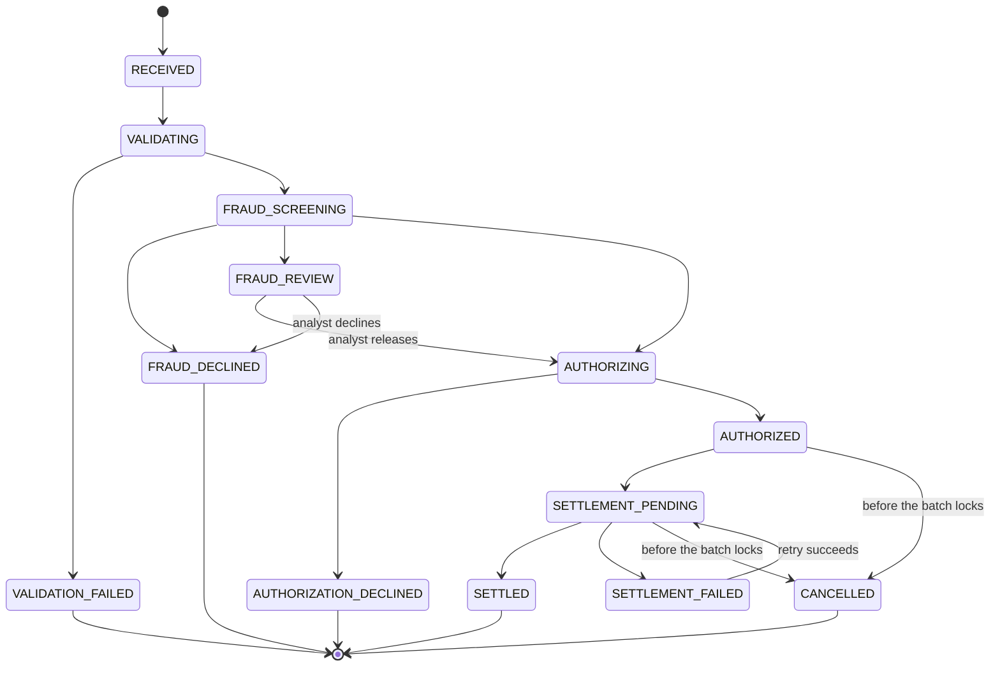

`FAILED` is a technical overlay. Any in-progress payment can sit in `FAILED` when a dependency broke and no business decline was decided. After a successful retry, Initiation puts the payment back on the step that stopped. Hold expiry before settlement also ends in `FAILED`.

### What each status means

| Status | What is true in the world | Is there a hold? | Has the journal changed? |
| --- | --- | --- | --- |
| `RECEIVED` | We stored the instruction and the idempotency row. | No | No |
| `VALIDATING` | Accounts, limits, calendar, and screening are being checked. | No | No |
| `VALIDATION_FAILED` | The instruction can never succeed. Example: Maya's account is closed. | No | No |
| `FRAUD_SCREENING` | Rules and velocity are scoring the payment. | No | No |
| `FRAUD_REVIEW` | A person must decide. The agent may write a recommendation. | No | No |
| `FRAUD_DECLINED` | Risk rejected it, or an analyst confirmed the decline. | No | No |
| `AUTHORIZING` | Ledger is trying to reserve the funds. | In progress | No |
| `AUTHORIZATION_DECLINED` | The reservation was refused. Typical reason: not enough available balance. | No | No |
| `AUTHORIZED` | The hold exists. The channel has a yes. | Yes | No |
| `SETTLEMENT_PENDING` | The payment is waiting for its rail window, or the post is in flight. | Yes | Not yet |
| `SETTLED` | The journal entry exists and the hold is consumed. This status stays. | Released | Yes |
| `SETTLEMENT_FAILED` | The window or the post hit a business or technical problem. | Still yes, until recovery or expiry | No, unless a later reversal is a different story |
| `CANCELLED` | The channel withdrew the payment before the settlement batch locked. | Released | No |
| `FAILED` | Technical stop or hold expiry. Recovery may still move it forward. | Depends on how far it got | No |

A business decline (`VALIDATION_FAILED`, `FRAUD_DECLINED`, `AUTHORIZATION_DECLINED`) is final. Retrying it with a new idempotency key is a new payment, and the same business rule will decline it again. Retrying it with the **same** key returns the original decline.

### Happy-path sequence

Maya submits the book payment. The channel waits up to the decision budget, 800 ms at p99, for a yes, a no, or a review.

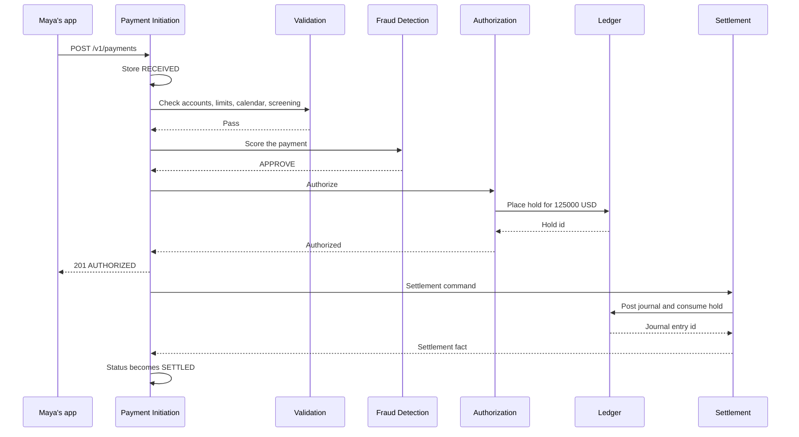

The `201` means the **decision** finished inside the time budget. It often arrives while the status is `AUTHORIZED` or `SETTLEMENT_PENDING`. `SETTLED` follows on the stream. The app learns that by reading `GET /v1/payments/{paymentId}` or by consuming a notification built from the lifecycle events.

If the budget expires first, the API returns `202` and the last status that was safely stored, often `RECEIVED`. The work continues. The app polls.

### Worked status trace for the book payment

| Time | Status | Why it changed |
| --- | --- | --- |
| 10:15:00.010 | `RECEIVED` | Row and idempotency record committed. |
| 10:15:00.040 | `VALIDATING` | Initiation started the validation call. |
| 10:15:00.090 | `FRAUD_SCREENING` | Validation passed. |
| 10:15:00.160 | `AUTHORIZING` | Fraud returned `APPROVE`. |
| 10:15:00.220 | `AUTHORIZED` | Ledger returned a hold id. |
| 10:15:00.230 | `SETTLEMENT_PENDING` | Settlement command stored in the same transaction. |
| 10:15:00.410 | `SETTLED` | Initiation consumed the settlement fact. |

Northwind can be credited a few hundred milliseconds after Maya's app received `AUTHORIZED`. Those are different moments. Section 2 is about that gap.

## 2. Authorization vs settlement

Authorization answers "may this payment happen, and have we reserved the money?" Settlement answers "have we made it permanent on the books, in the correct rail window?"

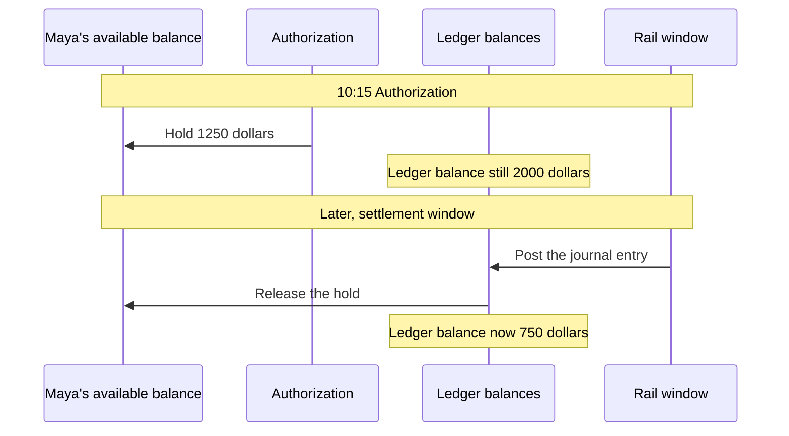

| | Authorization | Settlement |
| --- | --- | --- |
| Question it answers | Is this payment allowed, and are the funds reserved? | Is this payment permanent, and in which batch? |
| When | During the channel's request, inside the decision budget | After `AUTHORIZED`, on the rail's clock |
| Ledger effect | Insert a hold | Insert a balanced journal entry and consume the hold |
| Available balance | Down by the payment amount | Hold gone; ledger balance now carries the change |
| Ledger balance | Unchanged | Changed |
| Who can still stop it | The channel can cancel before the batch locks | After `SETTLED`, cancellation is closed. A reversal is a new posting. |
| Typical book timing | Sub-second | Sub-second after authorization, still a separate step |
| Typical ACH timing | Sub-second | Next business-day window |

An authorized payment is a promise with a reservation behind it. A settled payment is history. Code that treats `AUTHORIZED` as "Northwind has been paid" will be wrong for ACH, and it will be wrong for book transfers during the short gap before the journal post.

### Same-bank example

Maya pays Northwind at the same bank.

| Moment | Maya ledger | Maya holds | Maya available | Northwind ledger |
| --- | --- | ---: | ---: | ---: |
| Before | $2,000 | $0 | $2,000 | $500 |
| Authorized | $2,000 | $1,250 | $750 | $500 |
| Settled | $750 | $0 | $750 | $1,750 |

Northwind's available balance does not increase at authorization. We do not pay the creditor with a hold. We pay them with the posting.

### External ACH example

Maya pays Northwind's account at another bank on Friday at 18:00 in `America/New_York`. The ACH cutoff has passed. Validation rolls the value date to Monday, the next business day.

| Moment | What Maya sees | What the ledger has |
| --- | --- | --- |
| Friday 18:00, authorized | Status `SETTLEMENT_PENDING`, value date Monday | Hold of $1,250. Ledger balance still $2,000. |
| Monday settlement window | Status `SETTLED` | Debit Maya $1,250, credit `GL-CLEARING` $1,250, hold consumed. |

`GL-CLEARING` is our IOU to the rail: "this amount is due to the other bank in this window." Northwind's account does not exist in our database. Their bank will credit them after the rail settles. Our reconciliation file is how we confirm the rail agrees.

### Cancel sits between the two

Cancellation is allowed in `AUTHORIZED` and `SETTLEMENT_PENDING` until the settlement batch is locked. Initiation asks Authorization to release the hold. The journal is untouched because nothing was posted. The status becomes `CANCELLED`.

Once the batch is locked, the API returns a conflict (`settlement-locked`). The payment will settle, and undoing it means a reversal after `SETTLED`.

## 3. Reconciliation

Settlement updates **our** books. Reconciliation asks whether the **rail's statement** describes the same payments.

For a book transfer there is no other bank. The internal journal is the whole story, and the main check is that every settled book payment has exactly one balanced entry.

For ACH and wire, the rail simulator (and, in a real bank, the network) produces a statement file. Reconciliation matches each statement line to one internal settlement item.

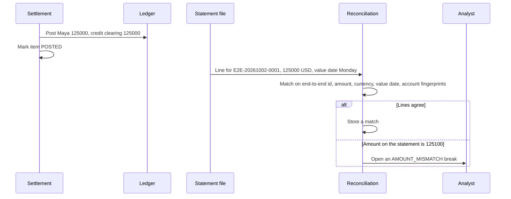

### Match key

Two records match when all of these agree:

| Field | Why it is in the key |
| --- | --- |
| End-to-end id | Ties the statement line to the client's payment. |
| Amount in minor units | Catches a truncated or duplicated amount. |
| Currency | `125000` USD and `125000` JPY are different payments. |
| Value date | A Monday item is not Tuesday's item. |
| Account fingerprints | Hashes of the debtor and creditor account identities, so the statement can be matched without copying raw account numbers into the break event. |

### Break classes

| Class | Example |
| --- | --- |
| `MISSING_STATEMENT` | We posted Maya's $1,250. The statement has no such line. |
| `MISSING_INTERNAL` | The statement has a $1,250 line we cannot find in our batch. |
| `AMOUNT_MISMATCH` | We posted `125000`. The statement says `125100`. |
| `VALUE_DATE_MISMATCH` | Both sides have the payment, on different business dates. |
| `DUPLICATE_STATEMENT` | The same line appears twice in the file. |

A break does not edit the journal. The original posting remains. An analyst, optionally with an agent recommendation, decides among retry, reversal, or no action. Money sitting in an unknown bucket can be represented in `GL-SUSPENSE` until that decision, as a separate posting. The break itself is a record of disagreement, not a balance update.

### Worked mismatch

| Side | End-to-end id | Amount | Value date |
| --- | --- | --- | --- |
| Our settlement item | `E2E-20261002-0001` | `125000` USD | Monday |
| Statement line | `E2E-20261002-0001` | `125100` USD | Monday |

Reconciliation opens `AMOUNT_MISMATCH` with severity based on policy. Maya's account still shows the $1,250 debit we actually posted. Nobody runs an `UPDATE` to change `125000` into `125100`. If the human decision is that the statement is right, the correction is a new journal entry for the $1.00 difference, with its own id and audit trail.

## 4. Holds

A hold is a reservation with an expiry time. It is how the bank stops Maya from spending the same dollars twice while a payment waits to settle.

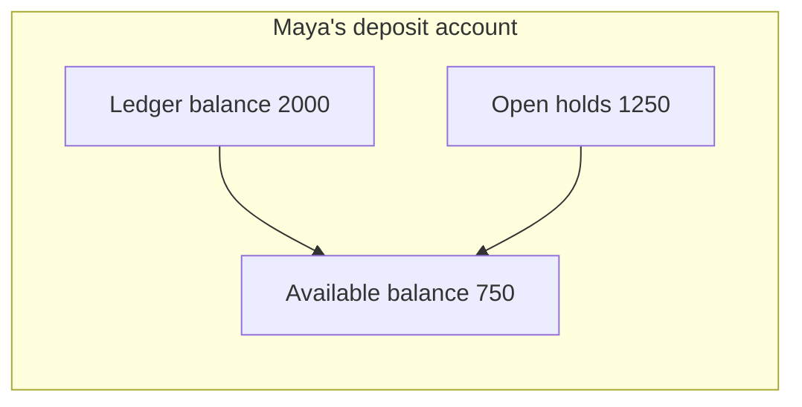

Available balance = ledger balance − open holds, for a normal customer deposit with no overdraft. Overdraft is out of scope, so a hold that would push available balance below zero is refused.

### Two payments, one balance

Maya is authorized for the $1,250 invoice. Before it settles, her app submits a $1,000 rent payment (`100000` minor units).

| Check | Result |
| --- | --- |
| Ledger balance | $2,000, which looks large enough |
| Open holds | $1,250 |
| Available balance | $750 |
| Rent payment | Declined with `AUTH_INSUFFICIENT_FUNDS` |
| New hold | None. A decline does not leave a reservation behind. |

This is the bug that appears when a service computes "can they pay?" from ledger balance and ignores holds. Only Ledger returns that answer, inside the hold transaction, using a lock on the account row so two authorizations cannot both pass.

### What a hold is not

| Idea | What is actually stored |
| --- | --- |
| A pending journal entry | A row in `balance_hold` with status `OPEN` |
| A message to the creditor | Nothing is credited yet |
| A permanent debit | Ledger balance is unchanged until settlement posts |

### How a hold ends

| Ending | Hold status | Available balance | Who triggers it |
| --- | --- | --- | --- |
| Settlement posts | `CONSUMED` | The ledger balance now includes the debit, so spending power stays reduced | Settlement, in the same ledger transaction as the journal entry |
| Cancel before the batch locks | `RELEASED` | Restored | Authorization, called by Initiation |
| Expiry before settlement lock | `RELEASED` | Restored | Compensation command after the sweep. Payment status becomes `FAILED` with reason `HOLD_EXPIRED`. |
| Technical retry of the same hold call | Stays `OPEN` | Unchanged, one hold only | Same ledger idempotency key returns the original hold |

Expiry exists so a payment stuck in `AUTHORIZED` cannot reserve Maya's money for days. The expiry timestamp is set when the hold is created. A settlement-locked item is not released by the sweep, because the money is already committed to a batch.

## 5. Ledger concepts

The ledger is a set of accounts plus an append-only journal. Customer-facing "my balance" is a view of one account. The bank's books are the whole set, and they balance.

### Why a customer balance is a liability

When Maya deposits money, the bank owes it back to her. Her deposit account is a **liability** of the bank. In accounting, liability accounts are **credit-normal**: a credit increases them and a debit decreases them.

That matches her statement:

| Statement word | Journal direction | Effect on the balance she can claim |
| --- | --- | --- |
| Money in | `CREDIT` | Up |
| Money out | `DEBIT` | Down |

An asset account works the other way. `GL-NOSTRO-SIM` is debit-normal because it represents cash the bank holds elsewhere. You do not need to memorize every internal account to write a payment feature. You do need to send positive amounts and a direction, and let Ledger apply the normal balance.

### Double entry

Every posting has two or more lines. The sum of debit minor units equals the sum of credit minor units, in one currency. The bank's books stay balanced because money is not created or destroyed inside a payment. It moves from one account to another.

Book settlement of Maya's invoice:

| Line | Account | Direction | Amount |
| --- | --- | --- | --- |
| 1 | Maya, customer liability | `DEBIT` | `125000` USD |
| 2 | Northwind, customer liability | `CREDIT` | `125000` USD |

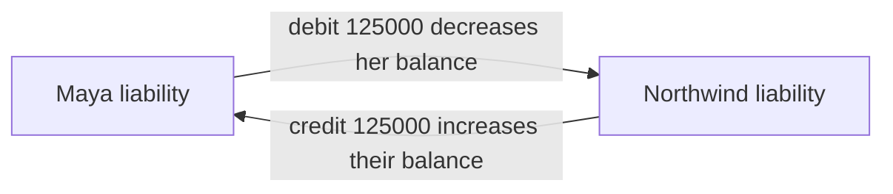

After the post, Maya is at $750 and Northwind is at $1,750. The bank's total customer liabilities are unchanged: $2,500 before and $2,500 after. The bank still owes the same total. It owes less to Maya and more to Northwind.

ACH settlement:

| Line | Account | Direction | Amount |
| --- | --- | --- | --- |
| 1 | Maya, customer liability | `DEBIT` | `125000` USD |
| 2 | `GL-CLEARING` | `CREDIT` | `125000` USD |

Total customer liabilities fall by $1,250. Clearing liabilities rise by $1,250. The bank now owes that amount to the rail instead of to Maya.

### Accounts the simulation keeps

| Account | Who it represents | Normal balance |
| --- | --- | --- |
| One row per customer | Money the bank owes that customer | Credit |
| `GL-CLEARING` | Amounts promised to a rail window | Credit |
| `GL-NOSTRO-SIM` | The simulated account we hold at another institution | Debit |
| `GL-SUSPENSE` | Unidentified amounts waiting for a human decision | Credit |
| `GL-FEE-INCOME` | Reserved for a future fee leg | Credit |

### Immutability

Journal lines are inserted. They are not updated or deleted. A wrong amount is corrected by a new entry. That gives auditors a story they can replay: entry A posted $1,250, entry B reversed it, entry C posted the corrected amount.

Each posting carries an idempotency key. A retried post returns the original entry instead of a second pair of lines.

Ledger also stores `ledger_balance_minor` and `held_minor` on the account row so authorization does not have to sum the whole journal on the hot path. Those columns change in the **same database transaction** as the hold or the journal lines. The journal remains the historical record. The columns are the current position.

### One transaction, three effects

Settlement of the book payment commits all of this together:

1. Insert the journal entry and its two lines.
2. Debit Maya's `ledger_balance_minor` by `125000` and credit Northwind's by `125000`.
3. Mark the hold `CONSUMED` and reduce Maya's `held_minor` by `125000`.

If the database transaction rolls back, none of the three effects remain. Callers that time out after a commit retry with the same key and receive the entry that already exists.

## 6. Reversals

A reversal undoes a **settled** payment by adding a new journal entry that swaps the directions. The original payment stays `SETTLED`. Its amount columns stay `125000`. A link of type `REVERSAL_OF` points from the new payment to the original.

Use a reversal when the money has already posted. Use a cancellation when it has only been held.

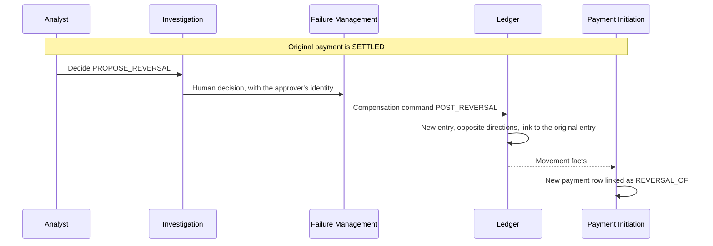

Reversal of the book invoice:

| Line | Account | Direction | Amount |
| --- | --- | --- | --- |
| 1 | Northwind | `DEBIT` | `125000` USD |
| 2 | Maya | `CREDIT` | `125000` USD |

Maya returns to $2,000. Northwind returns to $500. The original debit is still in the journal. The credit sits beside it. Net effect on the account is zero. The audit log shows both.

A large reversal needs two different people. That control is called four-eyes. The investigation agent may recommend `PROPOSE_REVERSAL`. It cannot approve it, and it cannot be the second approver.

`POST_REVERSAL` is refused unless `approved_by` is a human user. Automatic compensation is limited to releasing a hold **before** any posting exists.

### Partial story you will see later

Version 1 reverses the full payment amount. A $1.00 reconciliation difference, if approved, is its own small posting rather than an edited original. The same rule applies: new lines, original lines unchanged.

## 7. Chargebacks

A chargeback is a **card** process. APOP version 1 has no card rail, no card number, and no chargeback status. This section exists so the word is not confused with a reversal.

### The people in a card payment

| Name | Who they are |
| --- | --- |
| Cardholder | The person who used the card. |
| Issuer | The cardholder's bank. It authorized the card. |
| Merchant | The business that sold the goods. |
| Acquirer | The merchant's bank. It accepts card payments for the merchant. |
| Card network | The switch between issuer and acquirer, such as the networks behind Visa and Mastercard branded cards. |

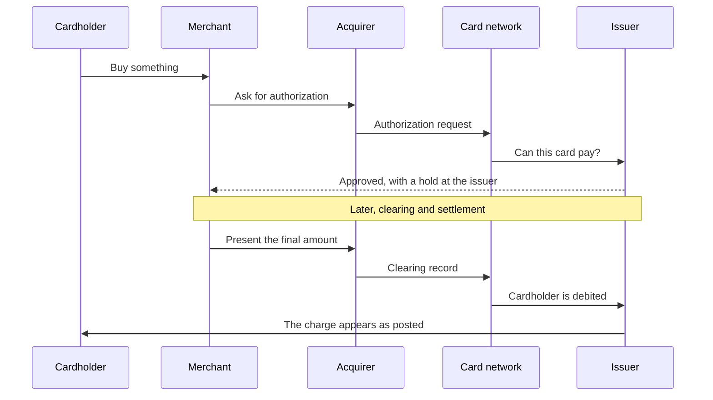

That first approval is an authorization, same idea as our hold. The later clearing record is what makes the charge permanent, same idea as our settlement. The timing is often a day or more, which is why a hotel can authorize $200 and later settle $175.

### What a chargeback adds

Days or weeks after the charge has posted, the cardholder tells the issuer they dispute it: the goods never arrived, the amount was wrong, the charge was duplicated, or they do not recognize it. The issuer sends that dispute through the network. The acquirer usually takes the amount back from the merchant while the dispute is open. The merchant may answer with evidence. The network's rules decide the outcome if the two banks still disagree.

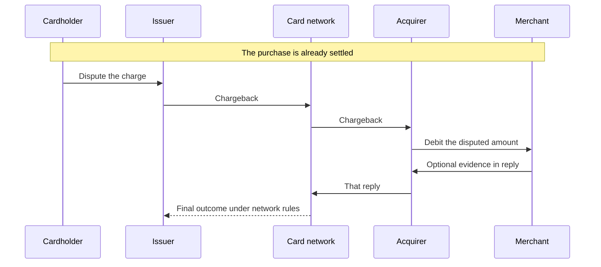

### Three words people mix up

| Word | Who starts it | When | What happens to the original posting |
| --- | --- | --- | --- |
| Cancel | The payer, in APOP | After authorization, before the settlement batch locks | No posting yet. The hold is released. |
| Reversal | The bank, after a human decision | After settlement | A new opposite journal entry. The original entry remains. |
| Refund | The merchant, in card acquiring | After settlement, merchant agrees | A new credit to the cardholder, initiated by the merchant. |
| Chargeback | The cardholder's bank | After a card charge has settled, under network dispute rules | A network message that pulls funds back. The original presentment record remains. The money movement is a new item. |

A chargeback can happen when the merchant does **not** agree. A refund happens when the merchant does agree. A reversal in APOP happens when our own operations decide a settled payment must be undone.

### If cards were added later

A chargeback would arrive as an inbound network message, open a case, and post a new journal entry linked to the original payment. It would not delete the sale, and it would not move a payment from `SETTLED` back to `CANCELLED`. That is the same immutability rule reversals already follow. Version 1 does not build that intake.

## 8. Failure scenarios

Failures split into two families.

**Business failures** are answers. The payment is not allowed. Retrying the operation will not make it allowed. The channel receives a payment id and a terminal decline status.

**Technical failures** are uncertainty. A timeout can mean the hold was placed, or that it was not. The recovery path retries with the same idempotency key and continues from the durable step.

| # | What happens | Status | Hold | Journal | What you implement |
| --- | --- | --- | --- | --- | --- |
| 1 | Maya's account is closed | `VALIDATION_FAILED` | None | None | Stop. Reason `VALIDATION_ACCOUNT_CLOSED`. |
| 2 | Amount is above the rail limit | `VALIDATION_FAILED` | None | None | Stop. Reason `VALIDATION_LIMIT_EXCEEDED`. |
| 3 | Screening port returns a hit | `VALIDATION_FAILED` | None | None | Stop. Reason `VALIDATION_SANCTIONS_REJECT`. Do not copy list contents onto the payment. |
| 4 | Fraud service is down | `FAILED` or the call errors fail-closed | None | None | No authorize call. Reason `TECHNICAL_DEPENDENCY`. |
| 5 | Fraud returns `DECLINE` | `FRAUD_DECLINED` | None | None | Stop. Reason `FRAUD_DECLINE`. |
| 6 | Fraud returns `REVIEW` | `FRAUD_REVIEW` | None until an analyst releases the case | None | Wait for a human. The agent may summarize. |
| 7 | Available balance is $750 and the payment is $1,000 | `AUTHORIZATION_DECLINED` | None | None | Reason `AUTH_INSUFFICIENT_FUNDS`. |
| 8 | Ledger times out after the hold commits | Stays at the last committed status, step `UNCERTAIN` | One hold | None | Retry the same ledger key. Expect the original hold id. |
| 9 | Channel cancels before lock | `CANCELLED` | Released | None | Release through Authorization. |
| 10 | Hold expires before lock | `FAILED` | Released | None | Reason `HOLD_EXPIRED`. |
| 11 | Settlement post times out after commit | `SETTLEMENT_PENDING`, item `POST_UNCERTAIN` | Consumed once the commit is visible | One entry | Settlement retries the same posting key. |
| 12 | Statement amount disagrees | Payment can already be `SETTLED` | Consumed | Original entry unchanged | Open a break. Wait for a human. |
| 13 | Same idempotency key, different body | No new payment | Unchanged | Unchanged | `409` conflict. |
| 14 | Poison event on the history projector | Payment status is unaffected | Unchanged | Unchanged | Dead-letter that record, keep the partition moving, open a failure case. |

### Sequence: not enough money

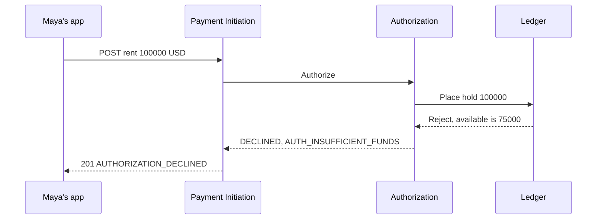

The HTTP status is `201` because the platform successfully **decided**. The payment resource exists so the channel can show the reason. The body status is `AUTHORIZATION_DECLINED`. No hold row remains.

### Sequence: timeout after the hold committed

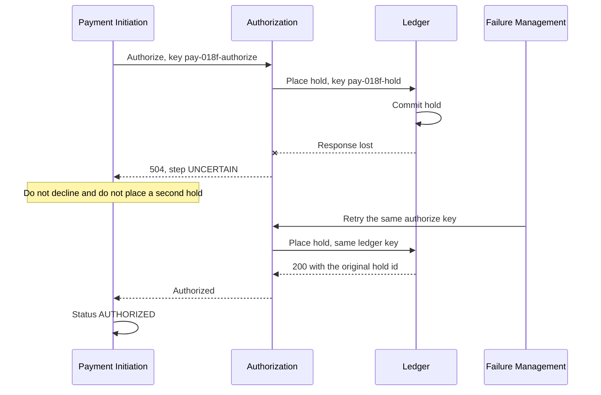

The dangerous bug is to treat the timeout as "no hold" and to submit a new key. That creates a second reservation. The safe behavior is to store `UNCERTAIN` and retry the original key.

### Sequence: fraud review

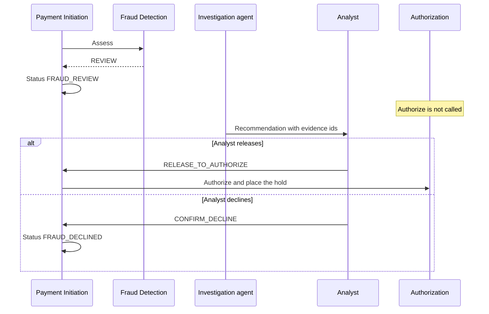

There is no hold during review. A review is not a weak yes. It is a pause before authorization.

## 9. Idempotency

Networks retry. Mobile clients retry. Load balancers retry. Kafka delivers a record more than once. Idempotency means those retries produce **one** business effect.

### The channel key

`POST /v1/payments` requires `Idempotency-Key`. The server stores the key with a hash of the canonical request body.

| Request | Result |
| --- | --- |
| Key `maya-invoice-4401`, body pays $1,250, first time | Create payment `018f…`, return `201 AUTHORIZED` or whatever the decision is |
| Same key, same body, app timed out and retried | Return the same payment id and the current decision. No second hold. |
| Same key, body now pays $1,300 | `409` `idempotency-conflict`. The $1,250 payment is unchanged. |
| Key omitted | `400` `idempotency-key-required` |
| Same key, 25 hours later | The record has expired (24-hour window). The key may be used for a new payment. |

Clients should keep a key for at least as long as they retry, and they should create a new key only when they mean a new payment.

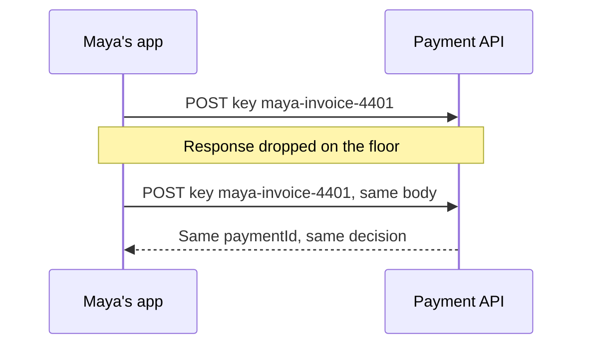

The end-to-end id is a second uniqueness rule: one debtor cannot reuse `E2E-20261002-0001` for a different payment inside the legal entity. The idempotency key covers transport retries. The end-to-end id covers the business reference printed on the invoice. Send both.

### Keys inside the platform

Each step has its own key, derived from the payment, so a retry hits the same row:

| Step | Key uniqueness | Replay returns |
| --- | --- | --- |
| Validation | One result per payment | The original pass or reject |
| Fraud assessment | One assessment per payment | The original decision and score |
| Authorization | One decision per payment | The original authorized or declined row |
| Hold | One hold per payment | The original hold id |
| Posting | One journal entry per settlement attempt key | The original entry id |

Kafka consumers store the event id in `processed_event`. A duplicate delivery finds that row and skips the work. Offsets are committed after that local transaction, which is why a crash can redeliver, and why the primary key has to exist.

### What idempotency does not do

| Situation | Outcome |
| --- | --- |
| The client intentionally sends a second invoice | A new key creates a new payment. Two holds, if both authorize. |
| The first request was a business decline | Replay returns the same decline. It does not reopen the case. |
| The body changes | Conflict. The server will not guess which amount you meant. |

## 10. Event-driven payments

The channel's HTTP call cannot hold a database transaction open across fraud, the ledger, a next-day ACH window, and reconciliation. Those steps belong to different services and different clocks. The services tell each other what they have **already committed** by publishing events.

An event is a fact in the past tense: "this payment was authorized," "this hold was placed," "this entry was posted." It is not a suggestion. The outbox pattern is what makes that sentence true. The service writes the business row and the outbox row in one database transaction. After commit, a relay publishes to Kafka. If the process dies before publish, the row is still there and the relay retries. Consumers assume the fact already happened.

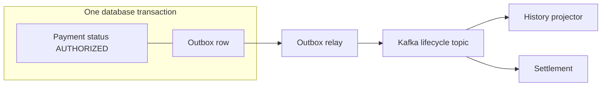

### Facts for Maya's book payment, in order

| Order | Topic | Fact | Who publishes |
| --- | --- | --- | --- |
| 1 | `payments.payment.lifecycle.v1` | Status advances through received, validating, screening, authorizing, `AUTHORIZED` | Payment Initiation |
| 2 | `payments.fraud.assessment.v1` | `APPROVE`, score, policy version, rule ids | Fraud Detection |
| 3 | `payments.ledger.movement.v1` | `HOLD_PLACED` on Maya's account | Ledger |
| 4 | `payments.command.settlement.v1` | Please settle this payment, with the hold id | Payment Initiation |
| 5 | `payments.ledger.movement.v1` | `POSTED` on Maya and `POSTED` on Northwind, then hold consumed | Ledger |
| 6 | `payments.settlement.item.v1` | Item `POSTED`, journal entry id | Settlement |
| 7 | `payments.payment.lifecycle.v1` | `SETTLED` | Payment Initiation |

History builds its timeline from these facts. It can be deleted and rebuilt from the archive. The ledger cannot. The ledger is the book of record. Kafka is the integration log.

Partition keys keep one payment's lifecycle in order: the lifecycle topic is keyed by `payment_id`. Ledger events are keyed by `account_id`, because Maya's account must see her hold and her later debit in order relative to her other payments. The two legs of one journal entry can land on different account partitions. The `journal_entry_id` is what ties them together.

### Sequence across the stream

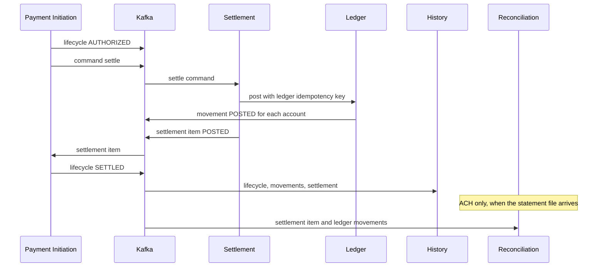

For ACH, the gap between the settle command and the post is the wait until Monday's window. The command sits with Settlement. Maya's hold stays open. No consumer is allowed to "help" by posting early.

### How to write a consumer

| Rule | Why |
| --- | --- |
| Store the event id before you commit your own update | Redelivery then becomes a no-op. |
| Treat the payload as a fact that already happened | The publisher's database committed first. |
| Ignore remittance and raw account numbers | They are not on the event. Read them from an authorized API if your role allows. |
| Do not change payment status from a projector | Initiation is the single writer. History stores a projection, which can lag by about two seconds at p99. |
| Send poison records to the dead-letter topic after bounded retries | One bad payload must not freeze every other payment on that partition. |

A projector that is behind does not mean the payment failed. It means the read model is catching up. The channel's `GET /v1/payments/{paymentId}` reads Initiation, the status writer, for the operational answer.

### Why the synchronous path still exists

Fraud, validation, and the hold happen while Maya's app is waiting, via internal HTTP. Those services **also** emit events so history, audit, and recovery can see the decision. The HTTP response is for latency. The event is for everyone who was not on the call. Settlement does not join that HTTP chain, because a next-day window cannot fit in an 800 ms request.

## If you remember one page

| Question | Answer |
| --- | --- |
| Who changes payment status? | Payment Initiation only. |
| What does authorization do to money? | Places a hold. Available balance drops. Ledger balance waits. |
| What does settlement do to money? | Posts a balanced journal entry and consumes the hold. |
| Can I update a journal line? | No. Post a reversal or a new adjustment entry. |
| What is a chargeback here? | A card-network dispute. Not a version 1 flow. Do not model it as a cancel. |
| What if the HTTP call times out? | Retry the same idempotency key. Look at `UNCERTAIN` steps. |
| What if the statement disagrees? | Open a break. Leave the journal as posted until a human approves a new entry. |
| Where is the truth about balances? | The Ledger database, computed inside Ledger. |

## Where to go next

| You want | Read |
| --- | --- |
| Services and which database they own | [Service boundaries](02-service-boundaries.md) |
| Topic names, keys, and payloads | [Kafka event design](03-kafka-event-design.md) |
| Tables, constraints, and the journal | [PostgreSQL schema design](04-postgresql-schema-design.md) |
| Request and response shapes | [API architecture](06-api-architecture.md) |
| How an agent may recommend a reversal | [Agentic AI architecture](05-agentic-ai-architecture.md) |
