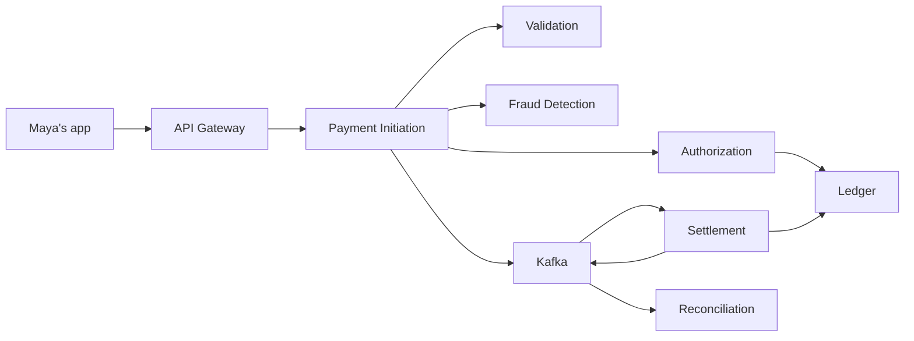
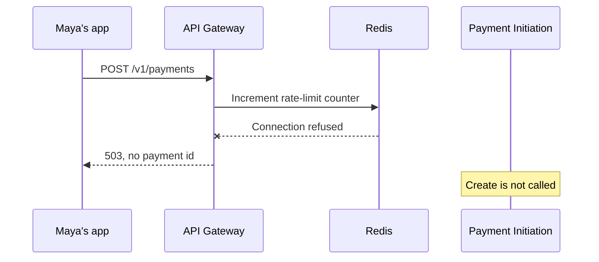
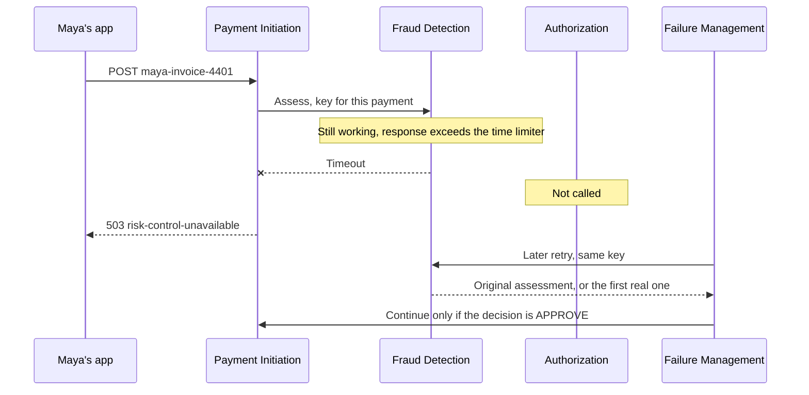
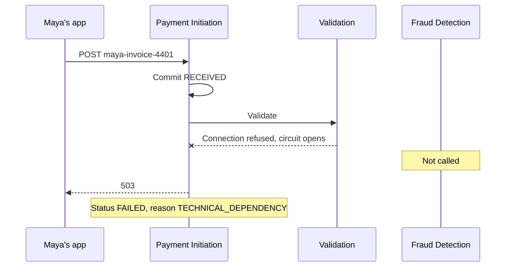
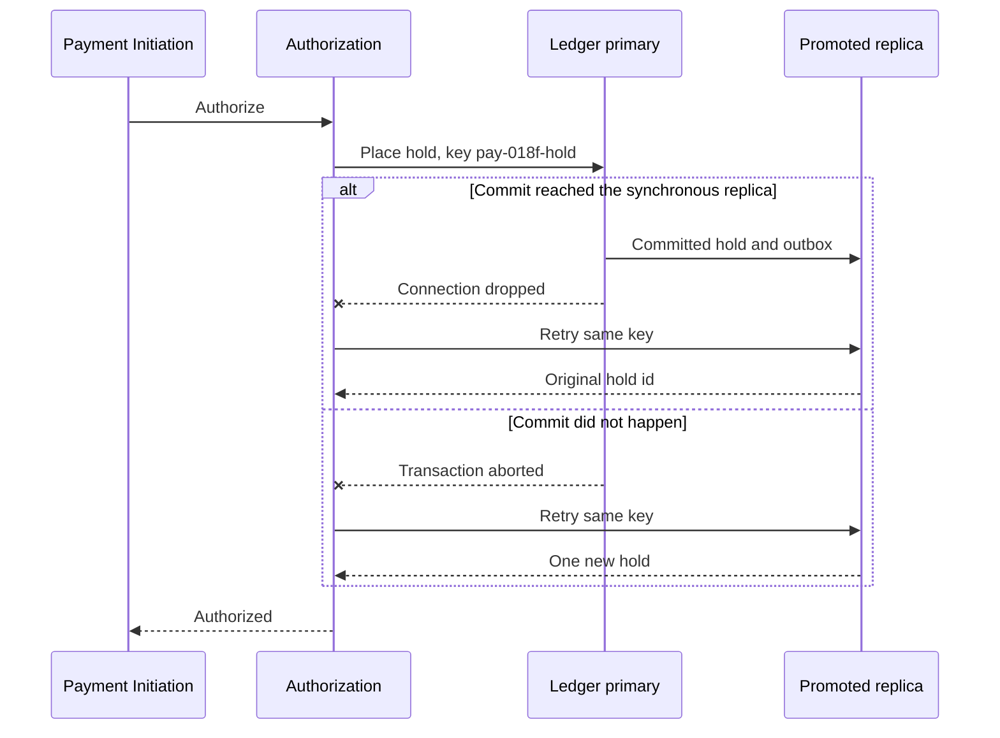
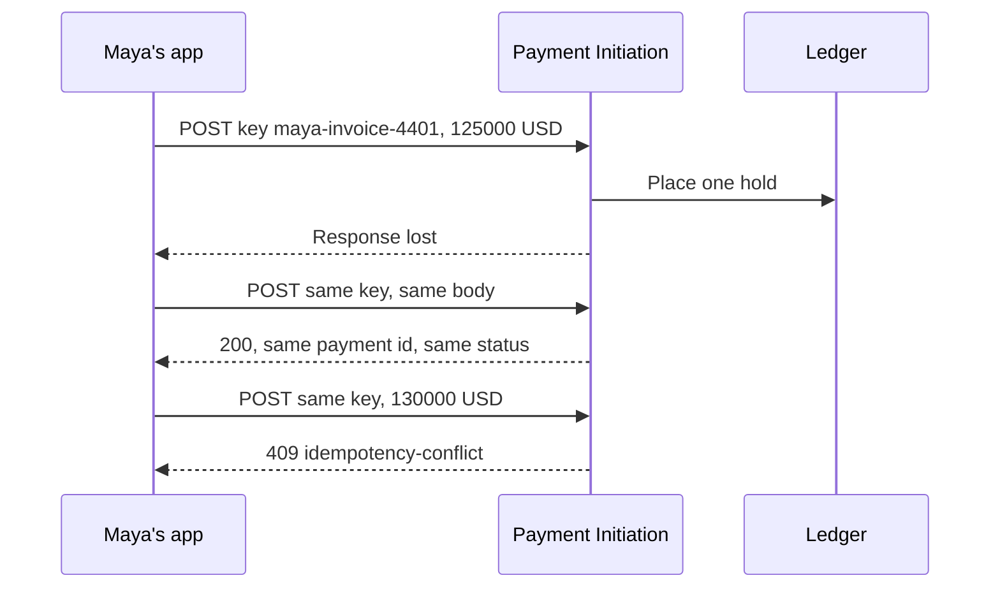
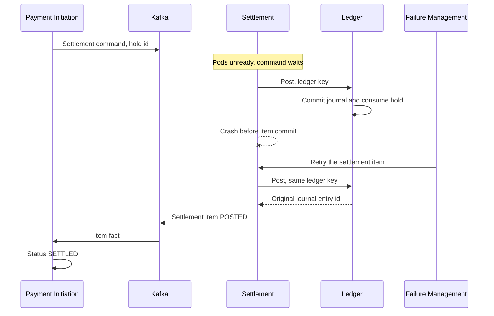
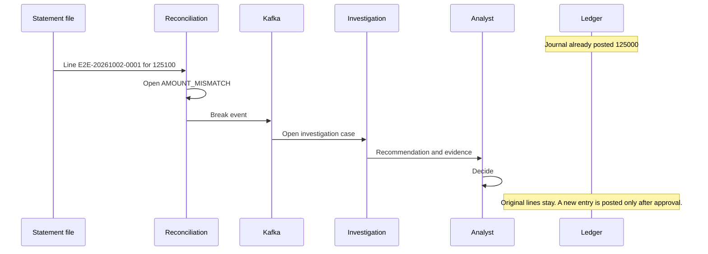

# 12. Failure scenarios

| | |
| --- | --- |
| Status | Proposed |
| Audience | Engineers and operations on-call |
| Related | [Domain guide](11-payment-domain-guide.md), [Service boundaries](02-service-boundaries.md), [Kafka](03-kafka-event-design.md), [Monitoring](08-monitoring-architecture.md) |

These are the failure cases the platform is designed to survive. Each one uses Maya's $1,250.00 invoice payment (`125000` USD, idempotency key `maya-invoice-4401`) so the customer view is concrete.

The synchronous path is Validation, then Fraud Detection, then Authorization and the Ledger hold. Settlement, history, and reconciliation run afterward on Kafka. A dependency that cannot give a risk decision stops the payment before a hold. A dependency that may already have committed is retried with the same key. The platform does not invent a business decline for a timeout.

Resilience4j wraps synchronous HTTP clients in this order: bulkhead, time limiter, circuit breaker, then one retry. The retry runs only when the failure is a definite transport error and the operation is idempotent. Multi-minute backoff belongs to Failure Management. Kafka uses the transactional outbox and the broker client's own producer retries. Those broker retries are not a Resilience4j policy.



| Id | Scenario | Where it hits | Customer receipt | Money reserved? |
| --- | --- | --- | --- | --- |
| F-1 | Kafka unavailable | After the decision is stored | `201` or existing status, then stuck before `SETTLED` | Yes, if authorization already finished |
| F-2 | Redis unavailable | Gateway write path, and fraud velocity | `503` on create | No, for a new create |
| F-3 | Fraud timeout | Initiation's fraud client | `503` or `202`, status not authorized | No, until a later retry gets a real `APPROVE` |
| F-4 | Validation unavailable | Initiation's validation client | `503` or `202`, status not authorized | No |
| F-5 | PostgreSQL failover | Ledger primary, or the platform primary | In-flight call `503` or `504`; poll afterward | Only if that transaction had committed |
| F-6 | Duplicate payment request | Idempotency check | Same receipt, or `409` | One hold at most |
| F-7 | Settlement service failure | After `SETTLEMENT_PENDING` | Status stays `SETTLEMENT_PENDING` | Hold remains until post or expiry |
| F-8 | Reconciliation mismatch | After `SETTLED` | Status stays `SETTLED` | Already posted |

## F-1. Kafka unavailable

All three brokers stop accepting produces and fetches. PostgreSQL, Redis, and the HTTP services stay up. Maya submits the book payment while the brokers are down. A second group of payments is already `AUTHORIZED` and waiting for their settlement command to be consumed.

### What happens

The decision path does not call Kafka. Initiation still validates, screens, authorizes, and commits the payment row, the hold, and the outbox rows in PostgreSQL. The outbox relay fails the produce because `acks=all` cannot be satisfied. `published_at` stays null. Rows remain in insertion order.

Settlement consumers receive nothing new, so they do not post. History stops advancing. Commands and facts that were already on the broker sit unread until fetches work again.

When the brokers return, the relay publishes the unpublished outbox from oldest to newest, one payment at a time. Consumers resume from the last committed offset. Settlement posts with the original ledger idempotency key.

```mermaid
sequenceDiagram
  participant App as Maya's app
  participant Init as Payment Initiation
  participant Led as Ledger
  participant Box as Outbox in PostgreSQL
  participant K as Kafka
  participant Setl as Settlement

  App->>Init: POST maya-invoice-4401
  Init->>Led: Place hold
  Led-->>Init: Hold committed
  Init->>Box: Status SETTLEMENT_PENDING and settlement command
  Box--xK: Produce fails, acks=all
  Init-->>App: 201 SETTLEMENT_PENDING
  Note over K: Brokers unavailable
  Note over Setl: No command arrives, no journal post
  K-->>Box: Brokers accept produces again
  Box->>K: Relay publishes the command
  K->>Setl: Settlement command
  Setl->>Led: Post with the original ledger key
```

### Which service reacts

| Service | Reaction |
| --- | --- |
| Payment Initiation | Completes the synchronous decision. Leaves outbox rows unpublished. |
| Ledger | Places the hold. Its movement event waits in the ledger outbox. |
| Outbox relays | Retry produces. Do not mark a row published without a broker acknowledgement. |
| Settlement, History, Reconciliation, Failure Management | Consumers pause. Offsets are not committed for records they have not processed. |
| API Gateway | Keeps accepting writes. Kafka is not a gateway dependency. |

### Which Kafka event is emitted

Nothing is acknowledged during the outage. These rows are already committed in outbox tables and are emitted, in order, after the broker accepts them:

| Topic | Fact waiting |
| --- | --- |
| `payments.payment.lifecycle.v1` | Transitions through `AUTHORIZED` and `SETTLEMENT_PENDING` |
| `payments.fraud.assessment.v1` | `APPROVE` for this payment |
| `payments.ledger.movement.v1` | `HOLD_PLACED` |
| `payments.command.settlement.v1` | Settle this payment and this hold |
| `platform.audit.recorded.v1` | Create and authorize actions |

`payments.settlement.item.v1` and the lifecycle `SETTLED` fact are emitted only after Settlement posts. They are not sitting in an outbox yet.

### Which Resilience4j pattern applies

None on the broker. The relay uses the Kafka producer with idempotent produces and `acks=all`. Resilience4j does not open a circuit on the payment API because of Kafka. The HTTP clients on this request still use their normal bulkhead, time limiter, and circuit breaker around Validation, Fraud, and Authorization, and those calls succeed in this scenario.

### What the customer sees

`201` with status `SETTLEMENT_PENDING` and the payment id. A refresh stays on `SETTLEMENT_PENDING` for as long as the command cannot be consumed. The app can say the payment was accepted and is not final. Available balance is already reduced by $1,250. The ledger balance is still $2,000. Northwind has not been credited.

Payments that were already `SETTLED` still read as `SETTLED`. Their history timeline may lag until the projector catches up.

### How operations investigate

1. Page from **Outbox age** (unpublished row older than 30 seconds) and **Kafka under-replicated** or a broker-down alert.
2. Open the Kafka dashboard. Confirm produce errors and flat consumer lag that then jumps when the cluster returns.
3. Query unpublished outbox rows for `maya-invoice-4401` by aggregate id. `published_at` null means the business commit happened and the broker did not.
4. After recovery, confirm consumer lag for `payment-settlement-executor` returns under the 2 second book-settlement objective, then `GET` the payment and expect `SETTLED`.
5. Match one hold and one journal entry in Ledger. A second post means the ledger idempotency key was not reused.

## F-2. Redis unavailable

Redis stops answering. The gateway uses it for rate limits. Fraud Detection uses it for velocity windows. Initiation uses it as a hot copy of idempotency pointers. PostgreSQL remains the source of truth for payments, limits, and idempotency.

### What happens

The gateway cannot update its rate-limit counters. It rejects new `POST /v1/payments` and serves reads with a small in-process limit. Maya's create never reaches Payment Initiation, so no payment row and no hold are created.

A payment already inside Fraud Detection, past the gateway, fails closed. Fraud will not treat a missing Redis as zero velocity. The assessment call errors. Initiation does not call Authorization.

The idempotency cache being down does not weaken duplicate protection. Initiation reads and writes `idempotency_record` in PostgreSQL on every create.



### Which service reacts

| Service | Reaction |
| --- | --- |
| API Gateway | Fails closed on writes. Applies a conservative local limit on reads. |
| Fraud Detection | Returns an error if velocity cannot be read. Does not return `APPROVE`. |
| Payment Initiation | For a call that already passed the gateway, records step `FRAUD` as `UNCERTAIN` or `FAILED` and does not authorize. Deduplicates with PostgreSQL. |
| Payment Validation | Serves calendar and account-status reads from PostgreSQL when the reference cache misses. |

### Which Kafka event is emitted

A create rejected at the gateway emits no payment topic record. There is no `payment_id`. Gateway metrics and access logs are the record.

If the payment was already stored and fraud then fails because Redis is down, Payment Initiation emits:

| Topic | Fact |
| --- | --- |
| `payments.payment.lifecycle.v1` | `FAILED` with reason `TECHNICAL_DEPENDENCY` |
| `platform.audit.recorded.v1` | The failed risk check |

No `payments.fraud.assessment.v1` and no `payments.ledger.movement.v1`. Failure Management emits `payments.failure.case.v1` with case type `UNCERTAIN_STEP` if the step is still uncertain when the grace period ends. When Redis is back, fraud velocity warms before new approvals. A cold window stays fail-closed until that warmup flag is set.

### Which Resilience4j pattern applies

| Client | Pattern |
| --- | --- |
| Gateway Redis commands | Time limiter. Repeated failures open a circuit breaker. The write API stays failed closed while the circuit is open. |
| Initiation → Fraud Detection | Time limiter and circuit breaker on the `fraud` client. Bulkhead stops fraud slowness from occupying every initiation thread. |
| Fraud → Redis | Time limiter around the velocity read. There is no retry that substitutes zeros for missing counters. |

### What the customer sees

On a new create: `503` with problem type `risk-control-unavailable` when the gateway rejects the write, or the same class of `503` if initiation fail-closes after fraud cannot score. The channel should say the payment was not accepted and no funds were reserved. Maya's balances are unchanged. `GET` still works unless the local read limit answers `429`.

### How operations investigate

1. Decision-availability burn pages if creates are failing. The fraud circuit page follows if in-flight assessments are erroring.
2. On the platform dashboard, confirm Redis is unreachable and memory or connection errors are present. On the resilience dashboard, read the `fraud` circuit state.
3. Search logs for gateway write rejections in this minute. Those lines have a correlation id and no payment id.
4. For any payment id that does exist, read `orchestrator_step` for `FRAUD`. Absence of a hold in Ledger confirms fail-closed behavior.
5. After Redis recovers, watch `apop.payment.decision` for a return of `AUTHORIZED`, and confirm a flushed velocity cache does not produce a burst of approvals before warmup.

## F-3. Fraud service timeout

Fraud Detection is running and then stops answering before its assessment commits. Maya's payment has already passed validation. Initiation is waiting on the fraud client. The end-to-end decision budget is 800 ms.

### What happens

The fraud time limiter fires. Initiation does not know whether Fraud committed an assessment, so the step is `UNCERTAIN`. Authorization is not called. No hold is placed. Initiation does not write `FRAUD_DECLINED`, because a timeout is not a risk decision.

One Resilience4j retry is allowed only when the failure is a definite transport break before the request was sent. A read timeout can mean the server is still working, so that retry is Failure Management's job, with the same idempotency key. The replay returns the original assessment if Fraud had committed, and otherwise computes it once.

After repeated timeouts the fraud circuit opens. Further creates fail fast, still with no hold, until the circuit half-opens and a probe succeeds.



### Which service reacts

| Service | Reaction |
| --- | --- |
| Payment Initiation | Stops the saga at fraud. Stores `UNCERTAIN`. Returns the technical error. Moves the payment to `FAILED` with `TECHNICAL_TIMEOUT` when the synchronous attempt is finished. |
| Fraud Detection | If it later commits, stores one assessment for the payment key. |
| Failure Management | Opens `UNCERTAIN_STEP` after the grace period and retries the same key. |
| Authorization and Ledger | Do not see this payment until a retry returns `APPROVE` and initiation resumes. |

### Which Kafka event is emitted

| Topic | When |
| --- | --- |
| `payments.payment.lifecycle.v1` | `FRAUD_SCREENING`, then `FAILED` with `TECHNICAL_TIMEOUT` |
| `platform.audit.recorded.v1` | The uncertain fraud step |
| `payments.failure.case.v1` | Case type `UNCERTAIN_STEP` after the grace period |
| `payments.fraud.assessment.v1` | Only after Fraud commits an assessment. A lost response still publishes from Fraud's outbox. |

No ledger movement is emitted for this attempt.

### Which Resilience4j pattern applies

The `fraud` client on Initiation: bulkhead, time limiter, circuit breaker, and a single retry only for a definite pre-dispatch transport failure. The time limiter is the pattern that fires in this scenario. The circuit breaker is the pattern that fires for the payments that follow. The end-to-end time limiter on the create request is what bounds Maya's wait.

### What the customer sees

If initiation reaches a fail-closed answer inside the budget, the app receives `503` `risk-control-unavailable`, a payment id, and reason `TECHNICAL_TIMEOUT`. `GET` shows `FAILED` while the retry is outstanding. The channel should describe that as an interrupted payment, not as a fraud decline.

If the 800 ms budget expires first, the app receives `202` with the last committed status, usually `FRAUD_SCREENING`, and polls. Available balance is unchanged. A later poll shows `AUTHORIZED` only after a real approval and a hold.

A business `FRAUD_DECLINED` is a different outcome: `201` with that status, and retries of the same key return the same decline.

### How operations investigate

1. **Fraud circuit open** pages after two minutes. Decision-latency burn pages if timeouts are widespread.
2. On the resilience dashboard, check `resilience4j.call.duration` and time-limiter expirations for client `fraud`.
3. Open the payment. `orchestrator_step` for `FRAUD` should be `UNCERTAIN`. Ledger should show no hold.
4. In the trace, the fraud client span ends with the time-limiter timeout. The authorization span should be absent.
5. Read the failure case. A successful retry stores one fraud assessment and, only on `APPROVE`, continues to a hold. Two assessment rows for the same payment id mean the fraud idempotency key was not enforced.

## F-4. Validation service unavailable

Every Validation pod is unready. Maya submits the payment. Initiation has stored `RECEIVED` and then calls Validation. Screening, limits, and the business calendar are inside that call, so Initiation cannot tell a closed account from a dead process.

### What happens

The validation call fails with a connection error or an open circuit. The step is `UNCERTAIN` or `FAILED`. Initiation does not call Fraud or Authorization. No hold is placed. The payment is not marked `VALIDATION_FAILED`, because that status means a business rule rejected a request the service actually judged.

Failure Management retries the same validation key. When Validation is back, a business reject still becomes `VALIDATION_FAILED`. A pass continues into fraud screening.



### Which service reacts

| Service | Reaction |
| --- | --- |
| Payment Initiation | Fail-closes the decision after the validation client fails. Single writer sets `FAILED`. |
| Payment Validation | No result row until a call actually completes. |
| Failure Management | Retries `VALIDATE` with the original key after the grace period. |
| Fraud, Authorization, Ledger | Idle for this payment. |

### Which Kafka event is emitted

| Topic | Fact |
| --- | --- |
| `payments.payment.lifecycle.v1` | `RECEIVED`, then `FAILED` with `TECHNICAL_DEPENDENCY` |
| `platform.audit.recorded.v1` | The failed validation attempt |
| `payments.failure.case.v1` | `UNCERTAIN_STEP` if the outcome was uncertain past the grace period |

There is no validation topic. A completed business rejection later appears as lifecycle `VALIDATION_FAILED` with a reason such as `VALIDATION_ACCOUNT_CLOSED`. That event is emitted by Initiation, after Validation has stored a `REJECT` result.

### Which Resilience4j pattern applies

The `validation` client: bulkhead, time limiter, circuit breaker, and one retry on a definite transport failure. In this scenario the circuit breaker opens after the failure threshold and the following creates fail fast. The bulkhead limits how many initiation threads wait on a dead service.

### What the customer sees

`503` with the payment id once the row exists, or `202` if only `RECEIVED` was committed when the budget expired. `GET` shows `FAILED` and `TECHNICAL_DEPENDENCY` until retry resumes the saga. Balances do not change. The channel should offer a retry of the **same** idempotency key, not a new payment.

### How operations investigate

1. Decision-availability burn is the page. The resilience dashboard shows the `validation` circuit open. There is no separate fraud-circuit page for this incident.
2. Confirm Validation readiness probes are failing and the pods are out of service.
3. For Maya's payment, `orchestrator_step` should show `VALIDATE` not succeeded, and no `FRAUD` step started.
4. Confirm Ledger has no hold and no journal line.
5. After the pods are ready, watch the failure case move to `CLOSED` and the lifecycle leave `FAILED` for `FRAUD_SCREENING` or a real `VALIDATION_FAILED`.

## F-5. PostgreSQL failover

The ledger primary loses its host. CloudNativePG promotes a synchronous replica. For a few seconds, in-flight ledger transactions either are on the new primary, because they committed under synchronous replication, or they abort. A second case is the same promotion on the platform cluster that holds the initiation database. The two clusters fail over independently.

Maya's authorization call is inside `POST /internal/v1/holds` when the ledger primary disappears.

### What happens

The ledger transaction either committed the hold and its outbox row, or it rolled back. Authorization's HTTP call dies with a connection error or a timeout, so the authorization step is `UNCERTAIN`. Initiation does not decline for insufficient funds and does not send a second hold under a new key.

Failure Management, or Authorization's own idempotent replay, calls Ledger again with the same hold key. The new primary returns the existing hold if the first transaction committed, or creates the one hold if it did not.

Journal lines follow the same rule. A settlement post that committed before promotion is the only post. A post that rolled back is created once on retry.



Platform-cluster failover is the same shape for the payment row. A create that committed is returned on replay of `maya-invoice-4401`. A create that rolled back is inserted once on the retry.

### Which service reacts

| Service | Reaction |
| --- | --- |
| Ledger | New primary serves holds and posts. Idempotency unique keys reject a second financial effect. |
| Payment Authorization | Records an uncertain call, then retries the same ledger key. |
| Payment Initiation | Keeps a single payment status. Replays the same step key. |
| CloudNativePG | Promotes the synchronous replica. Operators cut traffic over through the cluster's service. |
| Outbox relay | Publishes only rows that committed, including `published_at` still null. |

### Which Kafka event is emitted

| Situation | Event |
| --- | --- |
| Hold transaction committed before promotion | `payments.ledger.movement.v1` with `HOLD_PLACED`, from the outbox on the new primary |
| Hold transaction aborted | No movement event until the successful retry commits, then one `HOLD_PLACED` |
| Payment row committed | `payments.payment.lifecycle.v1` for the statuses that were stored |
| Authorization stayed uncertain past the grace period | `payments.failure.case.v1` with `UNCERTAIN_STEP` |

A rolled-back transaction does not leave an event behind. The relay cannot publish a row that does not exist.

### Which Resilience4j pattern applies

The `ledger` client used by Authorization and by Settlement: time limiter, circuit breaker, and one retry because hold and post are idempotent. The circuit opens if the new primary is not accepting connections yet, and initiation then returns `503` `ledger-unavailable` without writing a false decline. The bulkhead keeps ledger waits off the fraud and validation thread pools.

### What the customer sees

The in-flight create returns `503` `ledger-unavailable` or `504` `decision-timeout`, with a payment id if `RECEIVED` was already stored. A poll after failover shows `AUTHORIZED` if the hold exists, or `FAILED` / the in-progress status with an uncertain authorize step if it does not. Once the retry finishes, a successful hold becomes `AUTHORIZED` and available balance drops by $1,250.

A customer reading an already settled payment may see a short read error if the platform primary is the cluster that failed over. After promotion, `GET` returns the same settled payment. Amounts do not change because of failover.

### How operations investigate

1. **Ledger replication lag** pages if the replica falls more than 10 seconds behind for 5 minutes. A hard primary loss shows connection errors and a promotion event before that lag alert clears.
2. On the ledger dashboard, confirm the new primary, replication lag back to normal, and the idempotent-replay rate. A spike in replays is the recovery working.
3. For Maya's payment, compare `hold_id` on the authorization row with `balance_hold`. One open hold is the expected result.
4. In the trace, one ledger client span fails and a later span with the same idempotency key succeeds.
5. Run a journal balance check for any post that was in flight: debit minor units equal credit minor units, one entry per ledger idempotency key. Restore drills belong in `uat`, not on the live primary.

## F-6. Duplicate payment request

Maya's app sends `POST /v1/payments` with key `maya-invoice-4401` and the $1,250 body. The response is lost. The app sends the same request again. Later a bug sends that same key with amount $1,300.

This is the steady-state retry case. It is not an outage. A second, different key for a second invoice is a second payment on purpose.

### What happens

The first request commits the payment, the idempotency row, and the request hash. The replay looks up `(legal_entity_id, idempotency_key)`, finds the same hash, and returns the original payment id and the current status. It does not call Ledger again if the decision is already stored. If the first request is still inside fraud or authorization, the replay joins that same payment and returns whatever status is committed.

The $1,300 body produces a different hash. Initiation returns `409` and leaves the $1,250 payment alone.

A duplicate Kafka delivery is a different duplicate. The consumer inserts `processed_event` with the event id. The second delivery hits that primary key and does not post, project, or open a second break.



### Which service reacts

| Service | Reaction |
| --- | --- |
| Payment Initiation | Owns the channel key and the request hash. Returns the original resource or the conflict. |
| Ledger | A retried hold or post with the same ledger key returns the original row. |
| Every Kafka consumer | Deduplicates on event id through `processed_event`. |
| API Gateway | Forwards both HTTP calls. It does not collapse them. |

### Which Kafka event is emitted

The first successful decision emits the normal lifecycle, fraud, and hold events once. The identical replay does not append a second `AUTHORIZED` fact and does not place a second hold, so it does not emit a second `HOLD_PLACED`.

The conflicting $1,300 call emits no lifecycle event. `platform.audit.recorded.v1` can record the rejected replay as a non-financial audit action. `apop.idempotency.replay` counts the identical retry and the conflict separately.

A redelivered consumer record emits nothing new. The first consumption already produced that consumer's downstream fact, if it had one.

### Which Resilience4j pattern applies

The client's HTTP retry is safe because the server operation is idempotent. Resilience4j's single retry on Initiation's way to Ledger is the same idea: a transport retry reuses the hold key. No circuit breaker opens because a duplicate arrived. Duplicate traffic is a successful request path.

### What the customer sees

| Attempt | HTTP | Body |
| --- | --- | --- |
| First create, decision finished | `201` | Payment id, status `AUTHORIZED` or `SETTLEMENT_PENDING` |
| Retry, same key and body | `200` | That same payment id and the current status |
| Same key, amount $1,300 | `409` | Problem `idempotency-conflict` |
| Missing key | `400` | Problem `idempotency-key-required` |

Available balance drops once, by $1,250. The channel should show one receipt. The conflict should be shown as "this request id was already used for a different payment," and the app should send a new key only when Maya intends a new payment.

### How operations investigate

1. No page. The idempotency replay metric and a single `409` are normal.
2. If Maya reports two debits, start from the idempotency key and from both payment ids.
3. One row in `idempotency_record` and one hold for `maya-invoice-4401` means the HTTP retry worked.
4. Two payment ids mean the client used two keys. That is two instructions, not a failed dedupe.
5. If a journal entry is doubled, compare `journal_entry.idempotency_key`. The ledger unique key is the control. Consumer logs showing the same event id twice, with one `processed_event` row, mean Kafka redelivery was absorbed.

## F-7. Settlement service failure

The payment is `SETTLEMENT_PENDING`. The hold is open. Initiation has committed the settlement command. Settlement then fails in one of two ways: its pods are down before the post, or it crashes after Ledger commits the journal and before Settlement commits the item.

### What happens

While the pods are down, the consumer group `payment-settlement-executor` has no members. The command stays on `payments.command.settlement.v1`. The hold remains `OPEN`. Book payments miss the 2 second settlement objective. ACH payments already waiting for Monday's window are unaffected until that window opens and the service is still down.

If Ledger committed and Settlement did not, the item is absent or `POST_UNCERTAIN`. Failure Management asks Settlement to retry. Settlement calls `POST /internal/v1/postings` with the original ledger idempotency key. Ledger returns the original journal entry. Settlement then commits the item as `POSTED` and publishes the item fact. Initiation is still the service that moves the payment to `SETTLED`.

A locked batch is not rebuilt with a different membership because a pod restarted.



### Which service reacts

| Service | Reaction |
| --- | --- |
| Settlement | Resumes the consumer. Retries an uncertain post with the same key. Does not open a second batch for the same window membership. |
| Ledger | One journal entry per ledger key. Hold ends `CONSUMED` in that same transaction. |
| Failure Management | Opens `POST_UNCERTAIN` when a post attempt is ambiguous. Calls the settlement retry API. It does not post the ledger itself. |
| Payment Initiation | Leaves status at `SETTLEMENT_PENDING` until the item fact arrives, then writes `SETTLED`. |

### Which Kafka event is emitted

| Topic | When |
| --- | --- |
| `payments.command.settlement.v1` | Already emitted when status became `SETTLEMENT_PENDING` |
| `payments.ledger.movement.v1` | `POSTED` for each account, and the hold consumed, once the ledger transaction exists |
| `payments.failure.case.v1` | `POST_UNCERTAIN` if Settlement crashed around the post |
| `payments.settlement.item.v1` | `POSTED` after Settlement's own commit |
| `payments.payment.lifecycle.v1` | `SETTLED`, published by Initiation after it consumes the item |

If the service is only down and no post was attempted, the failure-case event waits until the watcher's grace period treats the lag as a durable problem. The command itself is the event already on the topic.

### Which Resilience4j pattern applies

Settlement's `ledger` client: bulkhead, time limiter, circuit breaker, and one retry of the idempotent post. A time-limiter expiry after the ledger may have committed is recorded as `POST_UNCERTAIN` and is not looped inside the request thread. The circuit breaker opens if the ledger primary is the component that is actually failing, which stops Settlement from stacking ambiguous posts.

### What the customer sees

The create already returned `201` with `AUTHORIZED` or `SETTLEMENT_PENDING`. Polls stay on `SETTLEMENT_PENDING`. Available balance stays $750 because the $1,250 hold is still open. Ledger balance stays $2,000 until the single post commits, then moves to $750 and the hold drops.

The channel should keep showing "accepted, not yet final." If the hold expires before a locked batch exists, status becomes `FAILED` with `HOLD_EXPIRED`, the hold is released, and available balance returns to $2,000. That expiry is the backstop when settlement cannot recover in time.

### How operations investigate

1. **Consumer lag** on `payment-settlement-executor` pages after 10 seconds. **Outbox age** pages if Settlement cannot publish the item fact.
2. On the payment funnel, book-settlement lag is the customer-facing symptom. `AUTHORIZED` aging without `SETTLED` is the chart to open.
3. Read the settlement item. `INCLUDED` means the command arrived and no post has committed. `POST_UNCERTAIN` means Ledger must be checked before anyone posts by hand.
4. In Ledger, one `journal_entry` for the ledger idempotency key and a hold of `CONSUMED` or `OPEN` tells you which side of the crash you are on.
5. After retry, confirm one `SETTLED` lifecycle fact and a balanced entry: debit Maya `125000`, credit Northwind `125000` for a book payment.

## F-8. Reconciliation mismatch

Monday's simulated ACH statement arrives. Maya's payment is already `SETTLED` for `125000` USD, value date Monday, end-to-end id `E2E-20261002-0001`. The statement line for that end-to-end id says `125100` USD. Our journal already debited Maya $1,250.00 and credited clearing.

### What happens

Reconciliation loads the file, hashes it, and matches on end-to-end id, amount, currency, value date, and account fingerprints. Amount differs, so no match row is written. A break of class `AMOUNT_MISMATCH` is opened. The journal is not updated. The payment stays `SETTLED`.

Investigation intake opens a case. The agent may recommend `NO_ACTION`, `RETRY_TECHNICAL`, or `PROPOSE_REVERSAL`, with evidence ids from tools it actually called. A human decides. Any correcting money movement is a new journal entry. For a one-dollar difference, that entry is its own posting. It is not an edit of `125000` into `125100`.



### Which service reacts

| Service | Reaction |
| --- | --- |
| Reconciliation | Owns the match and the break. Does not post. |
| Investigation Agent | Opens the case from the break event. Runs only if policy asks for assistance. |
| Analyst | Decides. Two people are required when the disposition is a large reversal. |
| Failure Management | Sends a ledger command only after that human decision requires one. |
| Ledger | Appends a new entry if a correction is approved. |
| Payment Initiation | Leaves the original payment `SETTLED`. A reversal payment is a new linked payment. |

### Which Kafka event is emitted

| Topic | Fact |
| --- | --- |
| `payments.reconciliation.break.v1` | `AMOUNT_MISMATCH`, severity from policy, payment id, amount, value date |
| `payments.investigation.case.v1` | Case opened with source `RECON_BREAK` |
| `payments.investigation.case.v1` | Recommendation id, after a session stores one |
| `platform.audit.recorded.v1` | The break and, later, the human decision |

No new lifecycle status is emitted for the original payment. A later approved correction emits `payments.ledger.movement.v1` for the new entry and, if it is a full reversal, lifecycle events for the new reversal payment. `payments.reconciliation.break.v1` is emitted again when the break is `RESOLVED`.

An unreadable statement file is a different failure. The run is marked failed and Failure Management hears about it through the failed run. Previously matched items stay matched. That path does emit `payments.failure.case.v1`. The amount mismatch above does not.

### Which Resilience4j pattern applies

The matcher is a batch job, not a payment-decision client. Reading the statement drop uses a retry with backoff. A circuit breaker is not opened against a single mismatched line, and a mismatch is not retried as if it were a timeout. If the investigation agent is asked to assist, its LLM client uses a time limiter, a circuit breaker, and a bulkhead. An open LLM circuit leaves the break in the analyst queue. It does not change the payment.

### What the customer sees

`GET /v1/payments/{paymentId}` still returns `SETTLED` for $1,250.00. Maya's ledger balance includes that debit. The channel does not show a decline, a cancel, or a new pending state because a statement disagreed. Any later correction appears as a new posted activity item after a human approves it.

The break is visible to roles `payments.recon.read` and `payments.case.read`, not to the channel write role.

### How operations investigate

1. **Break age** tickets a high-severity break that is still open after 4 business hours. The reconciliation dashboard shows open breaks by class.
2. Open the break. Compare our settlement item `125000` with statement line `125100`, same end-to-end id and value date.
3. Read the journal entry id on the settlement item. Confirm the posted lines still say `125000` and that debits equal credits.
4. Use the case timeline for the agent recommendation and the evidence ids. The recommendation is advisory.
5. After a decision, expect a new journal entry rather than an updated original line, then a break status of `RESOLVED` and an audit actor of the human who decided.

## What operations check on every payment incident

The alert names the failing dependency. The payment id proves whether money moved.

| Step | Where | Healthy finding |
| --- | --- | --- |
| 1 | Alert and runbook link | The runbook matches the dependency, not a neighboring symptom |
| 2 | `GET /v1/payments/{paymentId}` or the initiation row | Status and `reason_code` match the scenario above |
| 3 | `orchestrator_step` | `UNCERTAIN` where a response was lost, `BUSINESS_REJECTED` only for a real decline |
| 4 | Trace by `payment_id` or `trace_id` | The timed-out client is visible, and later services were not called after fail-closed |
| 5 | Ledger hold and journal | Zero or one hold, zero or one entry per ledger key, lines balanced |
| 6 | Unpublished outbox and consumer lag | Facts already committed are waiting, or consumers are caught up |
| 7 | Failure case or recon break | Technical recovery and statement disagreement are different queues |

| Customer-visible result | Meaning for balances |
| --- | --- |
| `503` before authorization | No hold and no post |
| `202` then `FAILED` with `TECHNICAL_*` | No hold yet, or a hold only if a later step had committed. Retry the same key. |
| `201` `AUTHORIZED` or `SETTLEMENT_PENDING` | Hold is open. Ledger balance unchanged. |
| `200` replay | Same payment as the first response |
| `409` | No second payment |
| `SETTLED` during a break | The original post stands until a human approves a new entry |
