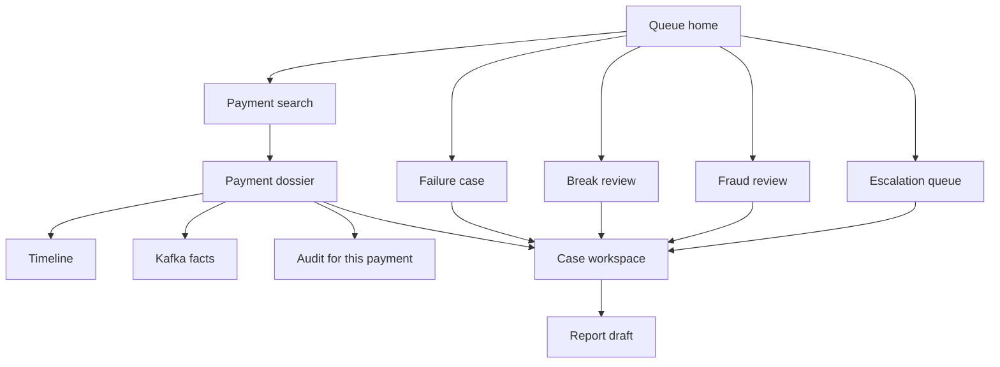
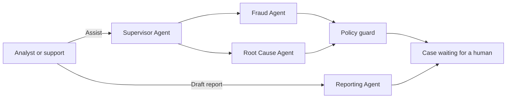
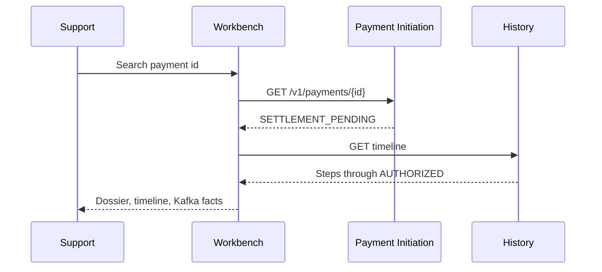
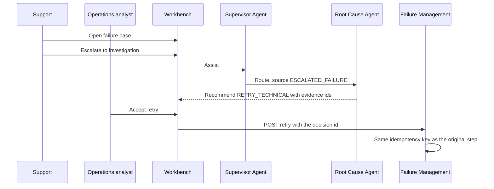
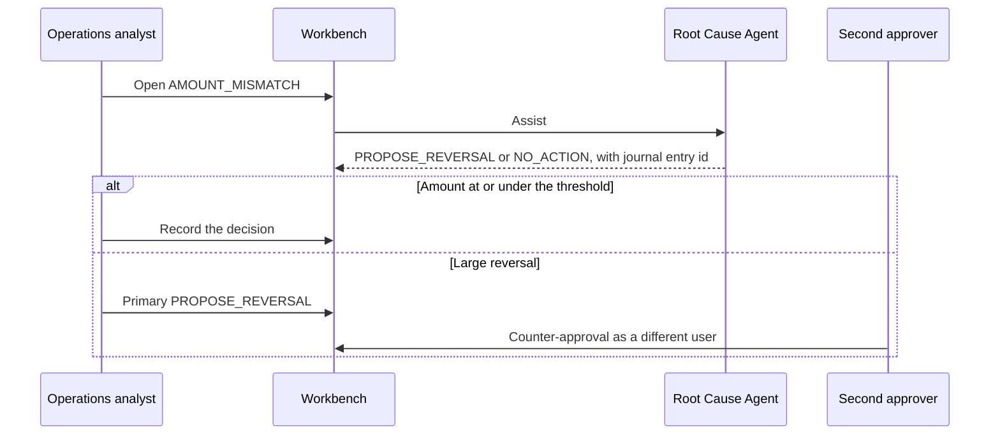
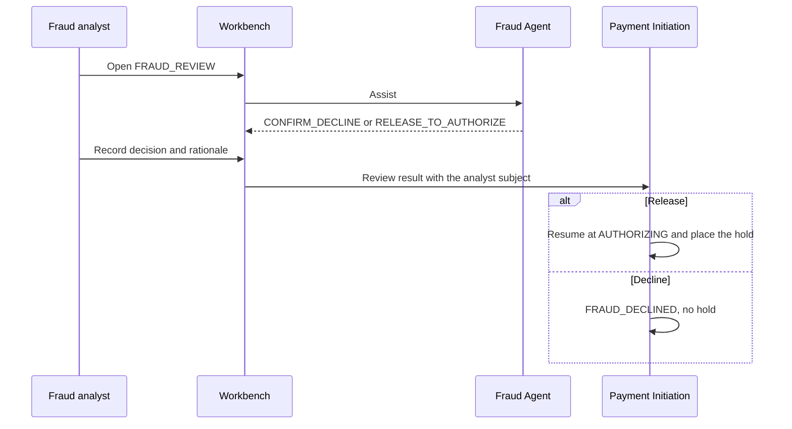

# 13. Investigation workbench

| | |
| --- | --- |
| Status | Proposed |
| Audience | Operations, fraud, support, and the investigation service owner |
| Related | [Agentic AI](05-agentic-ai-architecture.md), [API architecture](06-api-architecture.md), [Security](07-security-architecture.md), [Failure scenarios](12-failure-scenarios.md) |

The investigation workbench is the operator console for payments that need a person. It searches one payment, shows the timeline and the Kafka facts behind it, and hosts fraud review, reconciliation review, failure investigation, and escalation. Agents draft recommendations and reports. Humans decide anything that changes a payment.

The console is a client of the existing APIs. It does not write payment status, holds, or journal entries itself. Those writes stay in Payment Initiation, Failure Management, and Ledger, and they run only after a recorded human decision.

Agent behavior, tool limits, and the policy guard are specified in the [agent architecture](05-agentic-ai-architecture.md). This document names the four agents as operators see them and binds them to those controls. The workbench does not add a second agent runtime.

## Who uses it

Sign-in is the bank identity provider with MFA. The console reads roles from the access token and hides every action the role cannot perform. The API still enforces the role. A hidden button is not the control.

| User | Daily work | Roles | Decisions they can record |
| --- | --- | --- | --- |
| Operations analyst | Breaks, settlement delays, technical recovery | `payments.case.read`, `payments.case.decide`, `payments.recon.read`, `payments.ops.read` | `RETRY_TECHNICAL`, `NO_ACTION`, `ESCALATE`, and `PROPOSE_REVERSAL` at or under the four-eyes threshold |
| Fraud analyst | `FRAUD_REVIEW` queue | `payments.case.read`, `payments.case.decide` | `CONFIRM_DECLINE`, `RELEASE_TO_AUTHORIZE`, `ESCALATE` |
| Senior investigator | Escalations and second approval | The decide role plus `payments.case.approve-reversal` | Counter-approval of a large reversal, and any disposition already allowed by their analyst role |
| Support engineer | Find a payment and explain its status | `payments.read`, `payments.ops.read`, `payments.case.read` | None. Support can open an escalation. Support cannot assist a fraud case into revealing the feature snapshot. |
| Auditor | Reconstruct who looked and who decided | `payments.audit.read` | None. The audit pages are read-only. |

A person who submitted the payment cannot decide its case, even if their token has both `payments.write` and `payments.case.decide`. The console disables the decision bar and the API rejects the call.

Fraud analysts do not see the reversal action. Operations analysts do not see `RELEASE_TO_AUTHORIZE`. The disposition catalog is filtered by both the case source and the role.

## Sitemap

The console route is under `/workbench`. Deep links carry the payment id or the case id. Browser refresh returns the same server state. The console holds no private copy of the ledger.

| Page | Route | Purpose |
| --- | --- | --- |
| Queue home | `/workbench` | Counts and oldest age for fraud review, open breaks, technical failures, escalations, and approvals waiting on this user |
| Payment search | `/workbench/search` | Find one payment |
| Payment dossier | `/workbench/payments/{paymentId}` | Status, amount, rail, value date, hold, journal id, reason code, linked cases |
| Timeline | `/workbench/payments/{paymentId}/timeline` | Ordered business steps from Transaction History |
| Kafka facts | `/workbench/payments/{paymentId}/events` | Committed events for this payment from the history projection and the audit archive |
| Payment audit | `/workbench/payments/{paymentId}/audit` | Who viewed, decided, retried, and published |
| Failure case | `/workbench/failures/{caseId}` | Attempts, next retry, dependency, link into the scenario |
| Break review | `/workbench/breaks/{breakId}` | Our item beside the statement line |
| Fraud review | `/workbench/cases/{caseId}` | Assessment, rules, recommendation, decision |
| Case workspace | `/workbench/cases/{caseId}` | Shared shell for every investigation case |
| Escalation queue | `/workbench/escalations` | Cases in `ESCALATE` and failure cases a support engineer has sent for investigation |
| Report draft | `/workbench/cases/{caseId}/report` | Reporting Agent draft and the publish action |

Account numbers render as the last four digits. Remittance is visible on the case to fraud and operations analysts and is marked untrusted. It is omitted from exports and from the Reporting Agent's published report. The console has no control that reveals a full account number.

## What each page shows

### Queue home

Four columns, each a queue the signed-in user is allowed to see.

| Column | Ordered by | Row shows |
| --- | --- | --- |
| Fraud review | Oldest `FRAUD_REVIEW` | Payment id, amount, rail, score, policy version, age |
| Reconciliation | Severity, then age | Break class, amount, value date, payment id |
| Technical failures | Next attempt time, then age | Case type, reason code, attempt count |
| Waiting on me | Decision requested time | Disposition requested, whether a second approver is required |

Support engineers see technical failures and search. They do not see fraud scores.

### Payment search

One search box. The query is interpreted in this order: `payment_id`, end-to-end id plus debtor account id, idempotency key. A search that the caller may not see returns the same empty state as an unknown id, matching the API's `404` rule.

Results open the dossier. The page does not offer a bulk export of every payment for an account. Account activity remains the history API, paged, for callers who already have `payments.read` on that account.

### Payment dossier

The header is the operational answer from Payment Initiation: status, reason code, rail, amount, value date, hold id, journal entry id, correlation id.

| Region | Source | Empty means |
| --- | --- | --- |
| Parties | Initiation, names and last four | External creditor has no internal account id |
| Balances at decision | Ledger read for this payment's hold and postings | No hold was placed |
| Linked work | Failure case, break, investigation case | Straight-through payment with nothing open |
| Agent strip | Latest session status | No assistance has been requested, or the kill switch is off |

The dossier links to timeline, Kafka facts, and audit. It does not embed a second status from the history projection. When history lags, the page says the timeline is behind the operational status instead of showing two competing statuses as equals.

### Timeline

Each row is a history projection item: time, summary code, status, event id. Selecting a row opens the matching Kafka fact. This is the page an analyst uses to tell Maya's story from `RECEIVED` to `SETTLED` or `FAILED`.

### Kafka facts

This view is a read model of committed facts for one payment. It is not a broker login and it is not a topic browser.

| Column | Example |
| --- | --- |
| Time | Commit time from the event |
| Topic | `payments.payment.lifecycle.v1` |
| Event id | UUIDv7 |
| Type | Status `SETTLEMENT_PENDING` |
| Causation | Prior event id |
| Trace | Link to the trace in Grafana when `traceparent` was stored with the audit record |

Facts included are the lifecycle spine, the fraud assessment summary, ledger movements for this payment, the settlement command and item, a break, a failure case, and an investigation case. Payloads follow the event design: no remittance and no raw account numbers. Unpublished outbox rows appear in a separate "waiting to publish" strip for support engineers, sourced from the owning service's health detail, so a Kafka outage is visible before the fact exists on the topic.

### Failure, break, and fraud pages

They are filters and evidence layouts on top of the case workspace.

| Page | Evidence beside the narrative |
| --- | --- |
| Failure | Attempt list, last `detail_code`, dependency named in the [failure scenarios](12-failure-scenarios.md), hold and journal counts |
| Break | Side-by-side amount, currency, value date, end-to-end id. Difference highlighted. Original journal lines, read-only. |
| Fraud | Decision, score, policy version, rule ids. Feature snapshot only for the fraud analyst role. Similar-payment counts, not other customers' names. |

## Agents on the console

One Investigation Agent deployable runs four roles. A role is a prompt, a tool subset, and an output schema. The Supervisor picks at most one specialist per session. Specialists do not call each other. A second opinion is a new session a human requests.

| Workbench name | Architecture role | Starts | Allowed output |
| --- | --- | --- | --- |
| Supervisor Agent | Triage supervisor | Every assisted run | Which specialist to run, or `ESCALATE` with no specialist |
| Fraud Agent | Fraud investigator | Source `FRAUD_REVIEW` | `CONFIRM_DECLINE`, `RELEASE_TO_AUTHORIZE`, `ESCALATE` |
| Root Cause Agent | Failure investigator, and the recon investigator when the source is a break | `ESCALATED_FAILURE` or `RECON_BREAK` | On a failure: `RETRY_TECHNICAL`, `NO_ACTION`, `ESCALATE`. On a break: those plus `PROPOSE_REVERSAL`. |
| Reporting Agent | Report drafter | A human asks, after evidence exists | A report draft. No disposition the decision API can execute. |

The Supervisor cannot call `get_fraud_assessment`, `get_ledger_movements`, or `record_recommendation` with a money-moving disposition. It sees case source, age, severity, and status.

The Fraud Agent uses the fraud tool subset from the agent architecture, including the feature snapshot, and only for the case's payment.

The Root Cause Agent uses the failure and reconciliation tools: payment, timeline, ledger movements, settlement item, break, failure attempts, and the runbook. On a failure case it cannot emit `PROPOSE_REVERSAL`. On a break it can. It cannot emit `RELEASE_TO_AUTHORIZE` or `CONFIRM_DECLINE`.

The Reporting Agent reads the case, the timeline, stored recommendations, and human decisions already on the case. It does not read the feature snapshot, remittance, or party names. Its only write is a draft report stored on the case. The policy guard rejects a draft that contains a full account-number pattern or a disposition presented as already executed.

Session budgets stay as specified: 8 turns, 60 seconds, and a token ceiling. The console shows `RUNNING`, `COMPLETED`, `STOPPED`, or `FAILED`. A failed policy guard shows "session failed validation" and does not show the rejected text as advice.

The assist button is disabled when `investigation.agent.enabled` is off. Queues, search, timeline, and human decisions keep working. The banner reads that assistance is paused.

## Workflows

### Search and explain a payment

Support uses this when Maya asks why a payment is pending.

Support reads the reason and the waiting-to-publish strip. They do not retry settlement from this page. If the payment is `FAILED` or a failure case is open, they continue into the failure workflow.

### Trace Kafka events

From the dossier, Support opens Kafka facts. The page lists committed events in commit order and links each lifecycle row to its trace. During a broker outage the strip shows unpublished outbox rows and an empty tail on the topic. Support uses that pair to tell operations "the decision is stored and the command has not been published." They do not replay a topic from the console.

### View the timeline

The timeline is the business narrative. Kafka facts are the integration log underneath it. Analysts start on the timeline and open a fact when a step is missing or duplicated. A duplicate event id with one timeline row means the projector's idempotency worked. Two timeline rows for one event id is a defect to escalate.

### Investigate a failure

The recommendation names the dependency in the language of the failure scenarios: fraud time limiter, validation circuit, ledger failover, settlement `POST_UNCERTAIN`, or unpublished outbox. The analyst can choose `NO_ACTION` or `ESCALATE` instead. Accepting `RETRY_TECHNICAL` is the human approval. The console does not call Ledger.

### Reconciliation review

The break page keeps the statement amount and the posted amount on screen until the case closes. `NO_ACTION` resolves the break as accepted difference in the books we posted. `PROPOSE_REVERSAL` does not edit the original lines. After both required approvals, Failure Management requests the reversing post. The original payment stays `SETTLED`.

### Fraud review

The Fraud Agent's narrative is on the right. The assessment and rule ids are on the left, loaded from the fraud API, so the analyst is not reading the model as the only source. `RELEASE_TO_AUTHORIZE` is enabled only for a fraud analyst who did not initiate the payment. Until that decision, the dossier shows no hold.

### Escalation

Escalation moves a case to the senior queue. It does not change payment status.

| From | Who can send | What they record | Where it lands |
| --- | --- | --- | --- |
| Failure case | Support engineer or operations analyst | Note and `ESCALATE` | New investigation case, source `ESCALATED_FAILURE` |
| Fraud review or break | Analyst with `payments.case.decide` | Disposition `ESCALATE` and a rationale | Same case, status stays open, queue becomes senior |
| Agent session | Supervisor or specialist recommendation | `ESCALATE` inside the recommendation | Still requires a human to accept it |

The senior queue shows who escalated, when, and the note. The senior investigator may decide or send it back with `NO_ACTION` only when they are closing it without a money movement. Sending it back for more evidence is another note, and the case stays escalated.

A large reversal always escalates into the second-approver step even when the first analyst did not choose `ESCALATE`. The UI shows "waiting for a different approver" and removes the first analyst from the approver list.

### Reporting

A fraud or operations analyst opens the report tab on a case that already has a human decision, or on a set of cases they closed this shift. The Reporting Agent drafts:

| Section | Contents |
| --- | --- |
| Scope | Case ids, payment ids, time range |
| Outcome | Statuses and dispositions actually recorded by humans |
| Evidence | Evidence ids and runbook ids already stored |
| Open items | Cases still `AWAITING_HUMAN` or `ESCALATED` |
| Money movement | Hold id or journal entry id when one exists. The draft does not say a reversal happened unless the human decision and the ledger movement both exist. |

The analyst edits nothing inside the model output except to reject the draft and request another session. Publish stores the draft as the case report and writes an audit row with the publisher's subject. Publish does not call Initiation, Failure Management, or Ledger.

## Human approval

Every row that changes a payment is a human decision. Agents are absent from the approver column.

| Action | First human | Second human | Agent may recommend | Effect after approval |
| --- | --- | --- | --- | --- |
| Confirm fraud decline | Fraud analyst | No | Fraud Agent | `FRAUD_DECLINED`, no hold |
| Release fraud review to authorization | Fraud analyst who did not create the payment | No | Fraud Agent | Saga resumes at `AUTHORIZING` |
| Retry a technical step | Operations analyst | No | Root Cause Agent | Same idempotency key retried |
| Close with no money change | Analyst for that queue | No | Any specialist | Case closes, payment unchanged |
| Escalate | Analyst, or support for a failure | No | Supervisor Agent | Senior queue |
| Reversal at or under the threshold | Operations analyst | No | Root Cause Agent on a break | Reversing journal entry |
| Reversal above the threshold | Operations analyst | Different senior investigator with `payments.case.approve-reversal` | Root Cause Agent on a break | Reversing entry only after both decisions |
| Publish a report | Fraud or operations analyst | No | Reporting Agent drafts only | Report stored. No payment effect. |

The decision bar requires a rationale of at least a sentence and at most 512 characters, matching `human_decision.rationale`. The button stays disabled until a rationale is present. The console posts `POST /v1/cases/{caseId}/decisions` for the primary decision and `POST /v1/cases/{caseId}/approvals` for the counter-approval.

The second approver sees the first decision, the agent recommendation, and the journal entry id side by side. They cannot reuse the first analyst's session. Their token subject must differ. The API uniqueness rules reject a same-person approval even if the UI were bypassed.

`RETRY_TECHNICAL` on a step that never committed is still an approval, because it resumes a payment that was fail-closed. The analyst is accountable for that resume.

## Audit requirements

The console writes audit through the same path as the rest of the platform: an audit row and `platform.audit.recorded.v1` in the service that performed the action. The workbench does not keep a private log as the record.

| Action | Actor | Resource | Extra fields |
| --- | --- | --- | --- |
| Search that returns a payment | User | `payment` | Query kind: payment id, end-to-end id, or idempotency key. The raw query value is stored only when it is already a payment id. |
| Open dossier, timeline, or Kafka facts | User | `payment` | Page name |
| Open a fraud feature snapshot | User | `fraud_assessment` | Assessment id. Denied attempts are audited too. |
| Request assistance | User | `agent_session` | Agent role requested |
| Tool call inside a session | `AGENT` | Tool name and case | Already stored as `agent_tool_call`, plus an audit event |
| Policy guard rejection | `AGENT` | `agent_session` | Guard check that failed. The rejected narrative is not copied into the audit event. |
| Primary decision | User | `investigation_case` | Disposition, not the full remittance |
| Counter-approval | User | `investigation_case` | `COUNTER_APPROVAL` and the first decision id |
| Escalation | User | `investigation_case` or `failure_case` | Destination queue |
| Report draft created | `AGENT` | `case_report` | Session id and model route |
| Report published | User | `case_report` | Publisher subject |
| Assist attempted while the kill switch is off | User | `investigation_case` | Denied |

Audit rows are insert-only and retained 7 years with the rest of the audit archive. The payment audit page reads `GET /v1/audit/payments/{paymentId}` and is limited to `payments.audit.read` plus the analyst roles that already have case access for that payment. Support engineers see operational events for payments in their search scope and do not see fraud feature-snapshot access events.

Logs and traces from the console follow the monitoring rules. Page views carry `payment_id`, `case_id`, and `trace_id`. They do not carry remittance, party names, or full account numbers.

## What the console refuses to do

| Request | Result |
| --- | --- |
| Post, release, or edit a journal line from a button that skips the decision API | No such button. The case API is the only write. |
| Let the Reporting Agent mark a reversal complete | The draft can quote a journal entry id that already exists. It cannot create one. |
| Let Support accept `RELEASE_TO_AUTHORIZE` | Role check on the decision bar and on the API |
| Let the Fraud Agent recommend a reversal | Policy guard rejects the disposition |
| Let one person be both approvers | Unique `(case_id, decided_by)` |
| Browse a Kafka topic or run a consumer | The facts page is payment-scoped |
| Export a list of customers | Search and queues are paged and scoped. There is no export of a population. |

## Operational states the console must show

| Platform condition | Console behavior |
| --- | --- |
| LLM circuit open | Assist and draft show paused. Queues stay usable. |
| History projector lagging | Dossier status stays on Initiation. Timeline shows its watermark time. |
| Outbox unpublished | Kafka facts page shows the waiting strip. |
| Case `AWAITING_HUMAN` | Decision bar is the primary action for a role that can decide. |
| Session `FAILED` validation | Recommendation pane is empty of advice. Tool-call list remains. |
| Payment `SETTLED` with an open break | Header stays `SETTLED`. The break banner links to review. |

## How this stays consistent with the payment platform

Search uses Payment Initiation for status and Transaction History for the timeline. Kafka facts are the committed event archive, not a second book of record. Fraud release and decline go to Initiation. Technical retry and reversal go to Failure Management after approval. The four agents propose. The approval table is the list of people who can make those proposals real.
