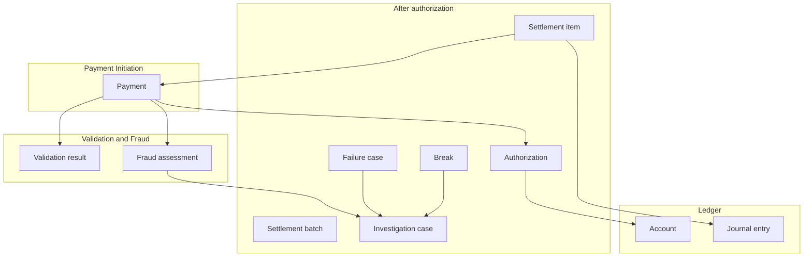
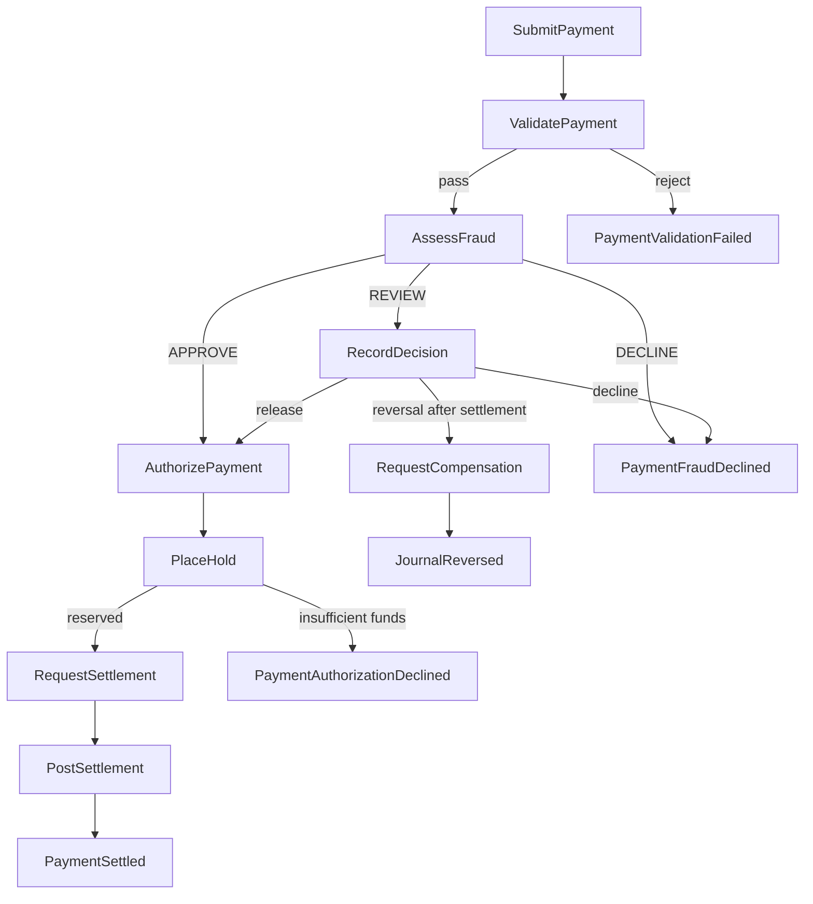

# 14. Event storming

| | |
| --- | --- |
| Status | Proposed |
| Audience | Engineers modeling the payment domain |
| Related | [High-level architecture](01-high-level-architecture.md), [Service boundaries](02-service-boundaries.md), [Kafka event design](03-kafka-event-design.md), [Domain guide](11-payment-domain-guide.md) |

This is the event-storming model of the Agentic Payment Operations Platform. A command is a request to change one aggregate. A domain event is a fact that aggregate has already committed. A policy is the rule "when this fact is true, issue that command." A read model is a query shape built from facts. An external system sits outside the bounded contexts and sends commands or files in.

The storm uses past-tense business names. The wire format stays the catalog in the [Kafka design](03-kafka-event-design.md). Payment status facts share one topic, `payments.payment.lifecycle.v1`, and only Payment Initiation publishes that topic. This document does not add topics.

## Notation

| Sticky | Meaning in APOP |
| --- | --- |
| Actor | A person or channel that issues a command |
| Command | An intention inside one consistency boundary |
| Aggregate | The cluster of rules committed in one transaction |
| Domain event | A fact recorded in that transaction |
| Policy | An automatic reaction that issues the next command |
| Read model | A projection someone queries |
| External system | A system outside the payment bounded contexts |
| Hot spot | A place where the team must be explicit because the rule is easy to get wrong |

Actors in this storm are the channel, the fraud analyst, the operations analyst, the support engineer, and the senior approver. Their console is the [investigation workbench](13-investigation-workbench.md). Agents recommend. They are not actors on commands that move money.

## External systems

| System | What crosses the boundary | Inside the platform |
| --- | --- | --- |
| Channel application | `SubmitPayment`, `CancelPayment`, and status reads | API Gateway then Payment Initiation |
| Identity provider | Authenticated subject, roles, legal entity | Gateway rejects unauthenticated calls |
| Screening reference | Hit or clear, through the validation screening port | A hit becomes `PaymentValidationFailed` |
| Rail statement drop | Statement file for a value date | Reconciliation imports it. In non-production the rail simulator writes the file. The simulator is not a book of record. |
| Enterprise LLM gateway | Redacted investigation prompts | Investigation Agent only. The hot path does not call it. |

Clearing houses and card networks are outside version 1. ACH and wire exist here as simulated rails with the same command and event shape a later network adapter would use.

## Aggregates

Each aggregate is owned by one service and stored in that service's database. Another service may store the same `payment_id` as a reference. It may not change the owner's state.

| Aggregate | Context | Identity | Invariant |
| --- | --- | --- | --- |
| Payment | Payment Initiation | `payment_id` | One status writer. One effect per idempotency key. Cancel only before the settlement batch locks. `SETTLED` is not edited. |
| Validation result | Payment Validation | `payment_id` | One result per payment key. A business reject has a reason code. |
| Fraud assessment | Fraud Detection | `payment_id` | One assessment per payment key. Decision is `APPROVE`, `REVIEW`, or `DECLINE` under a policy version. |
| Authorization | Payment Authorization | `payment_id` | `AUTHORIZED` exists only with a hold id. |
| Account | Ledger | `account_id` | Available balance of a customer account stays at or above zero. Holds and postings for that account commit on this row. |
| Journal entry | Ledger | `journal_entry_id` | Debits equal credits in one currency. Lines are insert-only. One entry per ledger idempotency key. |
| Settlement batch | Payment Settlement | `batch_id` | Membership is fixed once the window locks. |
| Settlement item | Payment Settlement | `payment_id` | One item per payment. Posting uses one ledger key. |
| Reconciliation run | Reconciliation | `recon_run_id` | A file hash is imported once. A matched item has one statement line. |
| Break | Reconciliation | `break_id` | A break records disagreement. It does not change the journal. |
| Failure case | Failure Management | `case_id` | Retries reuse the original step key. Automatic compensation releases a hold only when no posting exists. |
| Investigation case | Investigation | `case_id` | One case per source reference. A money movement waits for a human decision. Large reversals have two different subjects. |

History is not an aggregate. It is a read model and can be rebuilt. The journal is an aggregate and is the book of record.

## Commands

A command names one aggregate and one idempotency key. Synchronous commands are internal HTTP. Two commands are Kafka records because they must survive a restart and a rail window.

| Command | Issuer | Aggregate | Transport |
| --- | --- | --- | --- |
| `SubmitPayment` | Channel | Payment | `POST /v1/payments` |
| `CancelPayment` | Channel | Payment | `POST /v1/payments/{id}/cancellations` |
| `ValidatePayment` | Policy after `PaymentReceived` | Validation result | `POST /internal/v1/validations` |
| `AssessFraud` | Policy after `PaymentValidated` | Fraud assessment | `POST /internal/v1/fraud-assessments` |
| `AuthorizePayment` | Policy after fraud `APPROVE`, or after a human release | Authorization | `POST /internal/v1/authorizations` |
| `PlaceHold` | Authorization | Account | `POST /internal/v1/holds` |
| `ReleaseHold` | Authorization, on cancel | Account | `POST /internal/v1/hold-releases` |
| `RequestSettlement` | Policy after `PaymentAuthorized` | Settlement item | `payments.command.settlement.v1` |
| `LockBatch` | Settlement window clock | Settlement batch | Inside Settlement |
| `PostSettlement` | Policy when the item's window is due | Journal entry | `POST /internal/v1/postings` |
| `ImportStatement` | Rail file drop | Reconciliation run | File intake |
| `MatchStatement` | Policy after the file is loaded | Break or match | Inside Reconciliation |
| `OpenFailureCase` | Policy on uncertainty or a dead letter | Failure case | Inside Failure Management |
| `RetryStep` | Human `RETRY_TECHNICAL` | Failure case | `POST /internal/v1/failure-cases/{id}/retries` |
| `RequestCompensation` | Expiry policy, or an approved reversal | Journal entry or Account | `payments.command.compensation.v1` |
| `OpenInvestigation` | Policy on fraud review, high-severity break, or escalation | Investigation case | Intake consumer |
| `RecordDecision` | Fraud or operations analyst | Investigation case | `POST /v1/cases/{id}/decisions` |
| `ApproveReversal` | Second human, large amount | Investigation case | `POST /v1/cases/{id}/approvals` |
| `ApplyReviewResult` | Policy after a fraud decision | Payment | `POST /internal/v1/payments/{id}/review-results` |

`RequestSettlement` is published in the same database transaction as the payment status `SETTLEMENT_PENDING`. `RequestCompensation` with `POST_REVERSAL` carries a human subject. `RELEASE_HOLD` may carry `POLICY` when the hold expired or the payment was cancelled before any posting.

## Domain events

### Why a fact is published

An event exists so another context can react without sharing the writer's tables. If only the writer needs the fact, it stays a row inside that aggregate. The table says which is which.

| Domain event | Why it exists | Published as |
| --- | --- | --- |
| `PaymentReceived` | The instruction and the idempotency hash are durable before any risk call or hold. Retries and audits need that moment. | Lifecycle status `RECEIVED` |
| `PaymentValidated` | Validation passed, so fraud is allowed to run. The channel and history can show the payment moved past structure and limits. | Lifecycle status `FRAUD_SCREENING` |
| `PaymentValidationFailed` | A business rule rejected the instruction. Nothing downstream may authorize it, and the same key must replay this reject. | Lifecycle status `VALIDATION_FAILED` |
| `FraudAssessmentCompleted` | The risk decision, score, and policy version must be explainable without copying the feature snapshot onto every consumer. | `payments.fraud.assessment.v1` |
| `PaymentHeldForFraudReview` | A person must decide before any hold. Investigation intake depends on this fact. | Lifecycle status `FRAUD_REVIEW` |
| `PaymentFraudDeclined` | Risk, or an analyst, refused the payment. Authorization must not run. | Lifecycle status `FRAUD_DECLINED` |
| `PaymentAuthorizationDeclined` | Funds were not reserved. The reason is usually insufficient available balance. History must show a decision rather than a missing row. | Lifecycle status `AUTHORIZATION_DECLINED` |
| `FundsHeld` | Available balance changed on one account. Account-ordered consumers, including history, need the reservation itself, not only the payment status. | `payments.ledger.movement.v1` `HOLD_PLACED` |
| `PaymentAuthorized` | The payment aggregate now has a hold id. Settlement is allowed to start, and the channel can be told yes. | Lifecycle status `AUTHORIZED` |
| `PaymentSettlementPending` | The settlement command and the status were committed together. Operators can see a yes that is not yet final. | Lifecycle status `SETTLEMENT_PENDING` |
| `SettlementBatchLocked` | Batch membership is frozen. Cancellation and hold expiry must stop for items in that batch. | `payments.settlement.batch.v1` |
| `JournalPosted` | Ledger balances changed through a balanced entry. This is the book-of-record fact. Payment status alone is not a posting. | `payments.ledger.movement.v1` `POSTED`, one record per account |
| `FundsReleased` | A hold ended without a posting, or was consumed as part of posting. Available balance must be explainable. | `payments.ledger.movement.v1` `HOLD_RELEASED` |
| `SettlementItemPosted` | Settlement finished its item and recorded the journal entry id. Initiation uses this fact to mark the payment settled. Initiation does not watch the ledger topic to invent that status. | `payments.settlement.item.v1` |
| `PaymentSettled` | The single status writer has accepted settlement. Channels and the workbench treat this as final. | Lifecycle status `SETTLED` |
| `PaymentSettlementFailed` | The post was refused or the window could not complete. The hold is still a concern and failure handling needs a status. | Lifecycle status `SETTLEMENT_FAILED` |
| `PaymentCancelled` | The channel withdrew the payment before lock, and the hold release path was accepted. | Lifecycle status `CANCELLED` |
| `PaymentFailed` | A technical stop or hold expiry happened. This is not a business decline, so recovery is allowed to leave this status. | Lifecycle status `FAILED` |
| `JournalReversed` | A later entry undid an earlier one. Auditors need both facts. The original `JournalPosted` remains true. | `payments.ledger.movement.v1` `REVERSED` |
| `ReconciliationBreakOpened` | Our item and the statement disagree. Investigation must open without anyone editing the journal. | `payments.reconciliation.break.v1` |
| `ReconciliationBreakResolved` | A human disposition closed the disagreement. The queue and the audit need the end of the break. | `payments.reconciliation.break.v1` |
| `FailureCaseOpened` | Uncertainty or a poison message is now durable work, with attempts and a next time. | `payments.failure.case.v1` |
| `InvestigationCaseOpened` | A fraud review, break, or escalation is waiting for a person. The workbench queue is built from this. | `payments.investigation.case.v1` |
| `InvestigationRecommendationIssued` | An agent produced a guarded recommendation. It is not a decision, and analysts must see that it exists. | `payments.investigation.case.v1` with a recommendation id |
| `InvestigationDecisionRecorded` | A named human accepted a disposition. Downstream policies are allowed to run only after this fact. | `payments.investigation.case.v1` with the human decision |
| `AuditRecorded` | Who did it, across services, for reconstruction after traces expire. | `platform.audit.recorded.v1` |

These facts stay inside their aggregate and are not platform topics:

| Local fact | Why it is not a platform event |
| --- | --- |
| Validation result row | Initiation already turns the HTTP result into `PaymentValidated` or `PaymentValidationFailed`. A second event would let two facts disagree. |
| `ReconciliationMatched` | No other context changes behavior on a clean match. The absence of a break is the signal. |
| Agent tool-call rows | They are audit evidence for one session. The recommendation event is the fact other contexts can see. |
| Idempotency replay | Returning the original resource is a query of the aggregate, not a new business fact. |

## Policies

A policy is deterministic code. It is not an agent. If the policy's command fails, the step is `UNCERTAIN` or a failure case. The policy does not invent a decline.

| When this fact is true | Issue this command | Stop when |
| --- | --- | --- |
| `PaymentReceived` | `ValidatePayment` | Validation cannot be reached. Fail closed. No fraud call and no hold. |
| `PaymentValidated` | `AssessFraud` | Fraud or velocity data cannot be scored. Fail closed. No hold. |
| `FraudAssessmentCompleted` with `APPROVE` | `AuthorizePayment` | |
| `FraudAssessmentCompleted` with `REVIEW` | `OpenInvestigation` | Do not authorize. |
| `FraudAssessmentCompleted` with `DECLINE` | None | Payment becomes `PaymentFraudDeclined`. |
| `PaymentAuthorized` | `RequestSettlement` | Same transaction as `PaymentSettlementPending`. |
| Window due and batch locked | `PostSettlement` | Ledger uncertainty becomes `POST_UNCERTAIN`, then `RetryStep` with the same ledger key. |
| `SettlementItemPosted` | Mark the payment settled inside Initiation | Initiation is the status writer. |
| Statement file loaded | `MatchStatement` | An unreadable file opens a failure case. A mismatch opens a break. |
| `ReconciliationBreakOpened` at high severity, or any `PaymentHeldForFraudReview` | `OpenInvestigation` | Low-severity breaks wait for an analyst to request assistance. |
| Step `UNCERTAIN` past the grace period, or a dead letter | `OpenFailureCase` | |
| Hold expiry before batch lock | `RequestCompensation` `RELEASE_HOLD` | Then Initiation records `PaymentFailed` with `HOLD_EXPIRED`. |
| `InvestigationDecisionRecorded` as `RELEASE_TO_AUTHORIZE` | `ApplyReviewResult`, which continues at `AuthorizePayment` | The subject must be a fraud analyst who did not submit the payment. |
| `InvestigationDecisionRecorded` as `CONFIRM_DECLINE` | `ApplyReviewResult` | Status becomes `PaymentFraudDeclined`. |
| `InvestigationDecisionRecorded` as `RETRY_TECHNICAL` | `RetryStep` | Same business key as the failed step. |
| `InvestigationDecisionRecorded` as `PROPOSE_REVERSAL`, and a second approval when the amount is large | `RequestCompensation` `POST_REVERSAL` | `approved_by` is a human. The agent is never that human. |
| Same idempotency key and same request hash | Return the original payment | A different hash conflicts. No command runs. |

## Read models

| Read model | Built from | Queried by | Rebuild |
| --- | --- | --- | --- |
| Payment status | The Payment aggregate itself | Channel `GET /v1/payments/{id}` | Restored with the initiation database. It is not rebuilt from Kafka. |
| Payment timeline and payment history | Lifecycle, fraud summary, ledger movements, settlement items | Workbench and account activity | Yes, from the event archive |
| Account activity | Ledger movements | Channel and dossier | Yes, from the event archive |
| Fraud review queue | `PaymentHeldForFraudReview` and investigation cases | Fraud analyst | Yes, from investigation and lifecycle facts |
| Break queue | `ReconciliationBreakOpened` | Operations analyst | Yes |
| Failure queue | `FailureCaseOpened` | Support and operations | Yes |
| Escalation queue | `InvestigationDecisionRecorded` with `ESCALATE`, and escalated failures | Senior investigator | Yes |
| Audit trail | `AuditRecorded` | Auditor and the payment audit page | The archive is the long-term copy |

The workbench shows initiation status and the timeline together, and it labels the timeline when the projector is behind. The timeline is not allowed to override the payment aggregate.

## Lifecycle

### Payment created

The channel issues `SubmitPayment`. The Payment aggregate commits `PaymentReceived` only when the idempotency record is stored. That event exists so a lost HTTP response can return the same payment, and so no hold can exist for an instruction the platform does not remember.

### Payment validated

Policy issues `ValidatePayment`. The validation aggregate records a pass or a reject. Initiation then commits either `PaymentValidated` or `PaymentValidationFailed`. The failure event exists so fraud and ledger never see a structurally illegal, over-limit, or screening-hit payment. The pass event exists so the next policy can start fraud without reading the validation tables.

### Fraud review

`AssessFraud` commits `FraudAssessmentCompleted`. Three policies follow the decision. `APPROVE` continues. `DECLINE` commits `PaymentFraudDeclined` and stops. `REVIEW` commits `PaymentHeldForFraudReview` and `OpenInvestigation`. Those two events exist so a human queue can form while available balance is still unchanged. A later `InvestigationDecisionRecorded` is what releases or declines the payment. The recommendation event exists so the workbench can show advice that is not yet a decision.

### Authorization

`AuthorizePayment` issues `PlaceHold` on the debtor account. The account aggregate either commits `FundsHeld` or refuses. Authorization then has a decision, and Initiation commits `PaymentAuthorized` or `PaymentAuthorizationDeclined`. `FundsHeld` exists because available balance is an account fact. `PaymentAuthorized` exists because settlement is a payment fact. Both are required: a hold without an authorized payment is an orphan reservation, and an authorized payment without a hold is a promise the ledger does not back.

### Settlement

`RequestSettlement` is the command, and `PaymentSettlementPending` is the fact that the command was stored. The window policy locks the batch, then `PostSettlement` commits `JournalPosted` and consumes the hold. `SettlementItemPosted` tells Initiation the item is done. `PaymentSettled` is the status fact channels read. Splitting these events keeps the journal, the batch, and the payment status in three aggregates that can fail and retry independently, with one ledger key and one status writer.

### Reconciliation

`ImportStatement` loads the rail file. `MatchStatement` either records a local match or commits `ReconciliationBreakOpened`. The break event exists so investigation and the operations queue hear about disagreement. A match has no platform event because no other aggregate changes. Resolution waits for `InvestigationDecisionRecorded` when money would move, then `ReconciliationBreakResolved` closes the queue item. The original `JournalPosted` stays in the log.

### Investigation

`InvestigationCaseOpened` is the queue fact. The Supervisor, Fraud, and Root Cause agents run inside the case and may commit `InvestigationRecommendationIssued`. `InvestigationDecisionRecorded` is the only investigation fact that policies turn into `ApplyReviewResult`, `RetryStep`, or `RequestCompensation`. It exists so every later money movement points at a person. `JournalReversed` exists when that compensation posts, and it does not erase `JournalPosted`.

## Command flow

Cancel is a command from `PaymentAuthorized` or `PaymentSettlementPending` before `SettlementBatchLocked`. It issues `ReleaseHold` and ends at `PaymentCancelled`. It is absent from the happy path above because a cancelled payment never posts.

## Event flow

```mermaid
flowchart LR
  received[PaymentReceived]
  validated[PaymentValidated]
  assessed[FraudAssessmentCompleted]
  held[FundsHeld]
  authorized[PaymentAuthorized]
  pending[PaymentSettlementPending]
  posted[JournalPosted]
  item[SettlementItemPosted]
  settled[PaymentSettled]
  brk[ReconciliationBreakOpened]
  caseOpen[InvestigationCaseOpened]
  decision[InvestigationDecisionRecorded]

  received --> validated
  validated --> assessed
  assessed --> held
  held --> authorized
  authorized --> pending
  pending --> posted
  posted --> item
  item --> settled
  settled --> brk
  assessed -->|REVIEW| caseOpen
  brk --> caseOpen
  caseOpen --> decision
```

Fraud decline, validation failure, and authorization decline end the flow at that fact. They have no edge into `FundsHeld` or `JournalPosted`. `PaymentFailed` is a side exit from an in-progress fact when a dependency is uncertain. Recovery re-enters at the command that stopped.

## Aggregate ownership

| Aggregate | Owner service | Commands it accepts | Events it commits |
| --- | --- | --- | --- |
| Payment | Payment Initiation | `SubmitPayment`, `CancelPayment`, `ApplyReviewResult` | Every lifecycle status, including created, validated, review, authorized, settled |
| Validation result | Payment Validation | `ValidatePayment` | Local result only |
| Fraud assessment | Fraud Detection | `AssessFraud` | `FraudAssessmentCompleted` |
| Authorization | Payment Authorization | `AuthorizePayment` | Local decision, after Ledger returns |
| Account and journal entry | Ledger | `PlaceHold`, `ReleaseHold`, `PostSettlement`, compensation | `FundsHeld`, `FundsReleased`, `JournalPosted`, `JournalReversed` |
| Settlement batch and item | Payment Settlement | `RequestSettlement`, `LockBatch`, `PostSettlement` | `SettlementBatchLocked`, `SettlementItemPosted` |
| Break | Reconciliation | `ImportStatement`, `MatchStatement` | `ReconciliationBreakOpened`, `ReconciliationBreakResolved` |
| Failure case | Failure Management | `OpenFailureCase`, `RetryStep`, `RequestCompensation` | `FailureCaseOpened` |
| Investigation case | Investigation Agent | `OpenInvestigation`, `RecordDecision`, `ApproveReversal` | `InvestigationCaseOpened`, `InvestigationRecommendationIssued`, `InvestigationDecisionRecorded` |

Payment Initiation is the owner of payment status even when the triggering fact came from Settlement or from a human decision. Those callers send a command or a fact. Initiation commits the lifecycle event.

## Event producers

| Event | Producer | Nobody else publishes it |
| --- | --- | --- |
| Lifecycle statuses | Payment Initiation | Settlement, fraud, and the workbench do not set status |
| `FraudAssessmentCompleted` | Fraud Detection | |
| Ledger movements | Ledger | Authorization and Settlement call Ledger. They do not emit the movement. |
| Settlement item and batch | Payment Settlement | |
| Breaks | Reconciliation | |
| Failure cases | Failure Management | |
| Investigation cases, recommendations, decisions | Investigation Agent | The agent role emits a recommendation only after the policy guard accepts it |
| `AuditRecorded` | The service that performed the action | |

## Event consumers

| Event | Consumers | What the consumer does |
| --- | --- | --- |
| Lifecycle | Transaction History | Projects timeline and payment history |
| Lifecycle `FRAUD_REVIEW` | Investigation intake | `OpenInvestigation` |
| Lifecycle terminal and failure statuses | Failure watch | Opens a failure case when the grace period says the step is stuck |
| Lifecycle | Audit archive | Long-term copy |
| `FraudAssessmentCompleted` | Transaction History, audit archive | Stores the decision summary, not the feature snapshot |
| Ledger movements | Transaction History | Account activity |
| Ledger movements | Payment Initiation hold-outcome consumer | Completes cancel and hold-expiry status |
| Ledger movements | Reconciliation | Internal side of a later match |
| `SettlementItemPosted` | Payment Initiation | Commits `PaymentSettled` or `PaymentSettlementFailed` |
| Settlement item | Transaction History, Reconciliation, audit archive | Projection and match input |
| Settlement batch | Reconciliation, rail simulator in non-production, audit archive | Statement expectation |
| `RequestSettlement` | Settlement executor | Creates the item and posts when the window is due |
| `RequestCompensation` | Ledger compensation consumer | Releases a hold or posts a reversal in process |
| Break opened | Investigation intake | Case for a high-severity break |
| Failure case | Investigation intake | Case only when the failure was escalated |
| Investigation case | Audit archive | The workbench reads the investigation API, which is the case aggregate, for the live queue |

Consumers are idempotent on event id. A second delivery does not place a second hold or open a second case.

## Hot spots

| Spot | Rule the storm fixed |
| --- | --- |
| Timeout during `PlaceHold` | The command may have committed. Replay `PlaceHold` with the same key. Do not emit `PaymentAuthorizationDeclined` from a timeout. |
| Who emits `PaymentSettled` | Settlement emits `SettlementItemPosted`. Initiation emits `PaymentSettled`. |
| Two ledger partitions for one payment | Movements are keyed by account. `journal_entry_id` ties the debit and the credit. |
| Fraud review | `PaymentHeldForFraudReview` does not cause `PlaceHold`. |
| Clean recon match | Local fact only. Publishing it would force every consumer to ignore the common case. |
| Agent recommendation | `InvestigationRecommendationIssued` does not satisfy the policies that require `InvestigationDecisionRecorded`. |

## How to use this in implementation

When a new fact seems necessary, name it in past tense, name the one aggregate that commits it, and name the policy or read model that would change if the fact did not exist. If no other context changes, keep the fact local. If it is a payment status, add a value to the lifecycle contract instead of a new topic. Commands that must survive a process restart are the two Kafka commands already listed. Everything else on the decision path stays a synchronous command to the owning aggregate.
