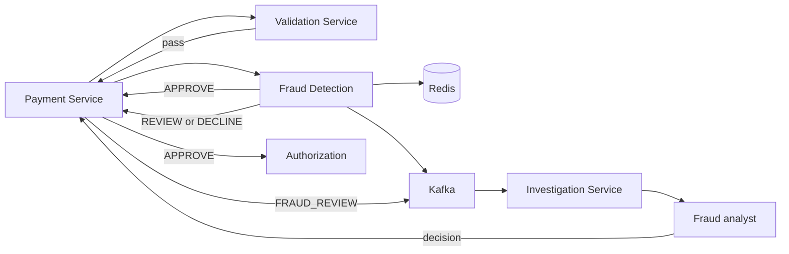
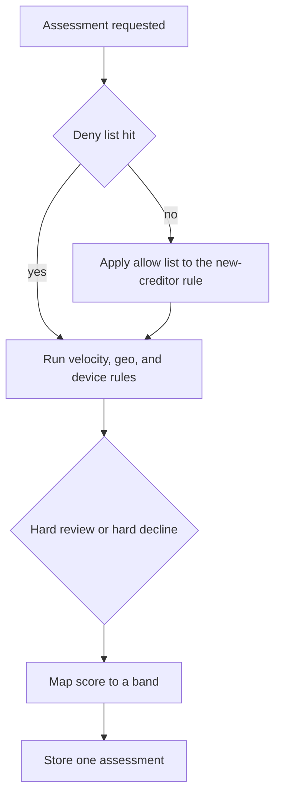
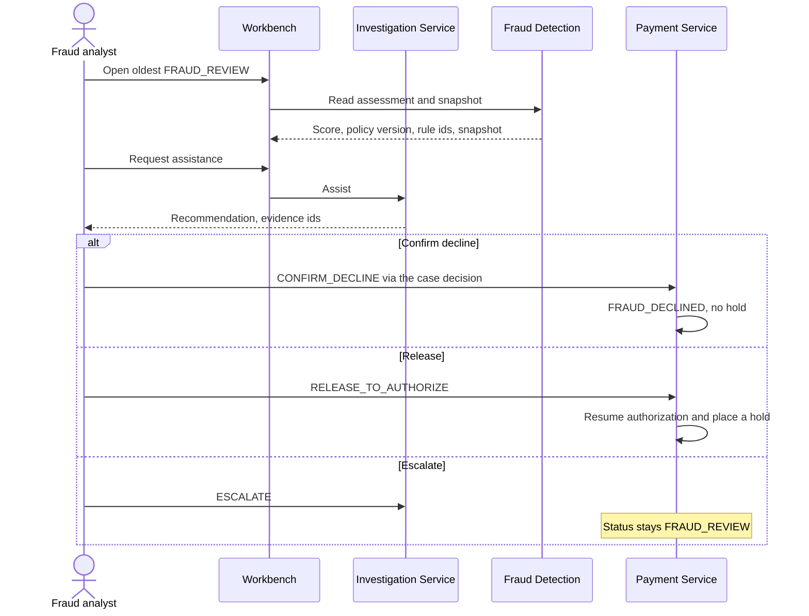

# 17. Fraud detection

| | |
| --- | --- |
| Status | Proposed |
| Audience | Risk engineers, fraud analysts, and the fraud service owner |
| Related | [Service boundaries](02-service-boundaries.md), [Kafka event design](03-kafka-event-design.md), [Investigation workbench](13-investigation-workbench.md), [SRE runbook](16-sre-runbook.md) |

Fraud Detection scores one outbound payment and returns `APPROVE`, `REVIEW`, or `DECLINE`. It runs after validation and before any hold. A review waits for a fraud analyst. The Fraud Agent may explain the case. It cannot release it, decline it, or place a hold.

Version 1 decides from versioned rules, velocity, restricted lists, geolocation context, and device context. A model scorer can be added behind the same interface later. Sanctions screening stays in Validation. An allow-list entry does not skip that screening.

If the assessment cannot be computed, the call errors and Payment Initiation fail-closes. No hold is placed. A timeout is `TECHNICAL_TIMEOUT`, not `FRAUD_DECLINED`.

## Place in the payment

The channel may send an optional risk context on `POST /v1/payments`. Fraud stores hashes and country codes in the feature snapshot. The Kafka assessment carries the decision, the score, the policy version, and the rule ids.

| Risk context field | Treatment |
| --- | --- |
| `channel` | `MOBILE`, `WEB`, `BRANCH`, or `API`. Included in the snapshot and allowed on the assessment event as a coarse label. |
| `sessionCountry` | ISO 3166-1 alpha-2 country of the session. |
| `deviceId` | Hashed with the Vault pepper before it is stored. The raw id is not written to PostgreSQL, Redis, Kafka, or logs. |
| Account country of record | Read from the debtor account reference inside the bank. The channel does not supply it. |

Precise coordinates, raw IP addresses, and full device identifiers are not part of the contract. They are not required to score the rules below.

## 1. Rule engine

The active `fraud_policy` row is one versioned document. Scoring loads that version and evaluates it in order. A replay of the same payment key returns the stored assessment and does not evaluate again.

| Rule kind | Effect |
| --- | --- |
| Hard decline | Sets the decision to `DECLINE` and records the rule id. Later score rules still run so the analyst can see them, and they cannot overturn the decline. |
| Hard review | Raises the decision floor to `REVIEW`. A hard decline still wins. |
| Score | Adds points from 0 to the rule's configured weight. The total is capped at 1000. |
| List | Consults an allow or deny entry. A deny entry is a hard decline. |

Each rule has an id, a description for analysts, an enabled flag, and either a weight or a hard action. Disabled rules stay in the document so a review can show that a control was off in that version. Changing a weight or a band publishes a new `policy_version`. It does not edit assessments already stored.

Evaluation order:

1. Deny lists for the creditor, the device hash, and the session country.
2. Allow list for the creditor. An allow hit suppresses the new-creditor score rule for that payment. It does not suppress deny lists, velocity, geolocation, device, or sanctions.
3. Velocity, geolocation, and device score rules.
4. Band the total into `APPROVE`, `REVIEW`, or `DECLINE` unless a hard rule already set the decision.

The feature snapshot stores the policy version, each rule id that fired, the points that rule added, and the inputs those rules used. Kafka receives the rule ids only.

## 2. Velocity checks

Velocity is a pair of counters in a time window: how many payments, and how many minor units. Windows are defined in the policy. Typical windows are 15 minutes, 1 hour, and 24 hours. The lengths are risk configuration.

| Window key | What it measures |
| --- | --- |
| Debtor | Count and amount from one debtor account |
| Debtor and creditor | Count and amount from one debtor to one creditor fingerprint |
| Device | Count and amount from one device hash across debtors |

A rule fires when the in-window total, including this payment, crosses the policy threshold. The rule id and the window name go to the assessment. The numeric threshold stays in the policy document and in the snapshot, not on the Kafka topic.

The same `payment_id` updates a window once. The Redis member for that update is the payment id. An idempotent replay of `AssessFraud` finds the existing assessment and does not add the amount again.

Counters are rebuilt from committed assessments if Redis is empty. Until the warmup flag for that debtor is set, scoring fail-closes. An empty window is not treated as a quiet customer.

## 3. Blacklists

Operators call a deny entry a blacklist entry. The system stores it as `list_type = DENY` on a restricted list. The matching key is a hash, not the raw account number or device id.

| List | Hash of | Hard effect |
| --- | --- | --- |
| Creditor deny | External creditor identity, or internal creditor account id | `DECLINE` |
| Creditor allow | Same identity | Suppresses only the new-creditor rule |
| Device deny | Peppered device id | `DECLINE` |
| Country deny | Session country code | `DECLINE` |

`beneficiary_list` in the fraud database is the creditor list from the schema design. Device and country deny entries use the same shape: type, hash, effective window, and an approver recorded in audit. Two people approve a new deny entry. One person cannot add their own payment's creditor during an open case and then decide that case.

List changes are versioned rows with `effective_from`. An assessment stores the list version it saw. Old assessments keep that version. Removing an entry sets `effective_to`. It does not delete the row.

A list hit records the rule id `LIST_CREDITOR_DENY`, `LIST_DEVICE_DENY`, or `LIST_COUNTRY_DENY`. The snapshot does not copy the underlying identity in the clear.

## 4. Geolocation risk

Geolocation risk compares the session country with countries the bank already knows for this debtor and this creditor. It is a country check, not a location trace.

| Rule id | Fires when |
| --- | --- |
| `GEO_SESSION_COUNTRY_NEW` | The session country has not appeared on this debtor's recent approved payments inside the policy lookback. |
| `GEO_CREDITOR_COUNTRY_MISMATCH` | The creditor institution country differs from the debtor account country and the pair is not on an allowed corridor for that rail. |
| `GEO_SESSION_CHANGE` | Two assessments for the same debtor, inside the policy interval, carry different session countries. |

`GEO_SESSION_CHANGE` is the control for a session that jumps countries faster than the policy allows. The interval and the country set live in the policy version. The assessment snapshot stores the two country codes and the timestamps of the two assessments. The Kafka event stores the rule id.

Missing `sessionCountry` on a `BRANCH` or `API` channel follows the policy flag for that channel. The default for `MOBILE` and `WEB` is a hard review when the country is absent, because the rule cannot be evaluated. That is fail-closed for the geo family, not a silent approve.

## 5. Device risk

The channel sends a device id. Fraud peppers and hashes it before Redis or PostgreSQL. Later payments from that debtor compare hashes.

| Rule id | Fires when |
| --- | --- |
| `DEVICE_NEW` | This debtor has no prior approved assessment with this device hash inside the lookback. |
| `DEVICE_DENY` | The hash is on the device deny list. Hard decline. |
| `DEVICE_MANY_DEBTORS` | The hash was used by more distinct debtors in the window than the policy allows. |

`DEVICE_MANY_DEBTORS` uses a Redis set of debtor account ids per device hash per window. The set stores account ids, which are internal surrogates, not account numbers. A missing device id on `MOBILE` or `WEB` is a hard review under the default policy. `BRANCH` may omit it because the channel is the branch, and the policy says so explicitly.

Device risk does not fingerprint the handset beyond the hash the channel already computed. The service does not collect installed software, contacts, or precise GPS.

## 6. Risk scores

The score is an integer from 0 to 1000 on `fraud_assessment.score`. Points come from score rules. Hard declines still store the score so analysts can see how the rest of the rules behaved.

| Band | Decision | What happens next |
| --- | --- | --- |
| Below the review threshold | `APPROVE` | Initiation authorizes and a hold may be placed |
| From the review threshold up to the decline threshold | `REVIEW` | Status `FRAUD_REVIEW`. No hold. A case opens. |
| At or above the decline threshold | `DECLINE` | Status `FRAUD_DECLINED`. No hold. |
| Any hard decline | `DECLINE` | Same as a band decline, with the list or hard rule id |
| Assessment could not be computed | No score | Initiation fail-closes. No `FRAUD_DECLINED`. |

Thresholds are fields of the active policy, for example a review floor and a decline floor. They are changed by publishing a new policy version, not by editing the row assessments already point at. A model, when one is approved, contributes a component the policy can weight. If that model endpoint errors, the assessment errors and the payment fail-closes. The rules do not quietly drop the model component and approve.

Maya's $1,250 book payment, under a policy where nothing else fires, scores 0 and is `APPROVE`. The same payment to a new creditor, from a new device, in a session country that fails `GEO_SESSION_CHANGE`, accumulates those rule weights. Whether that sum is a review or a decline is the policy version stored on the assessment, which the analyst can open.

## 7. Fraud reviews

`REVIEW` commits `FraudAssessmentCompleted` and Payment Initiation commits `PaymentHeldForFraudReview`. Investigation intake opens a case with source `FRAUD_REVIEW`. The payment stays without a hold until a fraud analyst records a decision.

| Analyst decision | Payment result |
| --- | --- |
| `CONFIRM_DECLINE` | `FRAUD_DECLINED`. Reason `FRAUD_DECLINE`. |
| `RELEASE_TO_AUTHORIZE` | Saga resumes at authorization and only then places a hold. |
| `ESCALATE` | Case stays open on the senior queue. Still no hold. |

A review that is not decided before the policy expiry becomes `FRAUD_REVIEW_EXPIRED` and the payment is declined. Expiry is a policy outcome, not an approval.

The analyst who created the payment cannot decide it. The workbench shows the score, the policy version, the rule ids, and the feature snapshot to the fraud analyst role only.

## Redis usage

Redis is the hot store for windows and seen-markers. PostgreSQL is the source of truth for the assessment, the policy, and the lists. Losing Redis fail-closes scoring. It does not approve on empty counters.

| Key | Value | TTL | Owner use |
| --- | --- | --- | --- |
| `vel:{debtorAccountId}:{window}` | Count and amount | Window length plus one hour | Debtor velocity |
| `vel:{debtorAccountId}:{creditorHash}:{window}` | Count and amount | Window length plus one hour | Pair velocity |
| `vel:dev:{deviceHash}:{window}` | Count and amount | Window length plus one hour | Device velocity |
| `devdebtors:{deviceHash}:{window}` | Set of debtor account ids | Window length plus one hour | `DEVICE_MANY_DEBTORS` |
| `ben:{debtorAccountId}:{creditorHash}` | Seen marker | 180 days | New-creditor rule |
| `geo:{debtorAccountId}` | Last session country and time | Policy lookback | `GEO_SESSION_CHANGE` |
| `devseen:{debtorAccountId}:{deviceHash}` | Seen marker | Policy lookback | `DEVICE_NEW` |
| `applied:{paymentId}` | Marker that this payment already updated windows | 48 hours | Stops double counting on retry |
| `warmup:{debtorAccountId}` | Warmup complete | Until rebuilt | Fail-closed gate after a flush |

List membership is cached with a short TTL and checked against PostgreSQL on a cache miss. A deny decision is read from PostgreSQL before it is returned, so a stale cache cannot hide a new deny entry.

The gateway's rate-limit keys and Initiation's idempotency cache are separate prefixes. Fraud does not write them.

## Kafka integration

Fraud Detection publishes one fact after the assessment transaction commits. Payment Initiation publishes the lifecycle status. Investigation consumes the review status, not a private fraud topic, to open the case.

| Topic | Publisher | When |
| --- | --- | --- |
| `payments.fraud.assessment.v1` | Fraud Detection | One assessment committed for the payment |
| `payments.payment.lifecycle.v1` | Payment Initiation | Status becomes `FRAUD_SCREENING`, `FRAUD_REVIEW`, `FRAUD_DECLINED`, or moves on to `AUTHORIZING` after a release |
| `payments.investigation.case.v1` | Investigation Service | Case opened for `FRAUD_REVIEW`, recommendation issued, human decision recorded |
| `platform.audit.recorded.v1` | Fraud Detection and Investigation | List changes, policy activation, analyst decision, snapshot access |

Consumers of the assessment topic are Transaction History and the audit archive. They store the decision, the score, the policy version, and the rule ids. They do not receive the snapshot.

The assessment payload stays the contract in the event design:

| Field | On the topic |
| --- | --- |
| `paymentId`, `assessmentId` | Yes |
| `decision` | `APPROVE`, `REVIEW`, or `DECLINE` |
| `score` | 0 to 1000 |
| `policyVersion` | Integer |
| `ruleIds` | Ids that fired |

Country codes, device hashes, window totals, and list hashes stay in `feature_snapshot`.

History shows a timeline line such as "fraud assessed" plus the decision. The workbench fraud page loads the snapshot from the fraud API under the fraud analyst role.

## Fraud events

| Domain event | Why it exists |
| --- | --- |
| `FraudAssessmentCompleted` | The score, decision, and policy version are fixed for this payment key. Replays return them. History can show the outcome without the snapshot. |
| `PaymentHeldForFraudReview` | A person must decide, and no hold exists yet. Investigation intake depends on it. |
| `PaymentFraudDeclined` | The payment is refused. Authorization must not run. The same key replays the refusal. |
| `InvestigationCaseOpened` | The review is a queue item with a case id. |
| `InvestigationRecommendationIssued` | The Fraud Agent's advice is visible and is not a decision. |
| `InvestigationDecisionRecorded` | A named analyst released, declined, or escalated. Only this fact resumes authorization. |

List and policy changes are audit events, not payment lifecycle events. They do not move a payment that was already assessed.

## Fraud analyst workflow

The analyst works in the [investigation workbench](13-investigation-workbench.md) fraud queue, oldest review first.

| Step | What the analyst checks |
| --- | --- |
| Header | Amount, rail, creditor last four, session country, channel. Status is still `FRAUD_REVIEW`. |
| Rules | Each fired rule id, its points, and whether a hard decline applied. |
| Velocity | Window name and totals from the snapshot, compared with the policy version. |
| Lists | Which deny or allow rule fired. The clear identity stays masked. |
| Geo and device | Country pair and whether the device hash was new or shared. |
| Decision | Rationale required. The button is `CONFIRM_DECLINE`, `RELEASE_TO_AUTHORIZE`, or `ESCALATE`. |

Release is available only to a fraud analyst who did not submit the payment. The hold appears on the dossier only after authorization returns. A second analyst on an escalation sees the first recommendation and records their own decision.

## Agent investigation support

The Fraud Agent is the specialist for source `FRAUD_REVIEW`. The Supervisor routes to it. The agent uses the existing tool gateway.

| Tool | Use on a fraud case |
| --- | --- |
| `get_payment` | Status, amount, rail, masked parties, untrusted remittance |
| `get_timeline` | Steps through `FRAUD_REVIEW` |
| `get_fraud_assessment` | Decision, score, policy version, rule ids, feature snapshot |
| `summarize_similar` | Counts for this debtor and creditor fingerprint over at most 30 days |
| `get_runbook` | The approved fraud-review procedure |

The agent does not receive Redis, a list-administration tool, or a tool that changes policy. `get_fraud_assessment` is refused for every role except the Fraud Agent, and only for the case's payment id.

Allowed recommendations are `CONFIRM_DECLINE`, `RELEASE_TO_AUTHORIZE`, and `ESCALATE`. The policy guard requires the assessment id and the payment id on a release recommendation. The case moves to `AWAITING_HUMAN`. The payment stays in `FRAUD_REVIEW` until the analyst's decision is stored.

If the LLM gateway or the agent is down, the queue and the snapshot view still work. Analysts decide from the rules. The kill switch `investigation.agent.enabled` stops new sessions and leaves intake running.

The agent does not see other customers' remittance or names. Similar activity is counts by status. Session country and the device hash in the snapshot are visible to the Fraud Agent because they are part of the assessment evidence, and they are omitted from the Reporting Agent's published report.
