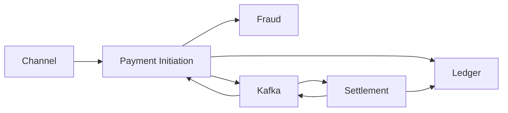

# 20. Interview guide

| | |
| --- | --- |
| Status | Proposed |
| Audience | Engineers interviewing at banks, networks, and payment companies |
| Related | [High-level architecture](01-high-level-architecture.md), [Domain guide](11-payment-domain-guide.md), [Kafka](03-kafka-event-design.md), [Fraud detection](17-fraud-detection.md) |

Use this to explain the Agentic Payment Operations Platform in an interview. Say what it is: a reference architecture for a simulated outbound payments platform, with production controls and no connection to a real clearing house. It is not a system you operated at JPMorgan Chase, Goldman Sachs, Visa, Mastercard, or Stripe.

The firms below care about the same mechanics. Lead with the control that matters to that desk, then use the same design.

| Firm | What they will push on | Sentence to open with |
| --- | --- | --- |
| JPMorgan Chase | Ledger integrity, segregation of duties, audit, operational resilience | "Status has one writer. Money moves only as an immutable, balanced journal entry, and a reversal is a new entry with a named human." |
| Goldman Sachs | Failure modes, consistency, what you do when a call times out after a possible commit | "I treat a timeout as uncertainty, not as a no. The retry uses the same ledger key, so the financial effect happens once." |
| Visa | Authorization versus clearing and settlement, and why a later dispute is not a cancel | "The cardholder's yes is an authorization hold. Settlement is a later presentment. A chargeback is a network dispute against a posted item." |
| Mastercard | Same network split, plus stand-in behavior when a dependency is down | "If fraud or sanctions cannot answer, I fail closed. I do not stand in and approve." |
| Stripe | API idempotency, developer-visible status, exactly-once business effect on at-least-once delivery | "The create call returns when the decision is durable. `SETTLED` is a later read. The same idempotency key and body always returns the same payment." |

## 1. Elevator pitch

"I designed a payment platform that takes an outbound payment from a channel, validates it, scores it for fraud, places a funds hold, and settles it asynchronously on either an internal book transfer or a simulated ACH or wire rail. The ledger is a double-entry book of record. Kafka carries facts only after the database commit, through an outbox. If the client retries, the idempotency key returns the original payment instead of a second hold. Exceptions go to analysts. Agents draft a recommendation from the evidence on that one case. A person approves anything that releases a review, retries a post, or reverses a settled payment."

Ninety seconds, if they want the shape:

"The synchronous path ends at authorized, fraud review, or a decline, with a p99 budget of 800 milliseconds. Settlement, reconciliation, and investigation run on the stream. Book transfers post within about two seconds. ACH waits for the next business-day window. A $1,250 payment is stored as 125000 minor units so we never use floats. Authorization reduces available balance and leaves the ledger balance unchanged. Settlement posts a balanced entry and consumes the hold. If fraud is down, the payment stops and no hold is created."

## 2. Architecture summary

Java 21 and Spring Boot services, one database each. PostgreSQL for state. Redis for rate limits, fraud velocity, and a hot idempotency cache. Kafka for the integration log. Kubernetes for runtime. OpenTelemetry into Prometheus, Grafana, traces, and logs. Resilience4j on synchronous clients.

| Boundary | Owner | Does not own |
| --- | --- | --- |
| Payment status | Payment Initiation | Balances |
| Fraud decision | Fraud Detection | The hold |
| Hold and journal | Ledger | Whether the payment should exist |
| Rail window and batch | Settlement | Payment status |
| Statement match | Reconciliation | Editing a posted amount |
| Recommendation | Investigation agents | The human decision |

Hybrid orchestration is the core distributed-systems choice. Validation, fraud, and authorization are synchronous calls because the channel needs one decision inside a latency budget. Settlement is a command on Kafka because a next-day window cannot fit in that request. Initiation is still the only service that emits lifecycle status. Settlement emits "item posted." Initiation turns that fact into `SETTLED`.

Design load stated in the architecture: 50 creates per second sustained, 200 at peak. That number is a capacity sketch for the design, not a production benchmark from a live bank.

## 3. Banking concepts

Speak in the bank's words, then give the system consequence.

| Term | Interview line |
| --- | --- |
| Debtor and creditor | Maya pays, Northwind receives. Both are parties on one payment aggregate. |
| Rail | The track. `BOOK` is on-us. ACH is next business day. Wire is the next same-day window. |
| Minor units | $1,250.00 is `125000` USD. Integer money. The exponent comes from the currency. |
| Available balance | Ledger balance minus open holds. Only the ledger service computes it. |
| Hold | A reservation. Authorization writes it. Ledger balance does not move. |
| Posting | A balanced journal entry. Debits equal credits. Lines are insert-only. |
| Deposit account | A liability of the bank. A debit reduces what the bank owes the customer. That matches "money out" on the statement. |
| Value date | The business date the money is considered moved. It can differ from the API timestamp. Cutoff rolls ACH to the next business day. |
| Reconciliation | Our posted item versus the rail statement. A mismatch is a break. The journal stays as posted until a human approves a new entry. |
| Reversal | A new opposite entry after settlement. The original payment remains `SETTLED`. |
| Chargeback | A card-network dispute after presentment. Not a cancel, and not in version 1. I can explain the flow and I did not implement card acquiring. |
| Four-eyes | Two different people for a large reversal. The agent is neither of them. |
| Fail closed | No fraud or sanctions answer means no authorization and no hold. |

The story that lands with Visa and Mastercard: authorization is the issuer's yes and a hold. Clearing is the presentment of the final amount. Settlement is the movement of value between institutions. A hotel can authorize $200 and settle $175. Our book transfer collapses the wait to sub-second, and it is still two steps, because the HTTP contract must not call a payment settled before the journal exists.

The story that lands with a bank: customer liabilities are unchanged in total on a book transfer. We debit Maya and credit Northwind. For ACH we debit Maya and credit a clearing account, which is the bank's obligation to the rail. Northwind's account at the other bank is not on our ledger.

## 4. Kafka concepts

Kafka is the integration log, not the book of record. A row is published from an outbox in the same database transaction as the business fact. The relay marks it published only after `acks=all`. Consumers are at least once and deduplicate on event id.

| Topic | Key | Why that key |
| --- | --- | --- |
| `payments.payment.lifecycle.v1` | `paymentId` | Status for one payment stays ordered. Only Initiation publishes it. |
| `payments.ledger.movement.v1` | `accountId` | One account's hold and later debit stay ordered. The two legs of one entry can land on different partitions. `journal_entry_id` ties them. |
| `payments.command.settlement.v1` | `paymentId` | The settle command survives a restart and waits for the rail window. |
| `payments.fraud.assessment.v1` | `paymentId` | Decision, score, policy version, rule ids. The feature snapshot stays in the fraud database. |
| `payments.reconciliation.break.v1` | `breakId` | Investigators react to disagreement. A clean match is not a platform event. |

Say this unprompted: "I did not use a distributed transaction across PostgreSQL and Kafka. The outbox is the atomicity boundary. If the process dies after commit and before publish, the relay retries. Consumers assume the fact already happened."

Partition count starts at 12 for payment-keyed topics. Consumer parallelism stops at the partition count. Offsets commit after the local transaction that stores the effect and the processed-event row. During an incident I do not seek a group to latest, because that skips settlement commands, and I do not seek to earliest, because that replays the retention window.

Poison records retry a bounded number of times, then go to a dead-letter topic, and the partition moves on. Replay is a new event id with a causation id, after a fix.

Schema evolution is Avro, backward compatible. A breaking change is a new major topic, dual-published for one release.

## 5. Distributed systems concepts

| Idea | How this design uses it |
| --- | --- |
| Consistency boundary | One aggregate, one database transaction. Payment status is not a distributed lock. |
| Single writer | Initiation owns status. Ledger owns balances. Settlement does not set `SETTLED`. |
| At least once plus idempotency | Delivery can repeat. The business effect cannot. |
| Read your writes for the channel | `GET /v1/payments/{id}` reads Initiation, not the history projection. |
| Eventual consistency, bounded | History lag objective is 2 seconds at p99. The dossier says when the timeline is behind. |
| Saga | The synchronous half is an orchestrator with a step row. The asynchronous half is choreography on facts. |
| Compensation | Release a hold if nothing posted. After settlement, compensate with a reversing entry, not a delete. |
| Backpressure | Gateway rate limits, Resilience4j bulkheads, Kafka consumer lag alerts. |
| Failure domains | Ledger primary versus platform primary. Redis loss does not delete payments. Agent loss does not stop creates. |

The interview-quality point on sagas: I do not try to hold one database transaction open across fraud, a ledger primary, and a next-day ACH window. Each step commits. The step row is `UNCERTAIN` when the response is lost. Recovery re-invokes that command.

CAP, if they ask: the ledger primary is the linearizable point for a hold or a post, inside one PostgreSQL transaction with a row version. I accept partition behavior by failing the call, not by writing on both sides. Kafka is an availability and decoupling mechanism for facts that are already committed. I do not claim the whole platform is linearizable.

## 6. Idempotency discussion

Two keys, on purpose.

The channel key is `Idempotency-Key`, stored with a hash of the canonical body, unique per legal entity, for 24 hours. Same key and same hash returns the original payment and status. Same key and a different hash is `409`. A missing key is `400`. The end-to-end id is a second uniqueness rule per debtor, because that is the reference on the invoice, not the transport retry key.

The ledger key is derived from the payment and the operation. `PlaceHold` and `PostSettlement` are safe to retry because the unique key returns the original hold or the original journal entry.

Say the failure mode out loud. "The dangerous bug is to treat a timeout as 'nothing happened' and to send a new key. That creates a second hold. I store `UNCERTAIN` and retry the original key."

Kafka redelivery is the same idea one level down. `processed_event` is a primary key on event id. The second delivery is a no-op. That is why offset commit happens after that insert, in the same local transaction.

Redis caches the idempotency pointer. PostgreSQL is authoritative. If Redis is down, deduplication still holds. What fails closed is the gateway rate limit and fraud velocity, not the uniqueness constraint.

## 7. Resilience4j discussion

Decorator order on synchronous clients: bulkhead, then time limiter, then circuit breaker, then one retry. The retry runs only when the failure is a definite transport error before the request was sent, and the operation is idempotent. A read timeout might mean the server committed, so that retry belongs to Failure Management, with backoff that is durable and visible.

| Client | What opening the circuit means |
| --- | --- |
| `fraud` or screening | SEV-1. New payments fail closed. No hold. |
| `ledger` | Creates that need a hold return `503` or `504`. In-flight keys stay uncertain until replay. |
| `validation` | Fail closed before fraud. |
| `llm` | Analysts still decide. Payments already authorized still settle. |

Bulkheads stop a slow fraud dependency from occupying every initiation thread. The end-to-end time limiter on create is 800 ms. If it fires first, the API returns `202` with the last committed status and the client polls.

I do not wrap the Kafka broker in a Resilience4j circuit that fails the payment API. The decision path does not need the broker to return `201`. The outbox and `acks=all` cover publish. Settlement lag is a consumer-lag page, not a circuit on the create call.

Multi-minute retry lives in Failure Management because a request thread is the wrong place to hide a five-minute outage, and because each attempt must be audited.

## 8. Observability discussion

Three signals share a trace id. Metrics go to Prometheus. Traces go to Tempo. Logs go to Loki. Grafana is the console. Cardinality is part of the design: no payment id or account id on a metric label. Those ids belong on the span and the log line for one investigation.

| SLO | Objective |
| --- | --- |
| Decision availability | 99.9%, excluding caller 400 and 409. Business declines count as successful decisions. |
| Decision latency | 99% under 800 ms, including failures, because a timeout is user-visible. |
| Book settlement | 99% under 2 seconds from authorized to settled. |
| History freshness | 99% under 2 seconds. |
| Ledger posts | 99.99% of accepted posts acknowledged by the primary. |

Pages use multi-window burn rates, plus a few symptom alerts: fraud circuit open for 2 minutes, ledger replication lag over 10 seconds, consumer lag over 10 seconds, outbox unpublished older than 30 seconds, under-replicated partitions. I page on "customers cannot pay" and "money may be stuck or doubled," not on every error log.

Sampling is 5% of successful authorization traces and 100% of errors, timeouts, reviews, and settlement failures, with tail sampling at the collector so the decision sees the whole trace. If the collector dies, payment commits continue. The gap in traces is real. The ledger and the audit archive are the record for those minutes. I do not turn on 100% sampling during the outage and take Tempo down with it.

A useful investigation starts at `payment_id`: initiation status and step, the trace if retained, reason code in logs, lifecycle events, then the hold and the journal. One hold. One entry per ledger key. Debits equal credits.

## 9. Agentic AI discussion

The agent layer is off the hot path. Intake opens a case from a fraud review, a high-severity break, or an escalated failure. That intake is ordinary Kafka consumption. It does not call a model. The runner starts when policy or an analyst asks.

| Role | Allowed to recommend | Not allowed |
| --- | --- | --- |
| Supervisor | Which specialist, or escalate | Specialist tools, money dispositions |
| Fraud | Decline, release to authorize, escalate | Reversal, ledger tools |
| Root Cause | Retry, no action, escalate; reversal only on a break | Releasing a fraud review |
| Reporting | A draft from decisions already stored | Publishing as if it posted |

Controls I would defend in the room:

- Tool allow-list. No SQL, no shell, no general HTTP, no post.
- Every read is bound to the case's payment id.
- Remittance is untrusted content. It cannot change the prompt or the tools.
- Policy guard checks the output schema, the role's dispositions, and that every evidence id was returned by a tool in that session.
- Session budget: 8 turns, 60 seconds.
- Human decision with a rationale. Four-eyes is a second human, not the model.
- Kill switch stops new sessions. Queues stay up. Creates do not read the switch.
- Prompts retained 30 days for incident review, then deleted, and not used for training.
- Golden-set evaluation before a prompt or tool change. Production agreement is a metric, not an automatic policy change.

If they ask "why not let the agent approve low-risk reviews," the answer is product and control: a review exists because policy refused straight-through. Automating the release removes the reason the state exists. The agent is there to assemble evidence and cite it.

## 10. Common interview questions

1. Walk me through a successful payment.
2. Where is the source of truth?
3. What happens if the client retries?
4. What happens if the ledger call times out?
5. Why not one database for all services?
6. Why is settlement asynchronous even for a book transfer?
7. How do you keep Kafka and the database consistent?
8. How do you order events for one payment and for one account?
9. What is the difference between a hold and a posting?
10. How do you handle a fraud outage?
11. How does a chargeback differ from a reversal?
12. How would you reconcile a one-dollar mismatch?
13. How do you stop a consumer from falling over on one bad message?
14. What would you page a human for?
15. Why are agents not on the authorization path?
16. How would you add cards later without rewriting history?
17. What is your idempotency story for exactly-once?
18. How do you test this?
19. What would you cut from version 1, and what would you refuse to cut?
20. Tell me about a design decision you would revisit.

## 11. Sample answers

**Walk me through a successful payment.**

"The channel posts a payment with an idempotency key. The gateway authenticates and rate-limits. Initiation commits the payment as received, then calls validation and fraud synchronously. On approve, authorization asks the ledger to place a hold. That reduces available balance and does not change ledger balance. I return 201 at `SETTLEMENT_PENDING`. A settlement command is already in the outbox. Settlement posts a balanced entry, consumes the hold, and emits an item-posted fact. Initiation, which is the only status writer, marks the payment settled. For a book transfer that credits another customer at the same bank. For ACH it credits a clearing account and waits for the business-day window."

**Where is the source of truth?**

"The ledger database, for balances and journal lines. The payment row, for status. Kafka is the log of committed facts and two commands, settle and compensate. History is a rebuildable projection. Redis is a cache and a set of counters. If those disagree, I believe the ledger for money and initiation for status, and I treat a missing Kafka record with an unpublished outbox row as 'not yet published,' not as 'did not happen.'"

**What if the ledger times out?**

"I mark the step uncertain. I do not decline for insufficient funds, and I do not mint a new idempotency key. Failure management, or the authorization retry, calls the ledger with the same hold or post key. If the first transaction committed, the primary returns the original id. If it rolled back, the retry creates the one row. Synchronous replication on the ledger primary means a commit I received is on a replica. A commit I did not receive might still have happened, which is why the key matters more than the HTTP status."

**Why not one database?**

"So the ledger can have its own primary, backup, and access policy, and so a history rebuild cannot lock the book of record. The cost is no cross-service foreign keys. `payment_id` is a shared identity, not a shared table. Joins for auditors go through the audit archive and explicit reads, not through a query across schemas."

**Fraud outage.**

"The fraud client time-limiter fires, then the circuit opens. Initiation does not call authorization. The customer gets a technical failure, not a fraud decline, because I will not record a risk decision the service did not make. When fraud returns, replay uses the same payment key and creates one assessment. I would not loosen a threshold during the incident to make the dashboard green."

**Chargeback versus reversal.**

"A reversal is our bank posting a new entry that undoes a settled payment, with a human approver. A chargeback is the cardholder's bank pulling a posted card charge back through the network, often weeks later, even when the merchant disagrees. Version 1 has no card rail. If I added one, the chargeback would be an inbound case and a new journal entry linked to the original presentment. I would not move the original payment from settled back to cancelled."

**One-dollar break.**

"We posted 125000, the statement says 125100, same end-to-end id and value date. Reconciliation opens an amount-mismatch break. The payment stays settled. An agent may recommend, and an analyst decides. If we agree the statement is right, the correction is a new one-dollar entry, not an update of the original line. High-severity breaks have a four-business-hour queue target."

**Exactly-once.**

"I don't claim exactly-once delivery. I claim exactly-once effect. The channel key plus request hash, the ledger unique key, and the consumer's processed-event primary key are three layers of the same idea. The outbox gets the fact into Kafka after commit. Idempotent consumers absorb the duplicate."

**What I would cut, and what I would not.**

"I would cut the reporting agent, inbound payments, and a fraud model before I would cut the ledger idempotency key, the outbox, fail-closed fraud, or the rule that agents cannot post. Those four are the product. The rest is scope."

**A decision I would revisit.**

"Returning 201 for a business decline, with the decline in the body, is good for idempotency because the client always has a payment id to show. Some API reviewers want a 422. I would keep 201 so every decided payment is a resource, and I would be ready to defend that against a team that standardizes on 4xx for all domain rejects. I would also revisit whether book settlement should stay on Kafka for a two-second path. I kept it there so book and ACH share one posting pipeline. If book latency became the product, I would still post through the ledger API and only change when the command is issued, not who is allowed to write the journal."

## How to close

Offer a concrete artifact. "I can walk the sequence for a duplicate create, a fraud decline, or a settlement timeout." Those three cover idempotency, fail-closed risk, and money movement, which is what these interviews are scoring. If the interviewer is from a card network, add the authorization-versus-settlement distinction and stop before inventing a certification or a production volume you did not run.
